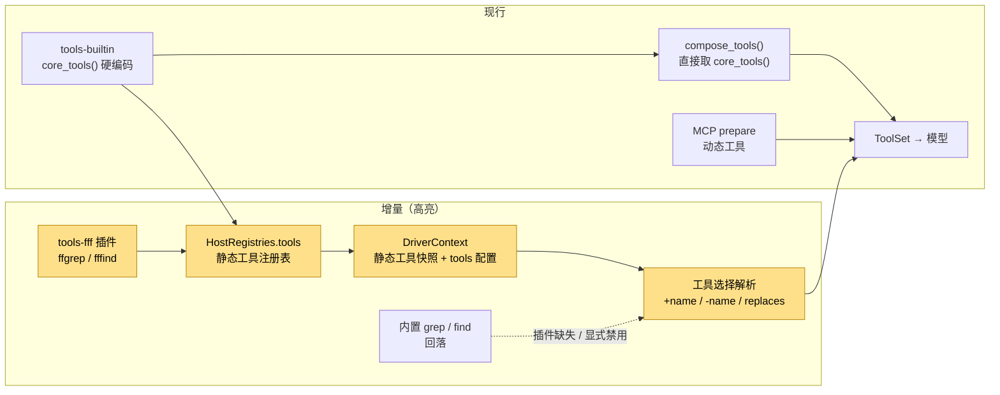
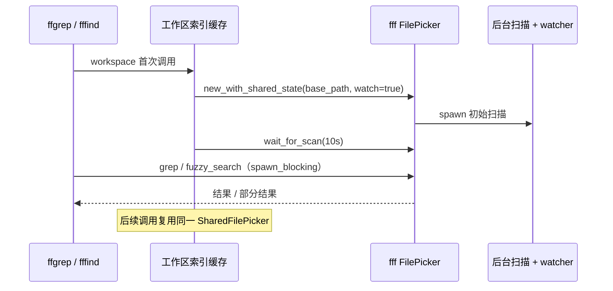

# 设计：检索工具插件化

## 1. 目标形态



**变动单元**：`tools-fff` 插件、`HostRegistries.tools` 静态注册、工具选择解析、`DriverContext` 快照。
**不变**：ReAct 内环、工具批调度、权限裁决、MCP 动态工具路径。

## 2. 工具选择算法

输入：静态工具候选集（内置 + 插件注册，按名去重）+ `tools: Vec<String>`。

```text
enabled = { all candidate names }
explicit_plus = {}
for entry in tools (按配置顺序):
    if entry starts with '-': name = entry[1:]; enabled.remove(name)
    else:                     name = entry.lstrip('+'); enabled.add(name); explicit_plus.add(name)
    if name not in candidates: warn("unknown tool")
for tool in enabled (按 name 稳定排序):
    for target in tool.replaces():
        if target in enabled and target != tool.name:
            enabled.remove(target)
            if target in explicit_plus:
                warn("tools list enables both {tool} and {target}; keeping {tool}")
```

关键点：

- 候选集始终保留被替换工具，因此 `-ffgrep` 后内置 `grep` 会自动回到可见集，不需要用户再 `+grep`。
- 替换工具胜出；用户想用内置时写 `-ffgrep -fffind`（或 `-ffgrep +grep`）。
- 显式 `+grep` 与 `ffgrep` 同时启用时 warning，仍保留 `ffgrep`；符合「同类保留一个」。
- 未知名只 warning，不影响配置加载；插件未装配时 `+ffgrep` 也可安全存在。
- 工具名去重：同名工具后注册者覆盖先注册者（`overlay_by_name` 语义）。

## 3. 配置形状

```yaml
tools:
  - read
  - bash
  - -grep
  - +ffgrep
  - -find
  - +fffind
```

- 根键 `tools` 是字符串列表，不是领域对象；不新增 `tools.search` 之类子域。
- 裸名等同 `+name`，便于只写「我要这些」。
- 空串、仅 `+`/`-`、空白词元在配置加载期报错；未知工具名只在装配期 warning。
- 默认（不写 `tools`）：全部静态工具启用，`ffgrep`/`fffind` 通过 `replaces` 自动替换 `grep`/`find`。

## 4. fff 工具源

### 4.1 工具面

| 工具 | 参数 | 输出 |
|---|---|---|
| `ffgrep` | `query`（必填）、`path`、`glob`、`mode`（`smart`/`literal`/`regex`/`fuzzy`）、`definitionsOnly`、`context`、`limit`、`timeout` | `path:line: content`，按文件分组；可含上下文行 |
| `fffind` | `query`（必填）、`path`、`mode`（`fuzzy`/`glob`/`regex`）、`limit`、`timeout` | 相对路径列表 |

- `ffgrep` 使用 `fff_search::grep::parse_grep_query` 解析 query；`path` / `glob` 作为约束词元追加到 query，沿用 fff 的查询语法。
- `mode` 映射：`literal` → `GrepMode::PlainText`，`regex` → `GrepMode::Regex`，`fuzzy` → `GrepMode::Fuzzy`，`smart` → `PlainText` + smart case。
- `definitionsOnly` 需要 `fff-search` 的 `definitions` feature；匹配行优先声明。
- `limit`：`ffgrep` 钳制 1..200，`fffind` 钳制 1..1000；默认 100。
- `timeout`：沿用 `parse_tool_timeout` 语义（正整数秒，钳制 600s；grep/find 默认 60s）。

### 4.2 索引生命周期



- 索引按 `ctx.workspace` 缓存；不同工作区各自一个 picker。
- 初始扫描超时（默认 10s）不报错，继续在已索引部分上搜索，并在结果前加一行 `[index partial]`。
- `watch=true` 让会话内文件变更可见；MVP 不持久化 frecency / query DB。
- 搜索在 `tokio::task::spawn_blocking` 中执行；`GrepResult` 借用的 picker 在闭包内完成格式化。
- 进程退出时 picker drop 触发后台线程取消。

### 4.3 回落

| 场景 | 行为 |
|---|---|
| feature `fff` 关闭 / 插件未装配 | 注册表无 ff 工具；内置 `grep`/`find` 保持可见 |
| 用户 `-ffgrep -fffind` | ff 工具禁用；内置 `grep`/`find` 回到可见集 |
| 用户 `+grep` 且 ff 工具启用 | warning；保留 ff 工具 |
| fff 索引初始化失败 | 工具返回可读错误；不静默切内置（避免语义漂移） |

## 5. 内核装配改动

- `XyTool::replaces()` 默认空切片；`ffgrep` / `fffind` 分别声明 `["grep"]` / `["find"]`。
- `ToolFeatures` 增加 `tool_selection: Vec<String>`（改为 `Clone`，不再 `Copy`）。
- `DriverContext` 增加 `static_tools: Vec<Arc<dyn XyTool>>`；默认空。
- `compose_tools`：
  1. 基座 = `static_tools`（非空）或 `core_tools()`；
  2. 追加 todo / plan / workflow / ask 等 session 工具；
  3. `resolve_tool_selection` 过滤并输出 warning。
- `ProductOccupancyFactory::driver_context` 从 `ctx.get::<HostRegistries>()` 取静态工具快照（过滤 `mcp__` 前缀），并读取 `ConfigService.app.tools`。
- `boot_with`：`boot_ctx` 已完成后，把注册表静态工具快照注入 `BootstrapInput`，使 Print / 初始 driver 与后续 driver 一致；独立 `bootstrap()` 仍回落 `core_tools()`。
- `tools-fff` 的 `apply` 向 `HostRegistries.tools` 注册 `ffgrep` / `fffind`；不写任何内核特判。

## 6. 规格与测试 seam

| 层 | seam | 测试 |
|---|---|---|
| 工具选择 | `resolve_tool_selection(tools, entries)` 公共函数 | runtime 单测：顺序、覆盖、unknown、replaces、显式冲突 |
| 配置 | `AppConfig.tools` + `validate_tools_selection` | config 单测 + `runtime-config` BDD |
| fff 工具 | `FffGrepTool` / `FffFindTool` 的 `execute_typed` | 临时目录单测（`watch=false`） |
| 内核装配 | `compose_tools` / `boot_with` | kernel 单测：注册表工具可见、插件缺失回落 |
| 端到端 | 现有 `cargo test --all-features --test bdd` | `agent-tools` / `infra-fff-search` 场景 |

BDD 场景优先复用现有工具 fixture / 临时工作区 seam，不新造 CLI 子进程。

## 7. 风险与取舍

1. **构建体积 / 时间**：`fff-search` 引入 LMDB sys、git2、rayon 等依赖；feature 默认开，CI 构建时间上升。可关闭 `fff` feature。
2. **默认行为变化**：模型默认看到 `ffgrep`/`fffind`；若模型对旧名有偏好，可 `-ffgrep -fffind` 回落。README 与 warning 需明确。
3. **索引内存**：大仓库首次扫描占用内存与 CPU；MVP 不开 content index / mmap cache，只保留文件列表与 watcher。
4. **fff 上游漂移**：预设式硬编码端点已回滚；本插件只依赖 crate API，不维护供应商清单。`fff-search` 升级需按 crate 语义复核。
5. **MCP 旁路**：`fff-mcp` 工具名带 `mcp__fff__` 前缀，不与本插件冲突；文档说明二选一即可。
