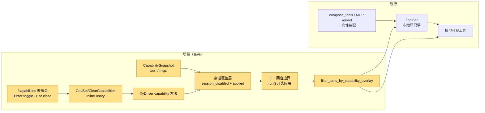
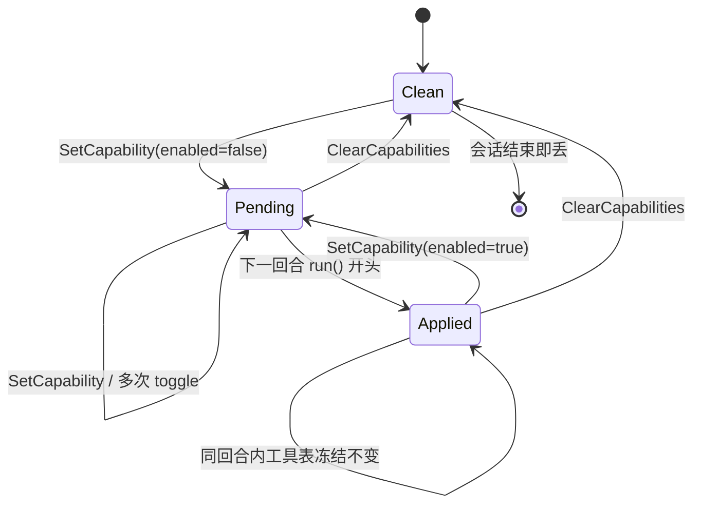
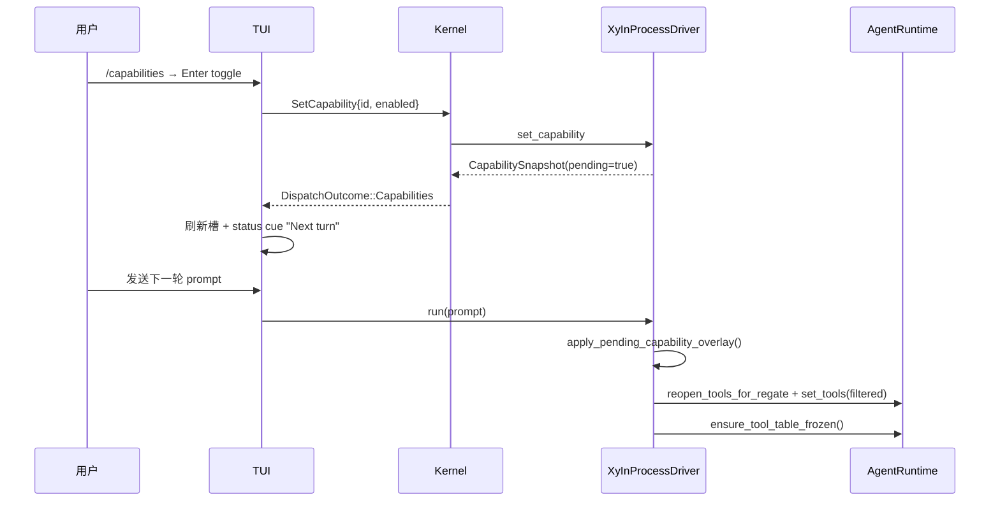

# 设计：会话能力覆盖盘

## 1. 目标形态



**变动单元**：能力 DTO、会话覆盖层状态、下一回合应用点、过滤函数、driver 能力缝、协议命令、TUI 覆盖盘。
**不变**：ReAct 内环、工具批调度、权限裁决、MCP 连接生命周期、工具表冻结机制。

## 2. 覆盖层状态机



- `session_disabled`：用户期望的禁用集合。
- `applied`：上一次真正写入工具表时的禁用集合。
- `pending = session_disabled != applied`；`CapabilitySnapshot.pending` 即任一条目 pending。
- 回合中途 toggle 不改当前工具表；`run` 开头才应用，保证当前回合已开工的工具不被拆掉。
- 会话结束不写盘，覆盖层随 driver 销毁消失。

## 3. 过滤语义

```text
for tool in base_tools:
    if tool.name in session_disabled(tool:<name>): drop
    if tool.name matches mcp__<server>__* and session_disabled(mcp:<server>): drop
    else: keep
```

- 工具条目来自 base 工具集（内核装配的静态工具 + 最近一次 MCP reload 的动态工具），排除 `mcp__` 前缀工具本身，后者聚合为服务器条目。
- MCP 服务器条目集合 = 配置中的 server id ∪ base 工具集中出现的 `mcp__<server>__*` 前缀。
- 已配置但未连接 / 未发现工具的服务器仍出现在快照中，便于用户预置开关。
- 未知 ID 的 `SetCapability` 返回 invalid_input，不静默成功。

## 4. 生效与重载



- `McpReload` 走 `install_base_tools`：重载产生的新工具集先存为 base，再按当前 `session_disabled` 过滤并冻结，避免重载绕过覆盖层。
- `apply_prepare_tools` 更新 base 后同样过滤，保证 MCP prepare 路径一致。

## 5. 协议与端

| 命令 | wire 方法 | Auth | Exec | 载荷 |
|---|---|---|---|---|
| `GetCapabilities {}` | `get_capabilities` | Readonly | Inline | `CapabilitySnapshot` |
| `SetCapability { id, enabled }` | `set_capability` | Writer | Inline | `CapabilitySnapshot` |
| `ClearCapabilities {}` | `clear_capabilities` | Writer | Inline | `CapabilitySnapshot` |

- 三个方法都返回完整快照，端侧无需二次拉取。
- Inline：不占会话写锁、不打断当前回合。
- TUI 覆盖盘挂在 `EditorSlot::Capabilities`，复用 `SelectList` 与 `tui.select.*` 绑定。
- pending 提示复用 status 区「下一回合生效」位，文案 `Next turn: capability overlay`。

## 6. 失败与边界

- `set_capability` 未知 id → invalid_input，槽保持原状并滚动提示。
- 空 base 工具集 → 快照只有已配置 MCP 条目；toggle 仍可记录，待后续工具集出现时生效。
- 覆盖层不改变 MCP 连接本身：禁用 `mcp:<server>` 只是隐藏其工具，服务器仍可连接 / 重连。
- 不写 JSONL：resume 后覆盖层为空，符合「会话内临时」语义。
