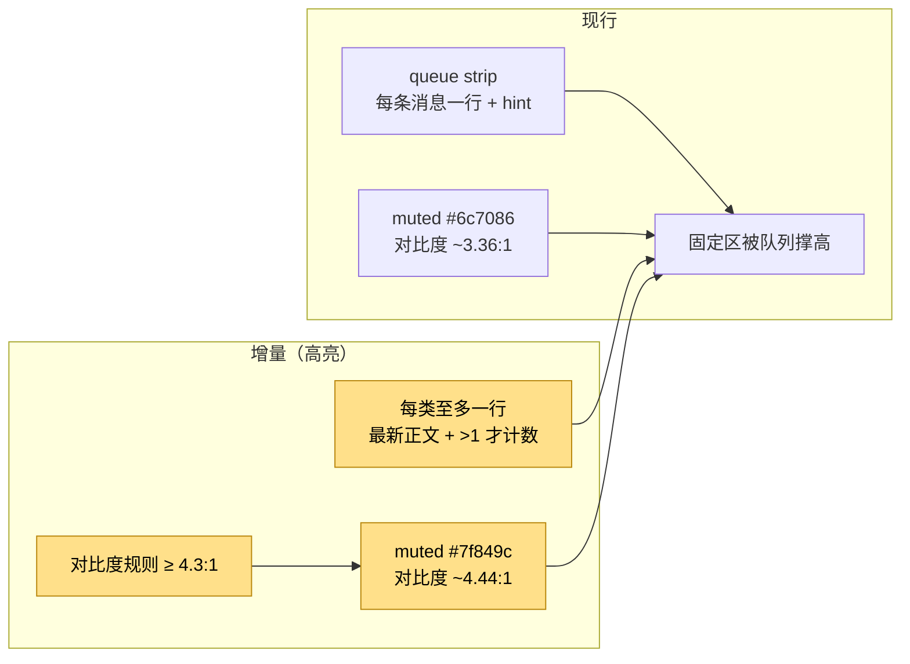
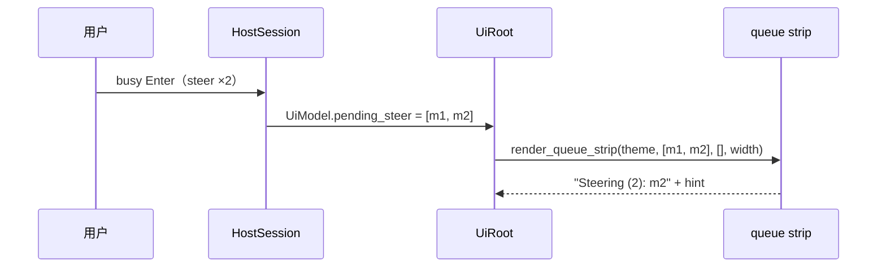

# 设计：TUI 减噪与对比度

## 1. 目标形态

**变动单元**：queue strip 渲染、暗色 `muted` token、对比度规则。
**不变**：队列 Alt+Up 还原、固定区顺序、status 词汇、色板语义。

## 2. Queue strip 压缩

- 输入仍是完整队列切片，渲染只取 `last()`。
- 计数只在 `len() > 1` 时出现，避免单条消息多一个「(1)」徽章。
- steer 与 follow-up 各最多一行；两者都空时仍返回空切片（0 行）。
- 宽度不足时沿用 `truncate_to_width(..., "...", true)`。
- 提示行保持固定一条。

## 3. 对比度

| token | 旧值 | 新值 | 用途 |
|---|---|---|---|
| `muted` | `#6c7086` | `#7f849c` | status / footer / 边框 |
| `tool` | `#6c7086` | 不变 | 工具摘要（保持更弱） |
| `diff-context` | `#6c7086` | 不变 | diff 上下文（保持更弱） |

- 对比度按 WCAG 相对亮度公式计算：`(L1 + 0.05) / (L2 + 0.05)`。
- `#7f849c` 在 `#1e1e2e` 上约 4.44:1，满足 4.3:1 下限。
- 浅色主题保持现状；规则只约束产品默认暗色。
- DESIGN.md 与 `Palette::dark()` 必须同步，由 `just qa-check-tui-tokens` 守卫。

## 4. 规格落点

- `app-tui-input` / `product-queue-fixed-zone`：补充每类至多一行、最新正文、>1 计数；新增「多条排队压成每类一行」场景。
- `app-tui-fixed-zone`：新增「次要文本对比度下限」规则与场景。

## 5. 边界

- 队列消息正文很长时仍单行截断，不换行增高。
- 计数只表达深度，不替代 Alt+Up 的完整还原。
- 对比度规则不引入新 token，不改变 `tool` / `diff-context` 的层级。
