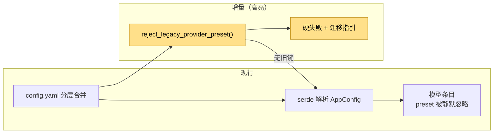

# 设计：provider preset 旧写法迁移

## 1. 加载链与新增检测点



**变动单元**：旧键检测器、迁移错误。
**不变**：分层合并、正常配置解析、模型装配。

## 2. 检测规则

| 旧写法 | 新写法 |
|---|---|
| `models.models.<alias>.preset: opencode-zen` | 显式 `provider` / `model` / `base_url` / `api` / `compat`，或改走网关 |
| `provider_presets: [...]` | 每个模型条目显式配置 |

- 检测在 `serde_json::from_value` **之前**执行，避免 serde 先报泛化错误或静默丢键。
- 错误类型复用 `LoadError::validation`，与 `loop_example` / `loop_policies` 旧键拒绝同形。
- 文案包含：旧键路径、迁移方向、`configs/example.yaml` 指针。
- 正常配置（无旧键）不触发检测，行为不变。

## 3. 错误文案

```text
models.<alias>.preset is no longer supported after the provider preset rollback;
set `provider` / `model` / `base_url` / `api` (and optional `compat`) explicitly,
or point the model at a gateway (see configs/example.yaml)
```

```text
provider_presets is no longer supported; configure each model entry explicitly
(see configs/example.yaml)
```

## 4. 验证

- 配置 crate 单测：model preset 拒绝、顶层 provider_presets 拒绝、正常配置通过。
- BDD：`runtime-config` 场景「旧预设键拒绝并提示迁移」。
- 门禁：`just qa` / `just qa-e2e` / `llman-sdd validate --check --strict`。

## 5. 边界

- 不做自动迁移或配置改写。
- 不把 preset 清单重新引入内核。
- 不改变模型条目的其他字段校验。
