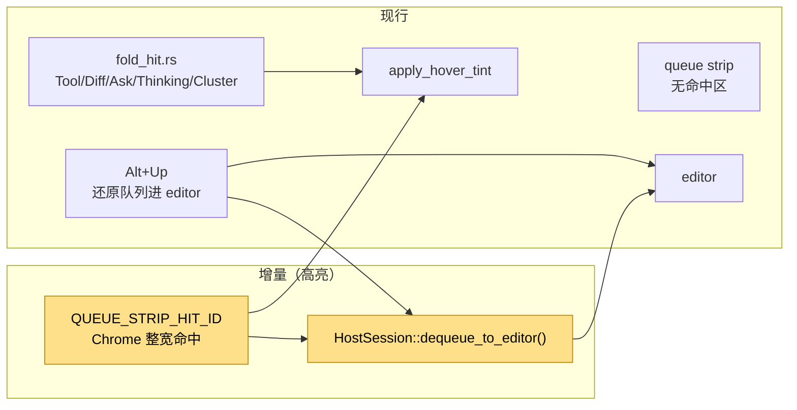
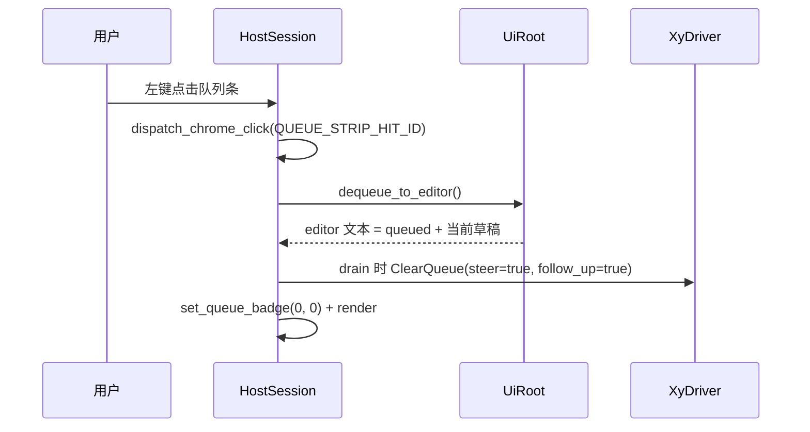

# 设计：队列条 hover 与点击还原

## 1. 目标形态

**变动单元**：队列条命中区、`dequeue_to_editor()` 共用路径。
**不变**：既有 fold hover、activity-fold、队列条文案与 Alt+Up 键位。

## 2. 命中区

- `UiRoot::render` 在拼接队列条前记录 `queue_strip_row = lines.len()`，并复用 `last_queue_rows`。
- `overlay_hits(width, transcript_rows)` 在队列条非空时追加：
  - `Hit::at_cell(QUEUE_STRIP_HIT_ID, 0, queue_strip_row).cols(0, width).tall(last_queue_rows)`
  - `HitSpace::Chrome` + `capturing()`，与 popup / sidebar chrome 命中同形。
- hover 区复用同一 `Hit`，由 `apply_hover_tint` 做弱强调。
- 命中 id 使用 `1 << 61 | 3`，避开 popup / sidebar 常量。

## 3. 点击语义

- `dequeue_to_editor()` 与键盘 Alt+Up 完全同语义：
  - 取 `ui_model.take_queued_for_editor()`；
  - 若 editor 有非空草稿，追加到末尾（空行分隔）；
  - 清空本地 steer / follow_up 条，置 `pending.dequeue = true`；
  - `sync_ui_root_from_model()`。
- 点击后 editor 获得文本，下一次泵循环执行 `ClearQueue` 并消退队列条。

## 4. 边界

- 队列条为空时不登记命中区。
- transcript 拖选进行中由既有 pointer 逻辑忽略点击，不因划过触发还原。
- hover 弱强调仍沿用引擎既有 `apply_hover_tint`，不新增背景色 token。

## 5. 验证

- 单测：`overlay_hits` 含队列条 id、整宽、Chrome。
- BDD：队列条点击后 editor 含排队文本、队列清空。
- 门禁：`just qa` / `just qa-e2e` / `llman-sdd validate --check --strict`。
