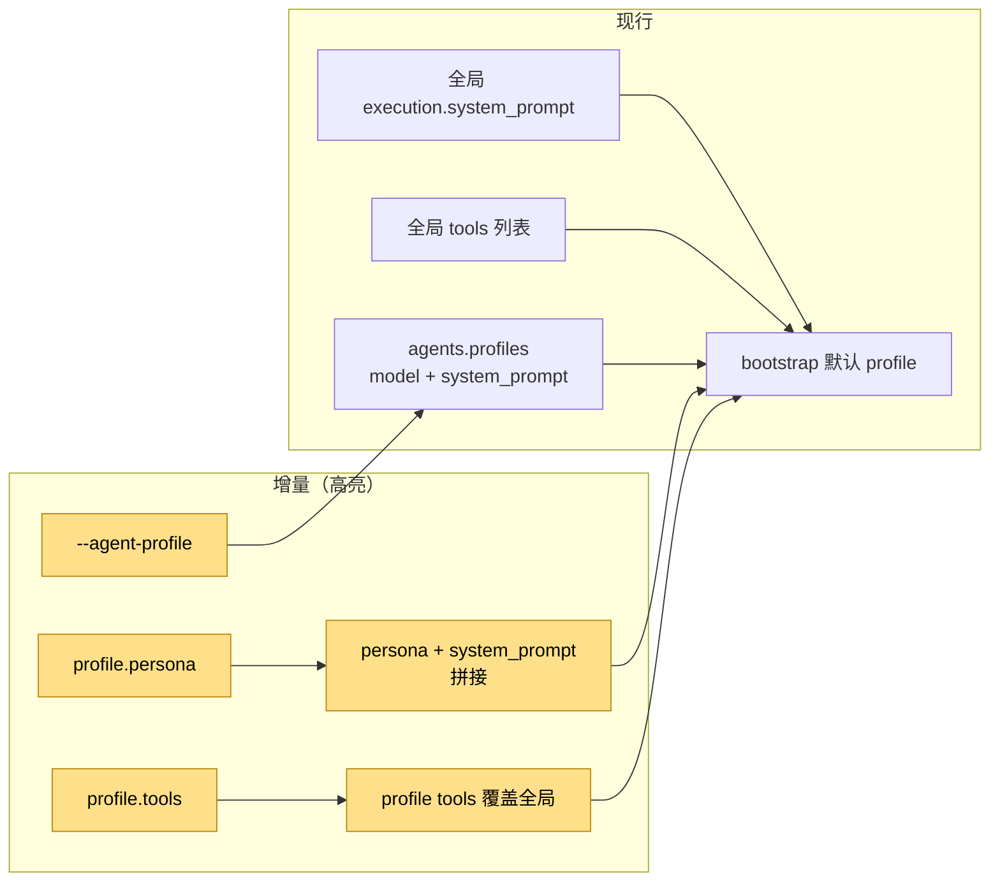
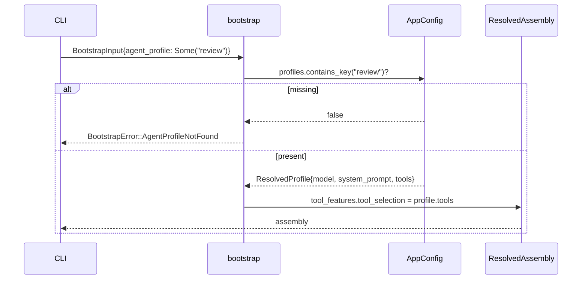

# 设计：Agent 预设

## 1. 目标形态



**变动单元**：profile persona/tools、`--agent-profile` 选择、prompt 拼接、工具目录覆盖。
**不变**：ReAct 内环、会话历史、cache 前缀、全局默认行为。

## 2. 配置形状

```yaml
agents:
  default_profile: "default"
  profiles:
    review:
      model: "deepseek-v4-flash"
      persona: "You are a strict code reviewer."
      system_prompt: "Focus on correctness and regressions."
      tools: [read, -bash, +ffgrep]
```

- `persona` / `system_prompt` 都为空时，回落到 `execution.system_prompt`。
- 仅 persona 或仅 system_prompt 时，直接用非空项，不额外加空行。
- `tools` 为空时沿用全局 `tools`；非空时整体覆盖（不拼接）。

## 3. 选择与失败



- 显式预设不存在 → `AgentProfileNotFound(name)`，文案指向 `agents.profiles`。
- 未传 `--agent-profile` → 沿用 `agents.default_profile` 的现有行为。

## 4. 验证

- 配置 crate 单测：profile 字段反序列化、persona 拼接顺序、tools 携带。
- BDD：`runtime-config` 两个场景（review 预设、未知预设）。
- 门禁：`just qa` / `just qa-e2e` / `llman-sdd validate --check --strict`。

## 5. 边界

- 不改 ReAct、工具执行、权限裁决。
- 不做极简模式与预设工坊。
- 不引入插件预设注册中心。
