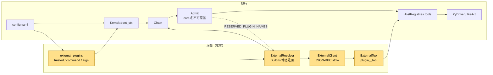
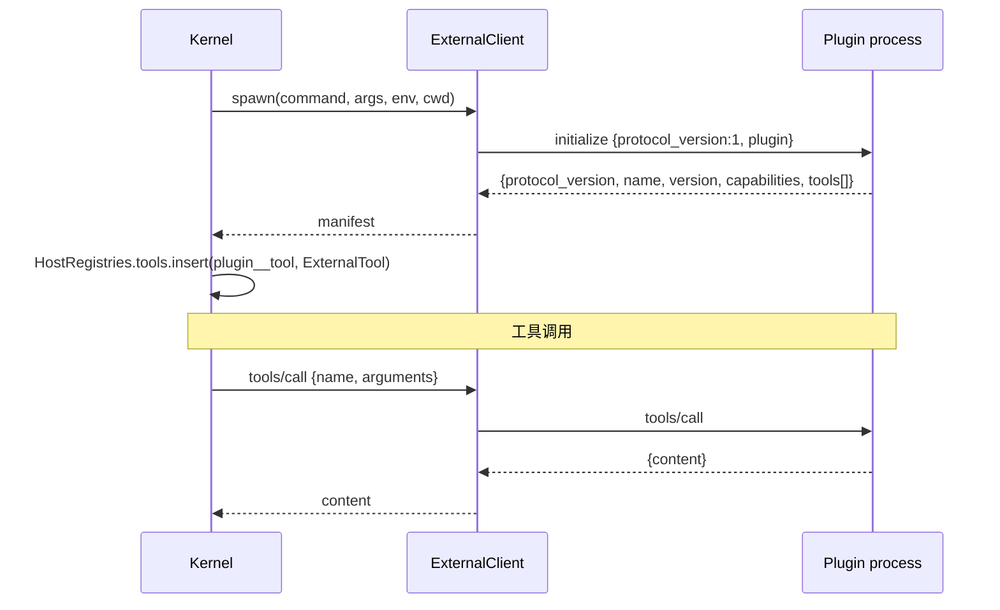
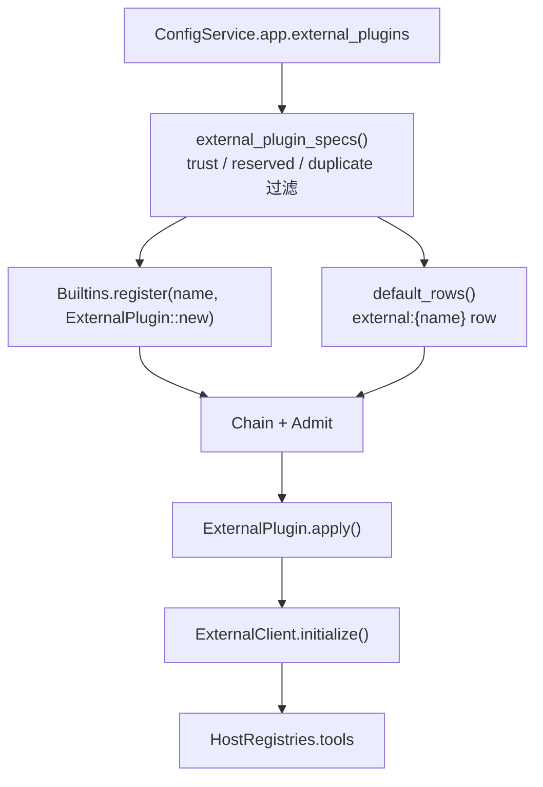

# 设计：第三方外进程插件最小切片

## 1. 目标形态



**变动单元**：`external_plugins` 配置、动态 Builtins 注册、stdio 客户端、工具桥。
**不变**：Chain / Admit 的解析顺序、HostRegistries 契约、XyDriver / ReAct 内环、每 token 流。

## 2. 配置与信任

```yaml
external_plugins:
  - name: "bun-demo"
    command: "bun"
    args: ["examples/plugins/bun-demo/plugin.ts"]
    trusted: true
    timeout_ms: 30000
```

装配前过滤：

| 条件 | 行为 |
|---|---|
| 无配置 / 空列表 | 零装配 |
| `trusted: false` | 跳过 + warn |
| name / command 空 | 跳过 + warn |
| name 命中 `RESERVED_PLUGIN_NAMES` | 跳过 + warn |
| name 重复 | 跳过 + warn |

`RESERVED_PLUGIN_NAMES` = 核心插件名 + 官方插件名（session-store / compaction / tools-* / mcp / hooks / todo / workflow / plan / provider-* / app-print / serve）。

## 3. 协议



- 传输：newline-delimited JSON-RPC 2.0；stdin 写、stdout 读、stderr inherit。
- 握手：`protocol_version` 必须为 1；`capabilities` 必须含 `tools`；工具名 provider-safe。
- 公开名：`{plugin}__{tool}`，与 MCP 的 `mcp__{server}__{tool}` 同形，避免覆盖既有工具。
- 调用：结果优先取 `result.content` 字符串；无 content 时回退整个 result JSON。
- 超时：`timeout_ms` 包住 initialize 与每次 tools/call；超时终止进程并报 `XyToolError::Timeout`。
- 失败：spawn / 握手 / 缺 tools 能力 → warn + 不注册工具 + 返回 Ok（不阻断内核装配）。

## 4. 装配接线



- 每个受信插件注册为 Builtins 的一个名字；loader row 携带该插件自己的 config。
- 复用既有 `Chain` 与 `Admit`；Admit 仍拒绝 core 名从 rows 挂载。
- `ExternalPlugin.apply` 在 `HostRegistries` 缺失时 warn 并跳过。
- 工具注册不覆盖既有同名工具（`get` 检查）。
- `ctx.effect` 清理：移除本次注册的工具并终止进程。

## 5. Demo

- `examples/plugins/bun-demo/plugin.ts`：Bun/TS 单文件，echo / add 两个工具。
- `examples/plugins/bun-demo/README.md`：配置与协议说明。
- `scripts/lab_external_plugin_bun.py`：本地 probe，spawn Bun demo 并验证 initialize / echo / add。
- 单测 `bun_demo_plugin_roundtrip` 标记 `#[ignore]`，本地 `--ignored` 运行；CI 用 Python fixture 覆盖协议。

## 6. 验证

- 配置 crate 单测：`external_plugins` 字段反序列化。
- 内核单测：Python fixture 握手 + tools/call；协议版本不匹配；工具命名。
- 内核 boot 测：受信装配、未受信跳过、保留名跳过、失败命令不阻断。
- BDD：`infra-plugin` 六场景。
- 门禁：`just qa` / `just qa-e2e` / `llman-sdd validate --check --strict`。
