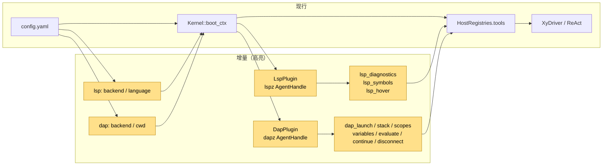
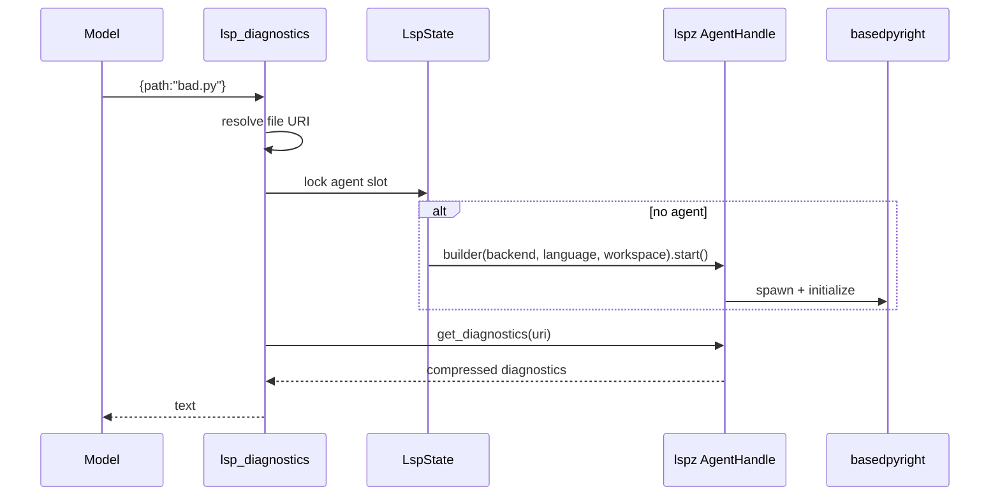

# 设计：LSP / DAP 工具插件

## 1. 目标形态



**变动单元**：LSP/DAP 配置、两个官方工具插件、懒启动 AgentHandle。
**不变**：HostRegistries 契约、XyDriver / ReAct、每 token 流、外部插件路径。

## 2. 配置与零装配

```yaml
lsp:
  backend: "basedpyright-langserver --stdio"
  language: "python"
  workspace_root: null   # default: tool ctx workspace
  compression: true

dap:
  backend: "python3 -m debugpy.adapter"
  cwd: null
  compression: true
```

- `AppConfig.lsp` / `.dap` 为 `Option`；缺省不追加 loader row、不注册工具。
- 配置存在时 kernel 追加 `{id:"lsp",name:"lsp",config:...}` / `{id:"dap",...}`。
- 插件 `apply` 只注册工具，不 spawn；首次工具调用才启动 AgentHandle（零成本）。

## 3. LSP 工具



- `lsp_diagnostics` / `lsp_symbols`：`path` 或 `uri`。
- `lsp_hover`：`path` / `uri` + 0-based `line` / `character`。
- URI：`url::Url::from_file_path`；相对路径基于 `XyToolCtx.workspace`。
- `LspState.agent: Mutex<Option<AgentHandle>>`；`ensure_agent` 懒启动。
- 卸载：移除工具 + `AgentHandle::shutdown`。

## 4. DAP 工具

- `dap_launch`：`program` / `cwd?` / `args?` / `breakpoints?`（`{path,lines}`）；等待首次 stop。
- `dap_stack`：`thread_id?` / `levels?`。
- `dap_scopes`：`frame_id`。
- `dap_variables`：`variables_reference`。
- `dap_evaluate`：`expression` / `frame_id?` / `context?`。
- `dap_continue`：`thread_id?`。
- `dap_disconnect`：`terminate_debuggee?`；取出 AgentHandle 并释放。
- `DapState.agent: Mutex<Option<AgentHandle>>`；`ensure_agent` 懒启动。
- 卸载：移除工具 + disconnect(terminate=true)。

## 5. 错误与边界

- 启动 / 查询失败 → `XyToolError::ExecutionFailed`（带原始错误文本）。
- 参数缺失 → `XyToolError::InvalidArgs`。
- 工具串行：`Mutex` 保护 AgentHandle；同一插件实例内一次一个查询。
- 不做多会话池 / daemon 复用；后续切片再评估。

## 6. 验证

- 插件单测：配置默认、URI 解析、参数反序列化。
- ignored 本地测试：
  - basedpyright：`bad.py` 未定义名 → diagnostics 含 `undefined_name` / `reportUndefinedVariable`。
  - debugpy：breakpoint → stack 含 `debug_me.py` → evaluate `x` 含 `41` → disconnect。
- BDD：`infra-lsp` / `infra-dap` 零装配与工具注册场景。
- 门禁：`just qa` / `just qa-e2e` / `llman-sdd validate --check --strict`。
