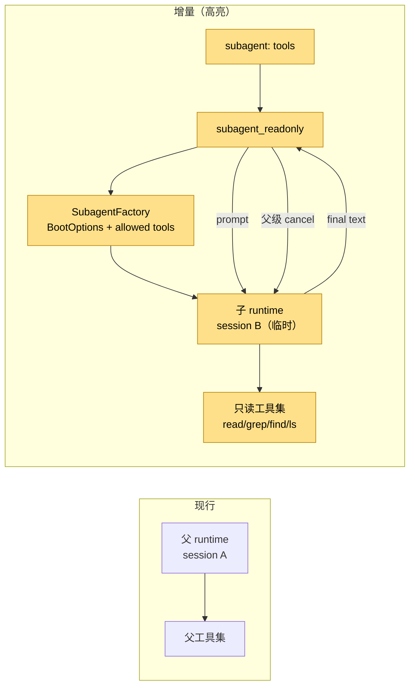
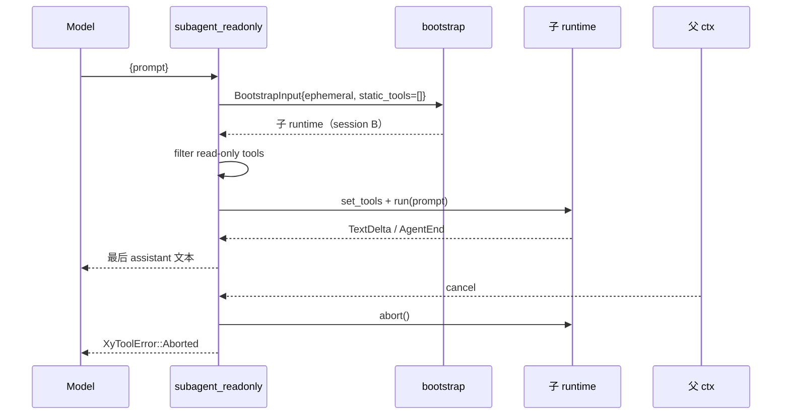

# 设计：只读子代理

## 1. 目标形态



**变动单元**：`subagent` 配置、`subagent_readonly` 工具、隔离 runtime、只读工具过滤、父级 abort。
**不变**：父 runtime 单写者、ReAct 内环、会话历史、每 token 流。

## 2. 配置与零装配

```yaml
subagent:
  tools: [read, grep, find, ls]
```

- `AppConfig.subagent` 为 `Option`；缺省不注册工具。
- 默认工具集包含 fff 搜索名，过滤时按实际工具表存在性生效。
- `boot_ctx` 在 `mount_core` 后注册工具，早于 loader rows 与 `static_tools_from_ctx`。

## 3. 执行流程



- 子 runtime 使用 `bootstrap_with`（可注入 env/cwd，测试隔离）。
- 子代理不共享父 session；每次调用创建临时会话。
- 工具集：`tools_snapshot()` 按配置允许名过滤；`set_tools` 后再 `run`。
- 最终文本：`AgentEnd.messages` 中最后一个 assistant 的 `text()`；若为空，回退累积 `TextDelta`；仍空则报错。
- 父级取消：`tokio::select!` 监听 `ctx.cancel.cancelled()`，调用 `driver.abort()`。

## 4. 权限与边界

- 子代理默认只读；`write` / `edit` / `bash` / `ask` 不在允许列表。
- 子代理继承父配置的 trust / model / provider；不提升权限。
- 父级 abort 组合到子任务；子任务不独立后台运行。
- 不做多子任务并发池；一次工具调用一个子 runtime。

## 5. 验证

- kernel 单测：只读过滤、缺 prompt、fake provider 下子代理返回文本。
- BDD：`agent-subagent` 零装配与注册场景。
- 门禁：`just qa` / `just qa-e2e` / `llman-sdd validate --check --strict`。
