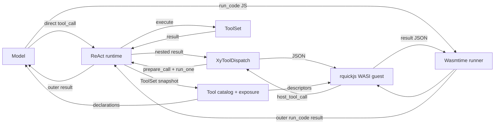
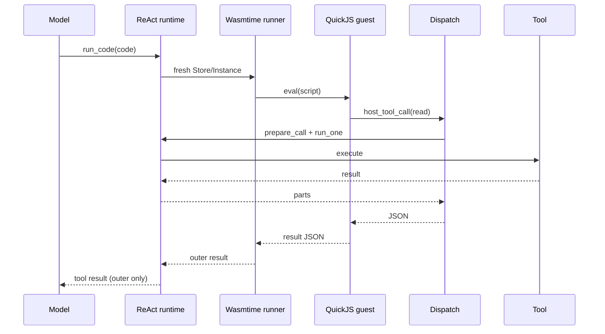

# Design — Codemode（Wasmtime）工具与工具暴露层

## 目标

- 新增 run_code 工具（codemode）：模型写 JS，脚本内调用所有被允许的工具。
- 建立工具暴露/catalog/声明层：内置、MCP、外进程插件、官方插件工具都能被模型理解。
- 能力限制在 catalog 与 dispatch 两侧生效；嵌套调用复用 ReAct 的 hooks/中间件/权限/事件。
- 运行时用 Wasmtime 50 stable + rquickjs 0.14 WASI guest；WASM 隔离、async host call、fuel/epoch/memory、模块缓存。
- MVP 只做 tool + mode on；不做强制模式、provider 原生 PTC、mode only、嵌套事件树、多语言。
- plan mode 由 c3197 删除（前置，已归档）；本 change 不实现 plan mode catalog 过滤。

## 现状

- XyToolCtx 只有 call_id/cancel/output_tx/state_events/workspace；无 dispatch（crates/xylitol-plugin-sdk/src/ports/tool.rs:13-19）。
- XyTool::execute 是 async（crates/xylitol-plugin-sdk/src/ports/tool.rs:83-93）；工具带 cancel token。
- ToolSet/selection/replaces/freeze；HostRegistries.tools；MCP mcp__{server}__{tool}；外进程插件 {plugin}__{tool}。
- prepare_call/run_one 负责 hooks、loop 中间件、权限、事件（crates/xylitol-runtime/src/agent/runtime/tool_exec.rs:114/200）。
- permission_router 只映射 read/write/edit/bash；check_process 未接线（crates/xylitol-runtime/src/agent/runtime/permission_router.rs:12-19）。
- 事件扁平：ToolExecutionStart/Update/End 只有 id（crates/xylitol-plugin-sdk/src/lifecycle.rs:79-94）。
- XyTool 无 exposure/namespace/output_schema。
- 现有 `loop_policies.tool_exposure` 中间件在 BeforeLlmRequest 过滤 `tool_schemas`（allow/deny/read_only；plugins/xylitol-official-plugin-loop-policies/src/middleware.rs:495-560）；它不是 XyTool 元数据，codemode 不得绕过。
- ToolTableFingerprint 目前只哈希 name/description/parameters（crates/xylitol-runtime/src/agent/tools/freeze.rs:24-43）；新增 exposure/namespace/output_schema 后必须纳入指纹。
- run_one 在构造 XyToolCtx 时不注入 dispatch，并直接发 ToolExecutionStart/End（crates/xylitol-runtime/src/agent/runtime/tool_exec.rs:227-262）；dispatch 注入与嵌套事件抑制需在 runtime 接线。
- McpToolDescriptor 已存在（plugins/xylitol-official-plugin-mcp/src/hub.rs:48）；MCP 工具经 ToolSet 进入 catalog，`static_tools` 会排除 MCP（crates/xylitol-kernel/src/occupancy/factory.rs:89-101）。

## 决策

### 1. 运行时

- Wasmtime 50.0.1（pin）；`wasmtime` + `wasmtime-wasi` 50；core module + WASI p1。
- Guest：rquickjs 0.14（QuickJS-NG），`full-wasi`，target `wasm32-wasip1`；产物约 1.1MB。
- 不采用 Boa：Boa in-process 无 heap limit / hard interrupt，不是安全边界。
- 不采用 Wasmi：sync host call、fuel only、无 Component Model/async；保留为后续 fallback。
- Engine 配置：`async_support(true)`、`consume_fuel(true)`、`epoch_interruption(true)`；Cranelift 默认。
- 每次 run_code 新建 Store/Instance；QuickJS Runtime/Context 在 guest 内每次新建；不跨执行复用 guest 状态。
- 模块编译一次，`Arc<Module>` 共享；模块缓存见 §6。

### 2. Guest ABI

Guest crate：`plugins/xylitol-official-plugin-codemode/guest`（cdylib；不默认进 workspace build）。

导出：

```text
alloc(len: u32) -> u32
dealloc(ptr: u32, len: u32)
eval(script_ptr: u32, script_len: u32) -> i32   // 0 ok / 1 script error / 2 invalid / 3 runtime error
result_ptr() -> u32
result_len() -> u32
```

Host import：

```text
host_tool_call(req_ptr: u32, req_len: u32, out_ptr: u32, out_cap: u32) -> i32
host_emit(ptr: u32, len: u32) -> i32
```

- `host_tool_call`：guest 写 JSON 请求；host 读 guest memory，await dispatch，写 JSON 响应到 guest 输出 buffer。返回写入字节数；buffer 不足返回负的所需容量；guest 扩容重试。
- `host_emit`：`text()` / `console` 输出；host 累积；不写 WASI stdout。
- WASI p1：只给 clock/random 等最小能力；无 preopen、无网络、无 stdio 继承。
- Guest 脚本作为 async function body 执行：`(async () => { <script> })()`；支持 `await`、`return`。
- Guest globals：`tools.<identifier>`、`tools.call`、`ALL_TOOLS`、`searchTools`、`describeTool`、`describeNamespace`、`text`、`console`、`exit`。
- `tools.call` 是同步 JS 调用；host import 是 async；Wasmtime 在 host future 处挂起 wasm 栈；MVP 顺序调用。
- 结果：guest 把 `{ text, value, error }` JSON 写入静态 buffer；host 读 `result_ptr/result_len`。
- Guest 构建：`cargo build --target wasm32-wasip1 --release`；需要 WASI SDK；仓库提供 `just codemode-guest` 与预编译资产；CI 校验 hash。

### 3. Host runner

- `CodemodeRuntime`：Engine、`Arc<Module>`、Linker、配置、模块缓存。
- `HostState`：`WasiP1Ctx`、`Arc<dyn XyToolDispatch>`、parent_call_id、`StoreLimits`、cancel token、output buffer。
- Linker：
  - `p1::add_to_linker_sync(&mut linker, |s| &mut s.wasi)`。
  - `linker.func_wrap_async("env", "host_tool_call", ...)`。
  - `linker.func_wrap("env", "host_emit", ...)`（同步）。
- Store：`Store::new(&engine, HostState)`；`store.limiter(|s| &mut s.limits)`；`store.set_fuel(fuel)`；`store.set_epoch_deadline(1)`。
- 执行：`instance = linker.instantiate_async(&mut store, &module).await?`；`eval.call_async(&mut store, (ptr,len)).await?`。
- 超时/取消：`tokio::select!` 包 `call_async` 与 cancel/timeout；触发时 `engine.increment_epoch()`，等 grace，映射为 cancelled/timeout。
- fuel 耗尽 trap → 错误；内存 limit → instantiation/eval trap → 错误。
- 结果：读 result buffer；解析 JSON；输出上限；失败保留 partial text。
- 错误映射：script error / runtime error / timeout / cancelled / fuel / memory / output too large。

### 4. 异步 host call

- `Config::async_support(true)` 必需；`func_wrap_async` host 函数。
- host 函数签名：`async fn(Caller<'_, HostState>, req_ptr: u32, req_len: u32, out_ptr: u32, out_cap: u32) -> Result<i32>`。
- 读 memory：`caller.get_export("memory")`；`Memory::read`；await `dispatch.call`；`Memory::write`。
- 请求 JSON：`{ name, args, parent_call_id }`；响应 JSON：`{ ok, parts, error }`。
- dispatch 是 async（MCP/网络工具）；host future 可 await；wasm 栈挂起；不阻塞 tokio worker。
- **风险**：rquickjs guest 的 `eval` 是同步导出，host import 是 async；需在 T1 验证 Wasmtime 支持“sync export + async import”。若不支持，fallback 同步 host bridge（`spawn_blocking` + oneshot），但会牺牲 async 取消/并发；记录为 blocker。
- MVP 顺序调用；JS `Promise.all` 并行 nested calls 后续；`max_parallel_subcalls` 不在首切片。

### 5. 限额与取消

- fuel：默认 1,000,000,000；按执行设置；trap 映射 `fuel_exhausted`。
- timeout：默认 120s；上限 600s；epoch + `tokio::time::timeout`。
- cancel：`XyToolCtx.cancel`；`Engine::increment_epoch`；`Store::set_epoch_deadline(1)`；trap 映射 `cancelled`。
- memory：`StoreLimitsBuilder::memory_size(max_memory_bytes)`；默认 64 MiB。
- 嵌套：`max_nested_calls` 默认 100；递归 `run_code` 拒绝。
- 输出：`max_result_bytes` 100 KiB / `max_output_tokens` 10000；截断写 full output temp file。

### 6. 模块缓存

- 编译：`Module::from_binary(&engine, GUEST_WASM)`；一次约 1.35–2.05s（1.1MB guest）。
- 缓存：`module.serialize()` → cache file；`unsafe Module::deserialize(&engine, &bytes)`；约 2.15ms。
- Key：Wasmtime 版本 + target arch/CPU + guest hash + Engine 配置；目录 `~/.cache/xylitol/codemode/`。
- 缓存字节必须可信；只读目录/校验 hash；失败回退编译。
- TUI/Serve 常驻：编译一次；Print 一次性：缓存命中约 2.4ms，未命中 1.35–2.05s。

### 7. 工具暴露

```rust
pub enum XyToolExposure {
    Direct,
    ModelOnly,
    Codemode,
    Deferred,
    Hidden,
}
```

- Direct：模型可见，codemode 可调。
- ModelOnly：模型可见，codemode 不可调。
- Codemode：模型不可见，codemode 可调，声明内联。
- Deferred：模型不可见，codemode 可调，不内联；靠 ALL_TOOLS/searchTools/describeTool 发现。
- Hidden：模型不可见，codemode 不可调。

默认：

- 核心 7 工具、todo/workflow：Direct。
- ask、subagent_readonly：ModelOnly。
- run_code：ModelOnly（模型可见、codemode 不可递归调用）。
- MCP、外进程插件：Direct（保持现状）；配置可改 Codemode/Deferred。
- 配置 codemode.exposure 可按名称/glob 覆盖。
- 与现有 `loop_policies.tool_exposure` 并存：它是模型可见工具过滤（allow/deny/read_only），不是本 change 的 `XyToolExposure`。catalog/声明/dispatch 必须取两者的交集；不得绕过。

过滤：

- 模型工具表 = Direct + ModelOnly。
- codemode catalog = Direct + Codemode + Deferred。
- 会话工具集 / 能力开关 / trust / `loop_policies.tool_exposure` 先过滤；catalog 与 dispatch 不绕过。
- 不实现 plan mode 过滤；c3197 删除 plan mode。

### 8. Catalog 与声明

- XyToolDescriptor：name、identifier、namespace、description、parameters、output_schema、exposure、guidelines。
- XyToolCatalog：snapshot/describe/search；runtime 实现；按 freeze 快照。
- identifier：非法字符→_；首字符数字加 _；冲突按 canonical 排序加 _2/_3；始终支持 tools["canonical"] 与 tools.call。
- namespace：core / official / mcp:{server} / plugin:{plugin}；声明按 namespace 分组。
- 声明：TypeScript 风格 declare const tools；复杂 schema 用 unknown + describeTool；inline_budget 3000 tokens；Deferred 不内联。
- 提示注入：codemode 插件注册 BeforeLlmRequest 中间件，按 catalog 生成声明，push 一条 user 消息；tool description 只放 API 指南。插件经 runtime 注入的 `Arc<dyn XyToolCatalog>` 读取快照，不直接遍历 ToolSet。
- 声明中间件必须在 `tool-exposure` 之后（order > 50）读取最终 `tool_schemas`，或显式按同一 allow/deny/read_only 过滤 catalog；不得先于 tool-exposure 生成未过滤声明。
- catalog 快照基于 ToolSet freeze；ToolTableFingerprint 必须包含 exposure/namespace/output_schema，元数据变化触发声明重建。
- MCP descriptor 复用 `McpToolDescriptor`（server/name/description/schema）；namespace 由 `mcp__server__tool` 解析。
- mode on 下不改工具表；mode only 后续。

### 9. Dispatch

- XyToolDispatch：`async fn call(parent_call_id, name, args) -> Result<XyToolCallResult, XyToolError>` + `catalog()`。
- runtime DispatchHandle 持有 ToolSet/hooks/hook_bus/permission/cancel/obs/loop_chain/turn_index/workspace/events。
- call：拒绝 run_code/Hidden/ModelOnly；解析 canonical/wire；prepare_call + run_one；嵌套 id `<parent>:code:<n>`；不落盘；错误返回 XyToolError。
- 并发：MVP 顺序；max_nested_calls=100；max_parallel_subcalls 后续。
- 事件：嵌套 Start/End 抑制；Update 转成外层 progress 文本（前缀 → name:）；外层 Start/Update/End 正常。
- 权限：run_code 映射 check_process(workspace)（新增 SandboxCapability::Exec）；嵌套调用各自能力；凭据剥离。
- AgentHooks/LoopChain 以 Arc 克隆；不得旁路 before_tool/after_tool/权限。
- runtime 在 `run_one` 构造 `XyToolCtx` 时注入 dispatch；嵌套调用复用同一 `ToolExecEnv` 的 workspaces / turn_id / obs_session / permission_check。
- 嵌套 Start/End 抑制需由 dispatch 使用独立事件通道或 `run_one` 事件策略；不得直接把 `run_one` 的事件转发到外层。

### 10. 输出与会话

- text()/return 收集；JSON 序列化；结果上限 max_result_bytes=100 KiB / max_output_tokens=10000；截断时写 full output temp file 并给路径。
- 脚本失败保留 partial output；XyToolError → is_error。
- 嵌套结果不进 session history；只外层 run_code tool result 落盘。
- 事件：外层事件进 journal；嵌套 progress 只走 tape（ToolExecutionUpdate 不写 journal）。

### 11. 配置

```yaml
codemode:
  enabled: false
  runtime: wasmtime
  mode: on
  timeout_ms: 120000
  max_output_tokens: 10000
  max_result_bytes: 102400
  max_nested_calls: 100
  fuel: 1000000000
  max_memory_bytes: 67108864
  module_cache: true
  inline_budget: 3000
  exposure:
    "mcp__*": deferred
```

- 未配置零装配；runtime 只 wasmtime；mode 只 on（MVP）；only 后续。
- 配置 schema-first；插件声明；项目配置沿用 trust 语义。
- 旧 Boa 配置不保留；如出现 `runtime: boa` 返回明确迁移错误（或忽略并警告），不静默降级。
- `codemode.exposure` 只覆盖 catalog 元数据；不替代 `loop_policies.tool_exposure` 的模型可见过滤。

### 12. 不做的

- provider 原生 PTC；Boa；Wasmi；多语言；Component Model；嵌套事件树；store/load；image()；output_schema 的结构化消费（MVP 只存元数据）；mode only；强制模式/命令/ModeStrip；plan mode 过滤；替换或删除 `loop_policies.tool_exposure`。

## 规则

- 必须：runtime 固定 Wasmtime 50 stable + rquickjs WASI guest；不得回退 Boa。
- 必须：WASM 边界；guest 无 FS/网络；只经 host import 调用工具。
- 必须：catalog 与 dispatch 两侧同时执行 exposure/会话/trust 过滤。
- 必须：catalog / 声明 / dispatch 尊重 `loop_policies.tool_exposure` 的有效模型可见集；不得绕过 allow/deny/read_only。
- 必须：嵌套调用复用 prepare_call/run_one；不得旁路权限/hooks/中间件。
- 必须：只有外层 run_code 结果进入模型上下文与 session；嵌套结果不落盘。
- 必须：run_code 不在 7 工具闭集；经插件注册表注册；并发类 Sequential。
- 必须：未配置零装配；配置关闭时不注册工具/中间件。
- 必须：identifier 唯一；冲突加后缀；保留 canonical 访问。
- 必须：声明有 inline budget；Deferred 不内联。
- 必须：ToolTableFingerprint 覆盖 exposure/namespace/output_schema。
- 必须：fuel / epoch / memory 限额；取消/超时映射为错误。
- 必须：模块缓存字节可信；缓存失败回退编译。
- 不得：递归调用 run_code；不得把 ask/subagent 暴露给 codemode。
- 不得：把 permission 当安全边界；文档明示。
- 不得：首切片改 protocol-app/wire/TUI 或发嵌套 ToolExecutionStart。
- 不得：跨 run_code 复用 guest 状态。

## 架构图

### 新架构



### 调用序列



## API 形状

```rust
pub struct XyToolDescriptor {
    pub name: String,
    pub identifier: String,
    pub namespace: Option<String>,
    pub description: String,
    pub parameters: serde_json::Value,
    pub output_schema: Option<serde_json::Value>,
    pub exposure: XyToolExposure,
    pub guidelines: Vec<String>,
}

pub struct XyToolCallResult {
    pub parts: Vec<AgentPart>,
    pub details: Option<serde_json::Value>,
    pub is_error: bool,
}

pub trait XyToolCatalog: Send + Sync {
    fn snapshot(&self) -> Vec<XyToolDescriptor>;
    fn describe(&self, name: &str) -> Option<XyToolDescriptor>;
    fn search(&self, query: &str, limit: usize) -> Vec<XyToolDescriptor>;
}

#[async_trait]
pub trait XyToolDispatch: Send + Sync {
    async fn call(
        &self,
        parent_call_id: &str,
        name: &str,
        args: serde_json::Value,
    ) -> Result<XyToolCallResult, XyToolError>;
    fn catalog(&self) -> std::sync::Arc<dyn XyToolCatalog>;
}
```

XyTool 增加默认方法：

```rust
fn exposure(&self) -> XyToolExposure { XyToolExposure::Direct }
fn namespace(&self) -> Option<&str> { None }
fn output_schema(&self) -> Option<serde_json::Value> { None }
```

XyToolCtx 增加可选 dispatch：

```rust
pub fn with_dispatch(mut self, dispatch: Arc<dyn XyToolDispatch>) -> Self;
pub fn dispatch(&self) -> Option<&Arc<dyn XyToolDispatch>>;
```

## 接入点

- xylitol-plugin-sdk：ports/tool.rs 增加 exposure/descriptor/catalog/dispatch 类型；XyToolCtx 增加 dispatch。
- xylitol-runtime：新增 agent/tools/catalog.rs（catalog + identifier）；tool_exec.rs 构建 DispatchHandle 并在 run_one 注入 dispatch；freeze.rs 扩展指纹；permission_router 增加 Exec/check_process。
- xylitol-kernel：装配 codemode 插件；compose_tools 注册 run_code；注入 catalog/dispatch；配置节。
- 新插件 plugins/xylitol-official-plugin-codemode：Wasmtime runner、guest ABI、globals、声明生成、BeforeLlmRequest 中间件、run_code 工具。
- guest：plugins/xylitol-official-plugin-codemode/guest；rquickjs 0.14；wasm32-wasip1；预编译资产/构建 recipe。
- workspace：根 Cargo.toml member；workspace-assembly 官方插件列表；runtime-config 配置 schema；Wasmtime 依赖。
- 不新增 crate 边界；插件只依赖 plugin-sdk + wasmtime + wasmtime-wasi + tokio/serde。

## Spec 变更

- 新增 agent-codemode.feature：exposure/catalog/declaration/dispatch/Wasmtime limits/zero assembly/recursion/cancel/module cache。
- agent-tools：XyTool exposure/namespace/output_schema；run_code 注册；不进 7 工具闭集；并发类 Sequential。
- agent-runtime：嵌套调用复用 before_tool/权限/after_tool；取消；事件；不得把嵌套结果写入模型上下文。
- domain-security：run_code 权限映射；凭据剥离；隔离声明。
- runtime-config：codemode 配置节。
- workspace-assembly：官方插件装配列表。
- 不改 protocol-app/wire/app-tui；plan mode 由 c3197 处理。

## 测试

- 单测：exposure 默认；catalog 过滤；identifier 冲突；声明 budget；dispatch 递归拒绝；权限；结果上限；模块缓存 key；tool-exposure 与 catalog 交集；freeze fingerprint 覆盖 exposure/namespace/output_schema；dispatch 注入与嵌套事件抑制。
- Guest ABI：`alloc/dealloc/eval`；`1+2`；result JSON；错误码。
- 集成：fake model 发 run_code；Wasmtime 执行 read/grep；外层结果；无嵌套 session 消息；async host call。
- 限额：while(true) fuel trap；epoch cancel；timeout；memory limit；max nested；输出截断。
- BDD：agent-codemode 场景；MCP deferred；取消；零装配；模块缓存。
- 门禁：just fmt / lint / test / qa。

## 风险

- **sync export + async host import**：需 T1 验证；若不支持，fallback 同步 bridge，牺牲 async/取消。
- Wasmtime 冷启动 1.35–2.05s；模块缓存 unsafe/版本/CPU；Print 一次性需缓存。
- rquickjs guest 构建依赖 WASI SDK；预编译资产/CI 维护。
- Wasmtime 安全公告；pin/patch；WASM 不是零漏洞。
- Guest ABI memory buffer/JSON 开销；错误码/partial output。
- Dispatch 嵌套与 runtime 重入/死锁；async host call 生命周期。
- 输出截断/full output 文件；session 不落盘。
- 声明 budget/复杂 MCP schema；退回 tools.call/describeTool。
- identifier 冲突；bracket 访问。
- 动态工具；catalog 在 freeze 快照；提示中间件每 turn 生成。
- Agent 使用质量；用真实模型测。
- 二进制/构建时间；Wasmtime 增加编译时间。
- 嵌套事件抑制；可观测性只有 progress；后续事件树。
- permission 建议性；bash 已是任意命令。
- 现有 `loop_policies.tool_exposure` 若未接入 catalog，codemode 会绕过 allow/deny/read_only。

## 实施顺序

1. Guest crate/ABI + Wasmtime runner：执行 `1+2`；fuel/epoch/memory；模块缓存。
2. Catalog/exposure/declaration；run_code 注册；零装配；模型可见声明。
3. Async host import + dispatch：read/grep；递归拒绝；权限/hooks/中间件。
4. 取消/超时/限额/输出/事件/会话；BDD。
5. 模块缓存/guest 资产/配置/测试/门禁；准备 apply。
