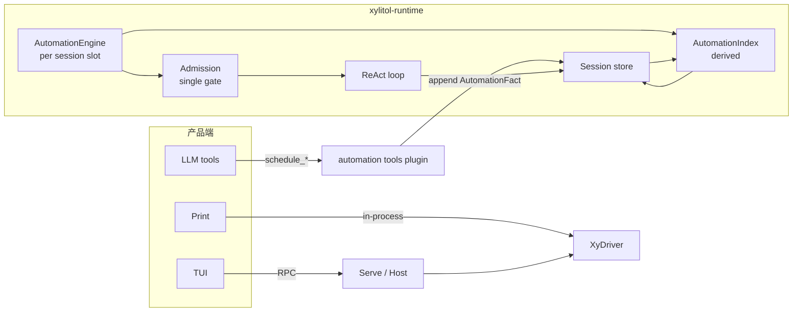
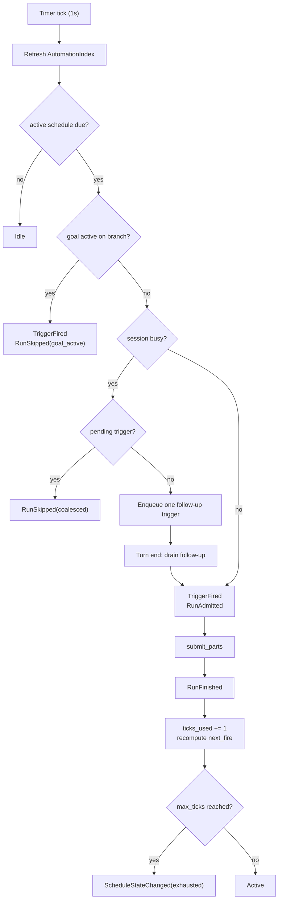
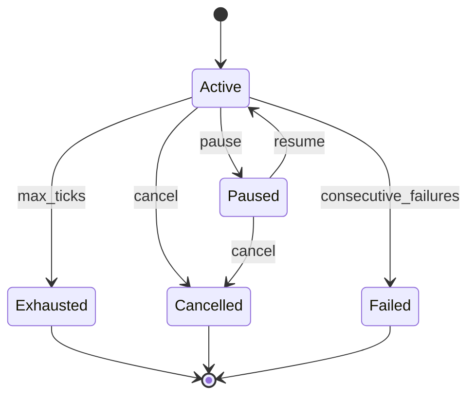
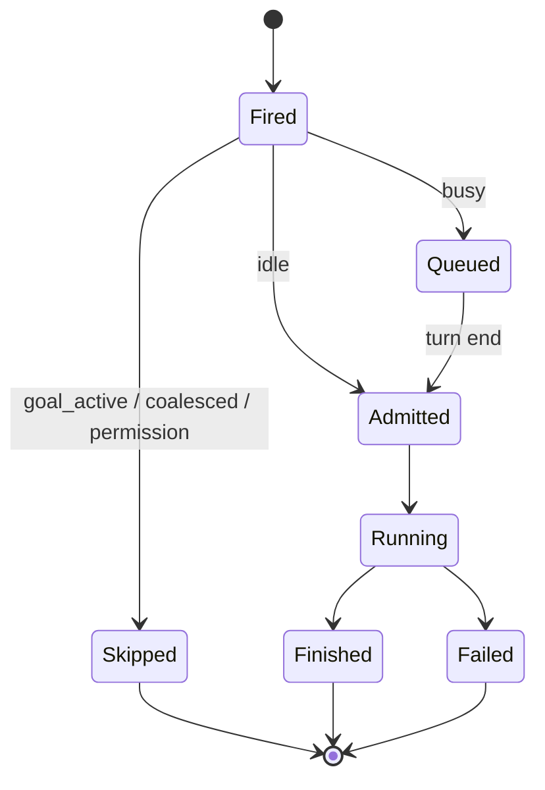

# Design: c3207-add-loop-scheduler

> 目标：把 /loop 从“用户每次提交”变成可持久化的 schedule + trigger + run 事实；第一版只暴露 LLM 工具，不做 TUI/nsh。
> 共享边界：c3207 定义 Automation Core；c3208 在其上追加 goal 事实与续跑，不另造调度器。
> 调研与 harness 对比：[research/automation-architecture-2026-11.md](research/automation-architecture-2026-11.md)。

## 1. 背景

c3206 已提供 branch、图边、COW fork、单写者准入与 `build_context` 投影；但没有 timer、schedule/trigger 事实与 goal 事实。当前 run 只由用户 `submit_parts` 触发，busy 时只有 steer / follow-up 改向，没有“到点自动开 run”。

## 2. 目标

- 支持 interval 与 5-field cron 的重复触发。
- 事实 append-only；状态由投影重建；host 只维护派生索引。
- 到点触发走同一 admission；busy 时只排 follow-up，不 steer。
- `max_ticks` 硬上限（缺省 256）；手动 pause / resume / cancel。
- 重启不补跑；fork 不继承 schedule/goal。
- 无人值守权限 fail-closed。
- 第一版只暴露 LLM 工具；TUI/nsh 后置。

## 3. 非目标

- 不做条件 DSL / 工作流引擎化；`stop_condition` 只保留字段。
- 不做 cron 自动过期；只由 `max_ticks` 与手动停约束。
- 不做 TUI 侧栏、nsh、跨 session 全局调度。
- 不实现 c3208 的 goal evaluator 与续跑；只预留事实与投影接口。
- 不做 GDR（Guarded Decision Reuse）。

## 4. 决策

| 决策 | 选择 | 理由 |
|---|---|---|
| 事实真源 | 会话分支 custom facts | 与 c3206 图/分支一致；append-only、可审计 |
| 派生索引 | 每个 session 槽的 `AutomationIndex` | 第一版保持单写者；跨 session 汇总后置 |
| 调度器位置 | `xylitol-runtime` | Print/TUI 都能用；不依赖 serve |
| 准入 | 复用 `XyDriver` admission | 不另造执行路径 |
| busy | follow-up 队列，单 pending，coalesce | 不打断当前 run；避免 backlog |
| cadence | interval + 5-field cron；本地时区 | cron 有明确日历语义；interval 精确 |
| 过期 | 不自动过期 | 由 `max_ticks` 与手动停约束 |
| 重启 | 不补跑，重算 `next_fire` | 与 Claude Code 一致；避免雪崩 |
| fork | 不继承 | 子分支独立；避免双触发 |
| 权限 | fail-closed | 无人值守不得自动批准 |
| 工具面 | `schedule_*` 模型工具 | 第一版不做 TUI/nsh |

## 5. 架构

**边界**：

- `AutomationEngine` 随 session 槽启动；槽销毁即停止。第一版不做跨 session 全局调度。
- `AutomationIndex` 只覆盖当前 session 的 leaf branch；branch travel 后重建。
- 工具只 append facts；engine 在 tick 时读投影，不要求工具直接持有 engine。
- engine 不直接调用 ReAct；只向 admission 提交 trigger，由 driver 在 idle / turn end 排空。

## 6. 事实模型

SDK 新增 `AutomationFact`，以 `custom_type = "automation"` 存入 `CustomEntry.data`。不新增顶层 entry type，不改 v7 格式。

| 事实 | 字段 | 说明 |
|---|---|---|
| `ScheduleDefined` | schedule_id、branch_id、prompt、cadence、max_ticks、stop_condition | 定义；最新一条生效 |
| `ScheduleStateChanged` | schedule_id、state、reason、actor | active/paused/exhausted/cancelled/failed |
| `TriggerFired` | trigger_id、schedule_id、branch_id、source、fired_at | 到期/手动触发 |
| `RunAdmitted` | trigger_id、admitted_at | 已进入 run |
| `RunSkipped` | trigger_id、reason、skipped_at | busy / coalesced / goal_active / permission / restart |
| `RunFinished` | trigger_id、outcome、finished_at | success / failed / aborted |

c3208 后续追加 `GoalDefined`、`GoalEvaluated`；c3207 的枚举保留扩展位，未知 kind 忽略并告警。

**投影**：

- `ScheduleProjection`：definition、state、ticks_used、next_fire、pending_trigger、last_outcome。
- `ticks_used` 只计 `RunAdmitted`；skipped/coalesced 不计。
- `next_fire` 由 cadence 计算；不持久化。
- 事实按 `branch_id` 过滤；fork 子分支不继承父 schedule。
- 未知事实 / 未知字段不阻塞加载。

## 7. Engine 与 admission

规则：

- engine 每 1s 检查一次；测试用 fake clock，不 sleep。
- 同一 schedule 最多一个 pending trigger；重复到期合并，不堆队列。
- 当前 run 是用户 run：排 follow-up，不 steer。
- 当前 run 是同一 loop 的上一 tick：跳过并记录。
- 重启后不补跑；按当前时间重算 `next_fire`。
- `RunSkipped` 必须写原因；不得静默丢 tick。
- 权限 fail-closed：需要交互确认但无 client 时跳过并记录，不自动批准。

## 8. Cadence

- `Cadence::Interval { seconds }`：精确间隔；最小 1s，建议 >= 60s。
- `Cadence::Cron { expr, timezone }`：5-field cron；本地时区缺省；不支持秒。
- 使用成熟 cron parser；不手写解析。DST/时区交给库处理。
- 不做自动过期；只由 `max_ticks` 与手动停约束。
- `next_fire` 在每次 tick/run 后重算；interval 以 fired_at 为基准，cron 按表达式。
- 连续失败退避：首版记录 failure；退避参数在 tasks 钉；不把失败伪装成成功。

## 9. 工具面

新增官方插件 `xylitol-official-plugin-automation`（或等价接线）注册模型工具：

| 工具 | 参数 | 行为 |
|---|---|---|
| `schedule_create` | prompt、cadence、max_ticks? | append ScheduleDefined；返回 schedule_id、next_fire |
| `schedule_list` | 无 | 投影当前 branch 的 schedules |
| `schedule_pause` | schedule_id | append ScheduleStateChanged(paused) |
| `schedule_resume` | schedule_id | append ScheduleStateChanged(active) |
| `schedule_cancel` | schedule_id | append ScheduleStateChanged(cancelled) |

约束：

- 工具只写事实；不直接启动 run。
- `schedule_create` 校验 cron/interval；非法输入返回可分类错误。
- 工具输出 JSON；不写 TUI 状态。
- 配置 `automation.enabled` 缺省 true；关闭时不装配工具与 engine。
- 不新增协议方法；跨进程仍走四象限信封。

## 10. c3208 接口

- `AutomationFact` 枚举预留 `GoalDefined`、`GoalEvaluated`；c3208 实现语义。
- c3207 engine 读取 goal 投影：active goal 存在时跳过 loop tick；goal done 时 append ScheduleStateChanged(paused, reason=goal_done)。
- c3208 的 evaluator 在 turn end 运行；第一版继承当前 session model；后续再评估小快模型。
- goal 续跑走 `DecideContinue`，不新开 run；不绕过 turn 边界/权限终裁。

## 11. 状态图

Trigger/Run 状态由事实投影，不塞进 Schedule 状态：

## 12. 失败与恢复

- engine tick 失败：记录诊断；不阻塞其他 schedule；下一次 tick 重试。
- run 失败：append RunFinished(failed)；schedule 保持 active；退避后重试。
- 连续失败达到阈值：ScheduleStateChanged(failed)；用户可 resume。
- 重启：重建 index；不补跑；due 时间已过则按当前时间重算。
- 事实写失败：tick 记为 skipped；不得假装已触发。
- 取消：pause/cancel 立即生效；pending trigger 丢弃并记录。

## 13. 兼容与迁移

- 不改 `SESSION_VERSION`；不新增顶层 entry type；`custom_type = "automation"`。
- 旧版本读取未知 custom_type 时忽略；不迁移旧 session。
- fork COW 父段中的 automation facts 按 branch_id 过滤，不投影到子分支。
- c3208 追加 goal variants 时不需要新格式版本。
- 现有单线模式、session tree、travel 不变。

## 14. 测试

- SDK 单测：fact encode/decode、projection、state transitions、branch filter、unknown kind、cron next_fire、interval next_fire。
- Runtime 单测：fake clock；engine tick；busy follow-up；coalesce；max_ticks；restart；fail-closed；cancel。
- 工具单测：schema、非法 cadence、pause/resume/cancel、list 投影。
- 集成测：MemoryStore + fake clock + ScriptedDriver；不依赖真实网络/模型。
- BDD：若产品可见行为需要，新增 `agent-automation` 场景；不重复单测边界。
- 门禁：`llman-sdd validate <id> --strict`；`just qa`。

## 15. specs 影响

- 新增 capability `agent-automation`：schedule/trigger/run 事实、cadence、busy 队列、max_ticks、fail-closed。
- `agent-tools`：schedule_* 工具契约（参数/输出/错误）。
- `agent-runtime`：复用 admission；不新增第二执行路径。
- `agent-session-store`：custom_type `automation` 的持久化与分支过滤（若无现成 custom 规则）。
- 不改 `protocol-app` / `app-tui-*`；TUI/nsh 后置。

## 16. 风险与未决

- 第一版 per-session engine：session 未加载时 schedule 不触发；跨 session 调度后置。
- index 刷新成本：leaf branch 大时需要增量；先测再优化。
- cron parser 选择、DST 边界、本地时区语义需在 tasks 钉。
- 连续失败退避参数、quiet hours / DND 未定；首版可只记录。
- 权限 fail-closed 的“需要确认”判定依赖 runtime permission 口；需在 tasks 验证。
- TUI 侧栏已有 c3226 在推进；c3207 不依赖，后续复用。
