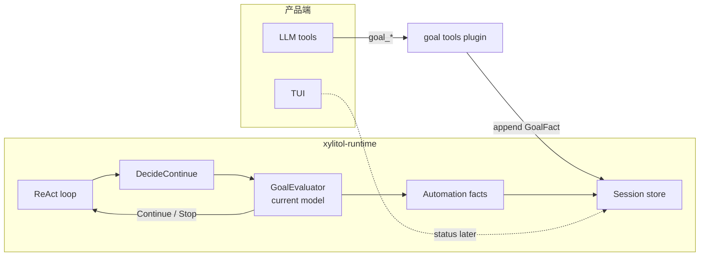
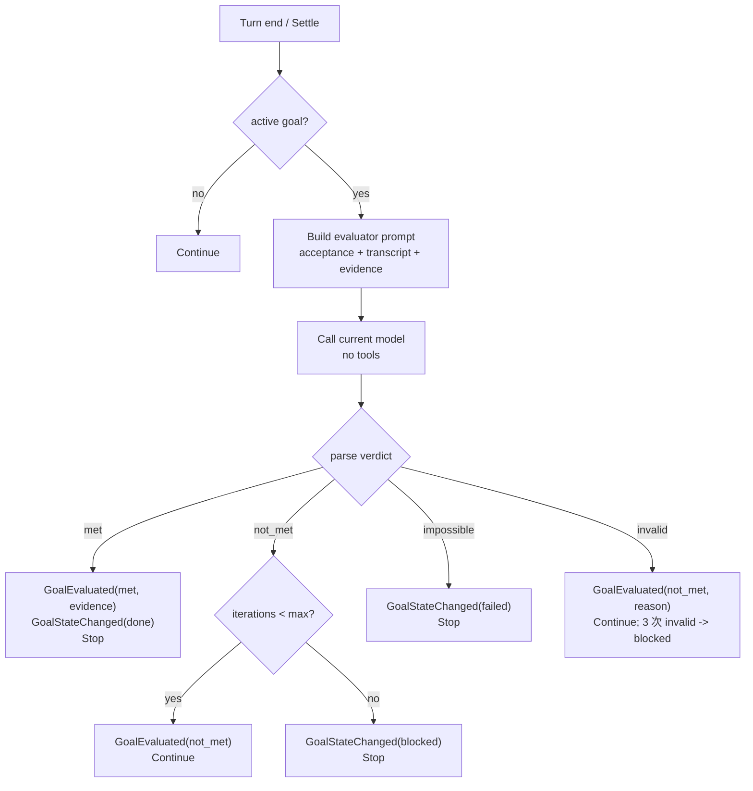
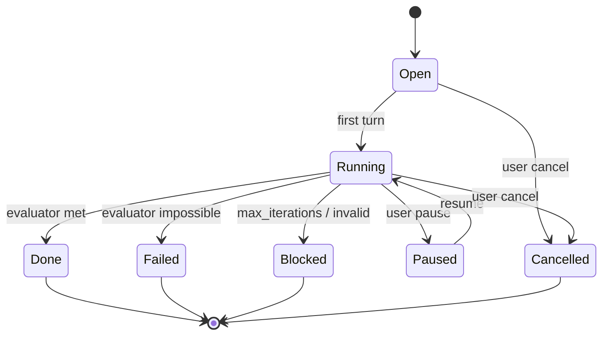

# Design: c3208-add-goal-tracking

> 目标：在 c3207 Automation Core 上增加 goal 事实、每轮 evaluator 与 `DecideContinue` 续跑；第一版只暴露 LLM 工具，不做 TUI/nsh。
> 依赖：c3207 的 facts / admission / per-session engine；不另造调度器。
> 调研：[c3207 Automation Core](../c3207-add-loop-scheduler/research/automation-architecture-2026-11.md)。

## 1. 背景

c3207 提供 schedule / trigger / run 事实与单写者准入；goal 不是另一种 schedule，而是“任务完成条件 + 每轮判定 + 续跑”。Claude Code 的 /goal 用独立 evaluator 在每轮结束判定 met / not_met / impossible；本设计沿用该模型，但第一版 evaluator 继承当前 session model。

## 2. 目标

- goal 事实 append-only；状态由投影重建。
- 每轮结束由独立 evaluator 判定；第一版 evaluator 继承当前 session model。
- `max_iterations` 硬上限（缺省 256）；done / failed / blocked 明确。
- goal 活跃时跳过同 branch 的 loop tick；goal done 时暂停关联 schedule。
- 一个 branch 同时最多一个 active goal。
- 用户可 pause / resume / cancel / 修改 acceptance；只追加事实。
- 第一版只暴露 LLM 工具；TUI/nsh 后置。

## 3. 非目标

- 不做自动改写 acceptance 或无限自我迭代。
- 不做 TUI 侧栏、nsh、跨 session goal。
- 不做 GDR（Guarded Decision Reuse）。
- 不做 evaluator 小快模型切换；后续再评估。

## 4. 决策

| 决策 | 选择 | 理由 |
|---|---|---|
| 事实真源 | 会话分支 custom facts（`custom_type = "automation"`） | 与 c3207 同一 Automation Core |
| evaluator 位置 | `xylitol-runtime` 核心服务 | 需要 model manager；插件不持有 loop 终裁 |
| evaluator 模型 | 第一版继承当前 session model | 不引入第二模型配置；后续再评估小快模型 |
| 判定 | met / not_met / impossible | 与 Claude Code 对齐 |
| 续跑 | 同一 run 内 `DecideContinue` | 不新开 run；不绕 turn 边界 |
| 上限 | `max_iterations = 256` | 硬约束，防无限续跑 |
| 并发 | 每 branch 一个 active goal | 避免多个 goal 争用 |
| loop 交互 | goal active 跳过 tick；goal done 暂停 schedule | 避免双驱动器 |
| 工具面 | `goal_*` 模型工具 | 第一版不做 TUI/nsh |

## 5. 架构

**边界**：

- evaluator 是 core 服务，不是官方插件；插件只写 facts，不参与 loop 终裁。
- evaluator 用 `XyModel` 独立调用，不带工具；只看 acceptance + transcript + 当前 evidence。
- goal 续跑走 `DecideContinue`；不新开 run，不绕过权限终裁。
- c3207 engine 读取 goal 投影：active 跳过 tick；done 暂停 schedule。

## 6. 事实模型

在 c3207 `AutomationFact` 上追加：

| 事实 | 字段 | 说明 |
|---|---|---|
| `GoalDefined` | goal_id、branch_id、objective、acceptance、max_iterations | 最新一条生效；新 goal 取代旧 active goal |
| `GoalStateChanged` | goal_id、state、reason、actor | open/running/done/failed/blocked/paused/cancelled |
| `GoalEvaluated` | goal_id、verdict、evidence、iterations_used、at | 每轮判定；append-only |

**投影**：

- `GoalProjection`：definition、state、iterations_used、last_verdict、last_evidence。
- `iterations_used` 只计 `GoalEvaluated`；达到 `max_iterations` 后 blocked/failed。
- 事实按 branch_id 过滤；fork 子分支不继承 goal。
- 未知 fact / 字段忽略并告警；不阻塞旧 session。

## 7. Evaluator

规则：

- evaluator 只看 transcript 与 acceptance；不跑命令、不读文件。
- `met` 必须带 evidence；缺 evidence 按 not_met 处理。
- `not_met` 的 reason 作为下一轮指导。
- 连续 3 次 evaluator 调用失败/输出非法 -> blocked，不无限重试。
- 不因 evaluator 失败自动批准工具；权限仍由 runtime 终裁。
- 用户 pause / cancel 后 evaluator 不再调用。

## 8. 状态图

## 9. 工具面

新增官方插件 `xylitol-official-plugin-goal`（或并入 automation 插件）：

| 工具 | 参数 | 行为 |
|---|---|---|
| `goal_set` | objective、acceptance、max_iterations? | append GoalDefined；取代旧 active goal；返回 goal_id |
| `goal_status` | 无 | 投影当前 branch 的 goal |
| `goal_pause` | goal_id | append GoalStateChanged(paused) |
| `goal_resume` | goal_id | append GoalStateChanged(running) |
| `goal_clear` | goal_id | append GoalStateChanged(cancelled) |

约束：

- 工具只写事实；不直接调用 evaluator、不直接开 run。
- `acceptance` 上限 4000 字符；空 acceptance 拒绝。
- 非法 / 不存在的 goal_id 返回可分类错误。
- 配置 `goal.enabled` 缺省 true；关闭时不装配工具。
- 不新增协议方法；跨平台仍走四象限信封。

## 10. 与 c3207 的交互

- c3207 engine 读 goal 投影：active goal 存在时，同 branch 的 loop tick 记 `RunSkipped(goal_active)`。
- goal done 时，c3208 append `GoalStateChanged(done)`；c3207 engine 观察后 append `ScheduleStateChanged(paused, reason=goal_done)`。
- goal 续跑走同一 runtime；不新增第二 admission。
- c3208 不修改 c3207 的 schedule 事实；只读投影 + 追加 goal 事实。

## 11. 失败与恢复

- evaluator 模型调用失败：记录诊断；goal 保持 running；下一轮重试；连续 3 次 -> blocked。
- evaluator 输出非法：按 not_met + reason；连续 3 次 -> blocked。
- goal done 但 evidence 缺失：按 not_met，不标记 done。
- 重启：goal 事实重建；active goal 恢复；iterations 保留；不补跑。
- 用户 cancel：立即生效；pending evaluator 结果丢弃。
- 事实写失败：不假装状态变更；记录诊断。

## 12. 兼容与迁移

- 复用 `custom_type = "automation"`；不新增顶层 entry type；不改 v7。
- 旧 session 无 goal facts -> 无 active goal。
- fork COW 父段 goal facts 按 branch_id 过滤，不继承。
- c3207 已落地的 schedule 事实不变；c3208 只追加。
- TUI/nsh 不变。

## 13. 测试

- SDK 单测：goal fact encode/decode、projection、state transitions、branch filter、unknown kind、max_iterations。
- Runtime 单测：fake evaluator model；met/not_met/impossible/invalid；evidence；pause/cancel；goal done -> schedule paused；goal active -> tick skipped。
- 工具单测：schema、acceptance 上限、goal_set 取代旧 goal、pause/resume/clear、错误分类。
- 集成测：c3207 engine + c3208 goal + MemoryStore + fake clock；不依赖真实模型。
- BDD：若产品可见行为需要，新增 `agent-goal` 场景；不重复单测边界。
- 门禁：`llman-sdd validate <id> --strict`；`just qa`。

## 14. specs 影响

- 新增 capability `agent-goal`：goal facts、evaluator、DecideContinue、max_iterations、loop 交互。
- `agent-tools`：goal_* 工具契约。
- `agent-runtime`：DecideContinue 增加 goal 判定；不新增第二执行路径。
- 不改 `protocol-app` / `app-tui-*`；TUI/nsh 后置。

## 15. 风险与未决

- evaluator 继承当前 model：成本/延迟高于小快模型；后续再评估。
- evaluator 只看 transcript：证据不足时可能误判；需要 evidence 规则。
- 连续 invalid / 模型失败阈值 3 次；是否更保守待 tasks 钉。
- goal active 跳过 loop tick 的 UX 需在 apply 验证。
- c3208 依赖 c3207 归档；c3207 未收口前不可 apply。
- TUI 侧栏已有 c3226；c3208 不依赖，后续复用。
