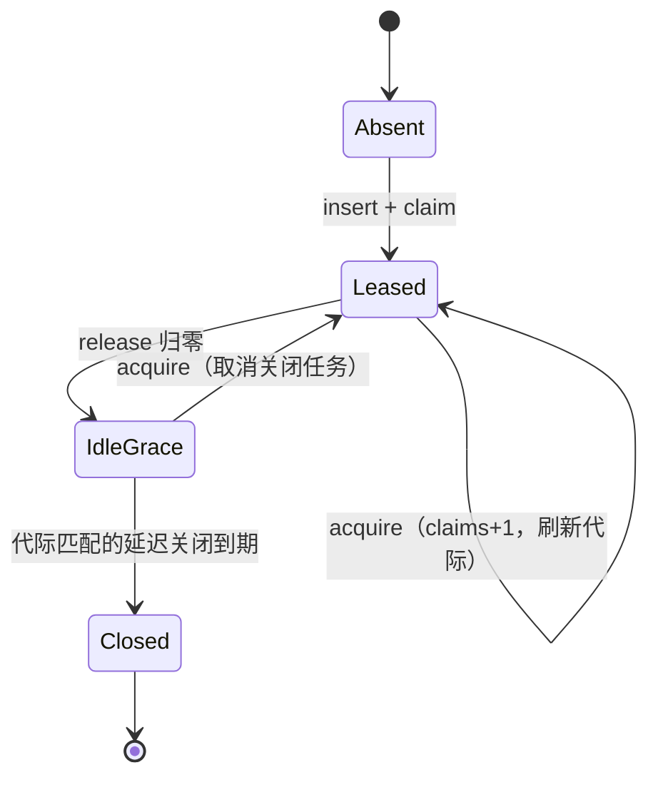

# Design — MCP 租约池与 OAuth 终态

## 1. 目标与边界

- 租约相位显式建模，空闲关闭任务可取消；OAuth 终态必达；prepare 门禁随会话复位。
- 边界：租约模型沿用 c3228 的 ResourcePool（不推翻）；不改 MCP 配置格式。

## 2. 决策摘要（2026-11-12 复核后全部定稿）

| 决策 | 内容 | 状态 |
|---|---|---|
| 租约相位 | PoolEntry 增 phase: Leased / IdleGrace / Closed；acquire/release/expire 显式转移 | 定稿 |
| 关闭任务 | schedule_idle_close 返回 JoinHandle 存 entry，新 acquire / reset_pool abort 旧任务 | 定稿 |
| 重连计数 | 空闲过期不再计入 reconnects（移到独立 idle_closes 观测） | 定稿 |
| 快照缓存 | update_snapshot 单点更新 last_view / last_result / last_tools；try_lock 失败视图标 degraded 且 complete=false | 定稿 |
| OAuth 真值 | **status 表为唯一真值**（存 status + expires_at_ms）；flows 只承载 channel；回调失败 / 监听器死亡 / 过期 均落 Failed，cancel 落 Cancelled；写 status 不再以 gateway 存在为前提 | 定稿 |
| 过期 | expires_at_ms 生效：查询时 Pending 且已过期转 Failed | 定稿 |
| 进度代际 | McpConnectProgress 增 generation；并发 connect 旧代际写入丢弃 | 定稿 |
| prepare 复位 | **新会话 / fork 会话**（不是 switch_session，见 §7）重置 prepare_acked 并开火准备 | 定稿 |

## 3. 租约相位

- expire_idle 保留代际比对；Close 动作收敛进 phase 转移；phase 为权威，claims 降为观测。

## 4. OAuth 终态收敛

状态真值 oauth_status 单表：回调成功 Completed；回调失败或监听器死 Failed；cancel 删 flow 写 Cancelled；查询时 expires_at 已过转 Failed(expired)；无 gateway 在 bind 阶段即 Failed(no_gateway)，不留 Pending。

## 5. 测试边界（seam）

- 单测：租约并发 acquire/release/过期；关闭任务被新 acquire 取消；OAuth 失败矩阵终态断言。
- BDD：infra-mcp 切会话后首轮门禁再次生效。

## 6. 风险与回滚

- 回滚：租约 / 快照 / OAuth 三片独立。

## 7. 实施前复核（2026-11-12）

逐条核对 proposal 的静态阅读结论（证据为代码行）：

| 结论 | 复核 | 证据 |
|---|---|---|
| 租约三元组：claims / idle_generation / reconnect_count | 成立 | hub.rs:37-40、49-73；resource_lease.rs:99-128 |
| 空闲过期计入 reconnects（语义污染） | 成立 | hub.rs:232（`expire_idle` 内 `reconnects += 1`） |
| schedule_idle_close 无 JoinHandle，卸载后仍可触发 | 成立 | hub.rs:208-217（`tokio::spawn` 丢弃句柄） |
| 快照五份独立更新 | 成立（last_* 由 update_snapshot 写；current/notice/progress 各自独立） | hub.rs:242、603-633、903-905；client.rs:596-614 |
| try_lock 失败合成「假就绪」视图 | 成立 | hub.rs:915-933：`servers.try_lock()` 失败 → configured=0 → `complete=true` |
| OAuth 双表；监听器失败只删 flow 不写 status | 成立 | client.rs:1078-1090、1095-1107 |
| 无 gateway 时终态永不落地 | **不成立**：无 gateway 时 `start_oauth` 在创建 flow 前即返回错误（client.rs:1032-1036），不会留下 Pending。真实缺口是「flow 已建、gateway 随后缺失」时 `complete_oauth` 的 status 写入被 gateway 条件包住（client.rs:1143-1152） | client.rs:1032-1036、1143-1152 |
| expires_at_ms 已生成但无人检查 | 成立 | client.rs:1076；全仓无读取（TUI 仅展示） |
| 连接进度无代际，并发 connect 互相覆盖 | 成立 | client.rs:515-614：两次 connect 都写同一 `progress_out` |
| prepare_acked 在 switch_session 未重置 | **不成立**：`switch_session` 调 `fire_session_prepare`，其首行即 `prepare_acked=false`（prepare.rs:144-145；session.rs:66）。真实缺口是 **new_session / fork_session** 只绑定不重置（session.rs:221-254、1-26），新会话沿用上一会话的 ack 跳过 MCP 首轮门禁 | session.rs:66、221-254；prepare.rs:144-145 |

修正后的实施范围：租约相位 / 关闭任务 / idle_closes；快照单点 + degraded；OAuth 终态（监听器失败、无 gateway 后缺失、过期）；进度代际；**new_session / fork_session** 门禁复位。

实施中新增发现（同一 session 重复 ensure 会反复重建连接）：`claim_and_connect` 每次 ensure 都先释放该 session 全部旧 claim 再重新 acquire；同 key 同 session 的重复 ensure 因此走到「释放归零 → 关闭 → 重插 → 重连」（Workspace 且 keep_alive=0 时零延迟关闭），表现为 reconnect_count 递增与连接风暴；并发 prepare 事件（Switch 与 Generate）还会让两批 connect 同时写同一 entry。

修复：
1. `ensure_for` 单飞（`ensure_lock`）：并发 prepare 事件串行执行，不再起两批 connect。
2. 仍被本 session 需要的 key 跳过释放；已连接（`connected` 非空）直接复用，不再 shutdown/重连。
3. 未连接的 still-desired key 就地重试：shutdown 旧 manager、起新 connect、`reconnect_count` +1（保持 r3272「失败 server 下一次 ensure 重连」语义），不再走释放→重插。

该修复同时让进度代际在并发 ensure 下稳定收敛。
