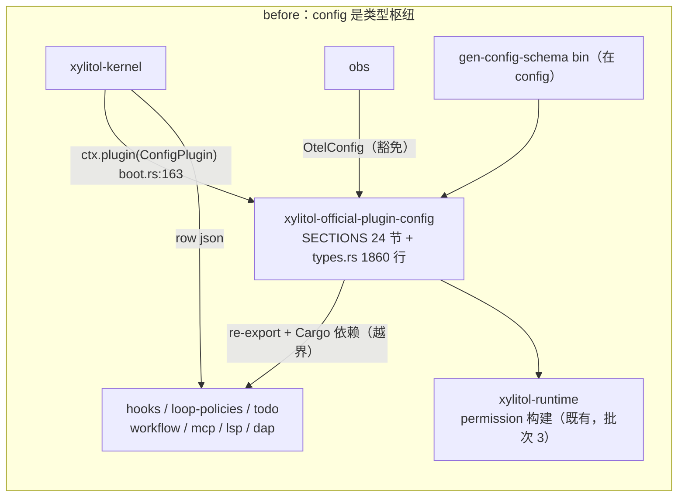
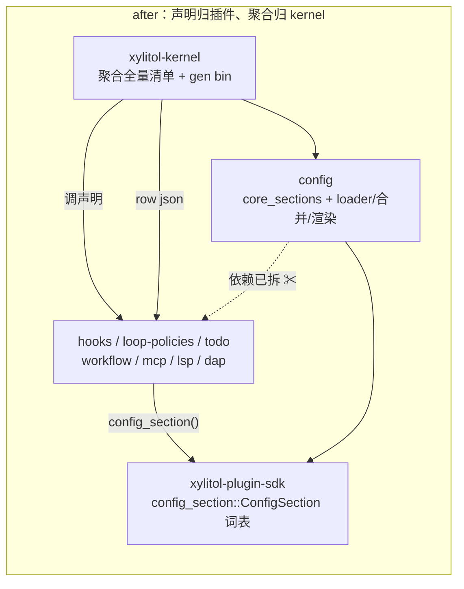
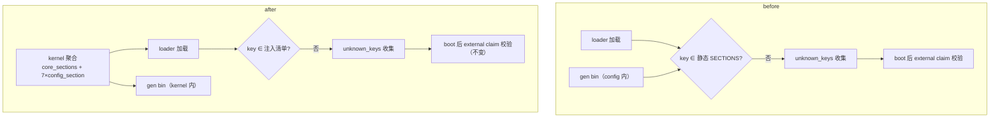

# 设计：配置节注册表（c3395）

## 目标形状（三层，对齐 LoopMiddlewareRegistry 既有模式）

- 词表 = xylitol-plugin-sdk：`config_section::ConfigSection { key: &'static str, schema: fn() -> serde_json::Value, default: fn() -> serde_json::Value }`。纯数据 + 函数指针，无新增依赖（serde_json 已在词表内）。schemars 不得进 sdk：schema fn 由各声明方 crate 在自己边界用 schemars 生成（符合 src/AGENTS.md「sdk 收纳准则」第 1 条）。
- 声明方 = 各官方插件与 config 核心节：七插件暴露 `pub fn config_section() -> ConfigSection`；config 暴露 `core_sections()`（核心域节 + 过渡节）。
- 聚合 = xylitol-kernel：boot 组装全量清单（编译期可见全部官方插件声明，静态聚合而非装配期注册），注入 ConfigPlugin 构造；未知键校验（loader.rs:252 现查静态表）改查注入清单——全集合等值，行为不变。
- 产物 = gen-config-schema bin 迁至 kernel（kernel 依赖全部官方插件，能取到全量清单，无需装配 runtime）；`render_app_config_schema` 参数化（config 侧）；`sort_object_keys` 已保证键序稳定，聚合顺序不影响产物字节。

## 归属表（24 节）

| 节 | 类型现居 | 归属 | 批次 |
|---|---|---|---|
| xylitol（引导段） | config types | config core | 已是 |
| models / agents / execution / session / tool_batch / tools / security / trust / serve / subagent / external_plugins / tui | config types | config core（决策 D2） | 本 change 定职不搬 |
| otel | config types | config core 过渡 | 2（评估搬 obs） |
| context_inject | config types 与插件双定义 | 插件（收敛双定义） | 2 |
| compaction / codemode | sdk（c3355 先例） | 不动 | — |
| hooks / loop_policies / todo / workflow / mcp_servers / lsp / dap | 插件（config 仅 re-export） | 插件自声明 | 本 change |
| 外进程 claim 键（boot.rs:143-149） | kernel | 保持现状 | 4（评估并入） |

## 本 change 范围

加：sdk 词表；七插件声明；kernel 聚合注入 + row 直连 + bin 迁移。
删：config 七插件 re-export 与 Cargo 依赖；旧 SECTIONS 表（收缩为 core_sections()）；ConfigDomain 死列。

## 后续批次（不在本 change）

- 批次 2：context_inject 双定义收敛（插件胜出）；otel 归属评估（obs 豁免现状）；compaction / codemode 声明挂到各自插件（类型留 sdk）。
- 批次 3：config→xylitol-runtime 依赖（permission 构建，lib.rs to_permission）处置评估；types.rs 瘦身复核。
- 批次 4（可选）：外进程 claim 并入注册表；「未装配插件节」语义收紧（若做，须另起 change 补 r3070 场景——本 change 保持「全量节集合合法」现状语义）。

## 决策记录

- D1 机制形状：静态聚合（kernel 编译期组装），非装配期注册。理由：未启用插件的节仍合法（现状语义），gen bin 无需装配 runtime；r3070「装配后认领」经注入清单等值满足。
- D2 核心域节（约 12 节）落点：留 config，config 定职「核心域节持有者 + 加载 / 合并 / 聚合器」。默认采用，未获用户确认。
- D3 首批搬迁：一把搬 7 个（拆掉 config 全部越界插件依赖）。默认采用，未获用户确认。
- D4 验收缝：既有 runtime-config .feature 场景 + 配置 crate 单测 + 产物逐字节不变。默认采用，未获用户确认。
- D5 compaction / codemode 类型留 sdk（既有先例，不扩大不回搬）。

## 不变式与验收

- configs/config.schema.json 逐字节不变（change 分支上 `just gen-config-schema` 后 git diff 为空）。
- 未知键两阶段校验行为不变；外进程 claim 不变；conf.d / secret.env / 深合并不动。
- BDD runtime-config 场景全绿；sdk / kernel / config / 七插件单测绿。

## 风险

- tests/bdd 若有钉死节清单的断言须同步（未确认；apply 时 rg 查 steps_config）。
- boot row 组装改直连，动 kernel bootstrap / boot 热点文件，回归靠既有 BDD 与 occupancy 装配测兜底。
- models.entries 形状被 x-magpie 连接器跨仓消费：本 change 不改形状，以产物字节一致作证。

## 深挖记录（2026-11-18，propose 复核）

### 逐问决策走查

**Q1 为什么静态聚合（kernel 编译期组装）而非装配期注册？**
未启用插件的节今天合法且被忽略（loader.rs:258 只查表 membership）；装配期认领会把它变成硬失败——行为变更，超出本 change 不变式。gen bin 无需装配 runtime 即可取全量清单。r3070「装配后认领」经注入清单等值满足。代价：kernel 调各插件声明函数——该依赖边已存在（kernel → plugins），无新增。

**Q2 为什么 schema / default 用 fn 指针而非 trait？**
ConfigSection 保持 Copy 纯数据行；无泛型污染 sdk 词表；schemars 留在声明方 crate（sdk 收纳准则第 1 条：纯数据 + 无新增依赖）。

**Q3 为什么 bin 迁 kernel 而非留 config 或去根包？**
config 看不到插件声明（正是要拆的依赖方向）；根包定职 argv + profile 不得扩；kernel 已依赖全部官方插件。

**Q4 七插件搬迁为什么低风险？**
类型真身已在插件（config 仅 re-export）；kernel → 插件的 row 通道已是 json；验收 = 产物逐字节不变 + BDD drift 场景已存在（steps_runtime_config.rs:536-541）。

**Q5 核心域节为什么留 config？**
消费面在 kernel 五文件（bootstrap / boot / composition / subagent / external_plugin）；搬 kernel 使 boot crate 兼类型库；r3070 禁的是「手写字段清单」，非「核心持核心节」；core_sections() 是声明面不是字段清单镜像。

**Q6 「未装配节」语义为什么不动？**
收紧 = 行为变更须动 spec（r3070 场景补写），批次 4 另起 change 决策。

**Q7 外进程 claim 为什么不并入？**
已 spec 且在工作状态；并入涉 boot 时序重排，扩面。批次 4 统一。

**Q8 ConfigDomain 死列删除为什么安全？**
全仓 0 消费者（rg 实测，仅 sections.rs 自身出现）。

### 注入点与调用面（事实）

- ConfigPlugin 构造唯一落点 boot.rs:163（ctx.plugin(...)）——注入清单的缝。
- sections() 生产调用 4 处：validate.rs:22（产物渲染）、validate.rs:119（合并校验）、loader.rs:258（未知键收集）、types.rs:458（validate_unknown_keys）——全部参数化，无 crate 外消费。
- 产物 drift 护栏已存在：tests/bdd/steps_runtime_config.rs:536-541（r2928 场景绑定）。

### 前后对照

| 维度 | before | after（本 change） |
|---|---|---|
| 节声明位置 | config sections.rs 静态表 24 节（299 行） | 七插件自声明 + config core_sections()（核心域 + 过渡节） |
| 类型枢纽 | config types.rs 1860 行（含七插件 re-export :671-674/816-818） | re-export 删除，类型只在归属方 |
| config Cargo 依赖 | sdk + runtime + 七插件 | sdk + runtime（runtime 留批次 3 处置） |
| 未知键校验数据源 | 静态 SECTIONS（4 调用点） | 注入清单（同 4 调用点参数化，全集合等值） |
| schema 产物来源 | sections() 表 | kernel 聚合清单（sort_object_keys 保字节稳定） |
| gen bin 位置 | config crate | kernel crate；justfile 指向更新 |
| kernel row 组装 | 经 config::types::* 取七插件类型 | 直连插件类型 |
| ConfigDomain | 表内死列 | 删除 |

### 图示：现状（config 是类型枢纽）

### 图示：目标（声明归插件、聚合归 kernel）

### 图示：校验与产物数据流对照

## Verify 记录（2026-11-18，双轴审查）

合约轴（0 CRITICAL / 2 WARNING）与标准轴（0 CRITICAL / 3 WARNING）分离审查，交叉确认后处置：

- lsp/dap 缺声明测试 + 类型化断言削弱 → 已补 `section_decl_tests`（声明冒烟 + serde 默认值类型化测试）。
- config 内 `sections::ConfigSection` 兼容 re-export 双路径 → 已删，crate 内 7 处改 sdk 直连。
- justfile drift 注释仍指 config → 已改 kernel。
- prelude 重复 use → 已合并。
- r3070 两场景（未知键硬失败 / warn 放宽）无 BDD 绑定——**存量缺口**（merge-base 即缺），非本 change 引入；列入批次 4 或独立小 change 补绑定。
- `ConfigSection` 按键判等（`PartialEq`）：注册表成员语义「同 key 即同节」；schema 差异不参与比较。
- kernel 键唯一性用 `debug_assert`：release 不生效；当前消费面（渲染覆盖 / known 集合去重）下重复 key 无行为危害。
- config 测试 fixture `test_sections()` 以字面量复刻 7 插件键：依赖方向所迫，保持机制测试所需最小键集，等值由 kernel 字节闸兜底。
- 声明落点不一致（5 插件在 config.rs、lsp/dap 在 lib.rs）：批次 2 统一评估。
