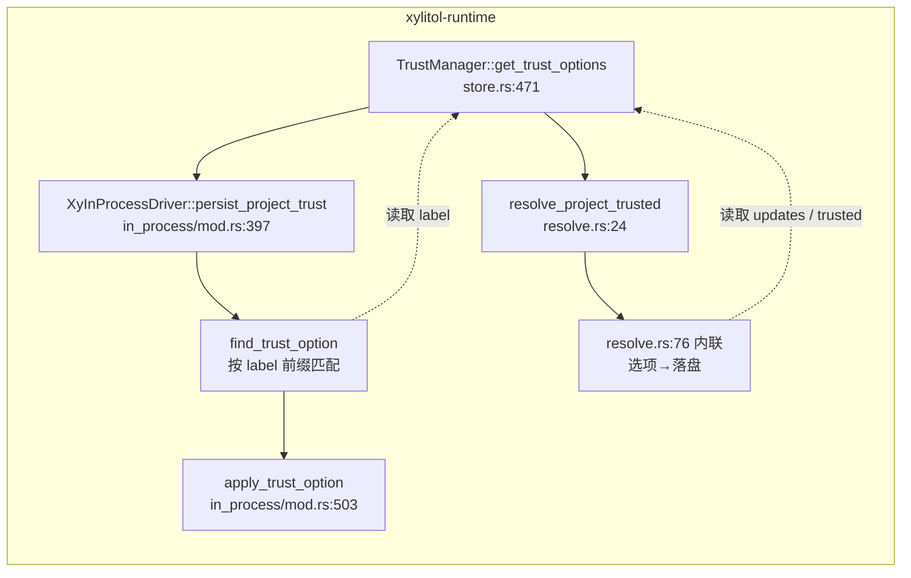
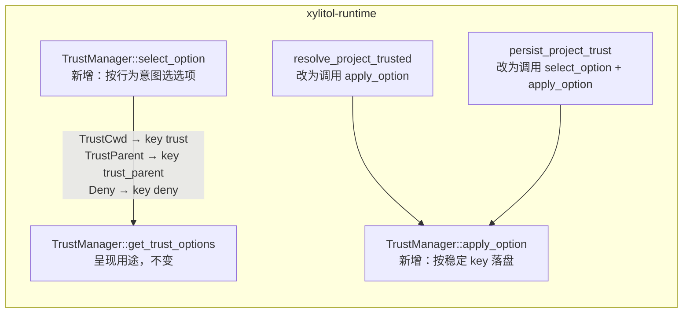

# Design

## 现状形状

两个薄点（深挖更正）：

1. **行为选择依赖展示文案**。`find_trust_option`（`in_process/mod.rs:485-500`）的接口是「给我一组菜单项和一个人机意图，我按文案猜出是哪一项」——调用者必须知道菜单文案长什么样，而选项本身已带 `key`。`TrustCwd` 更糟：直接取 `options.first()`（`:491`），**完全不校验身份**。
2. **选项 → 落盘逻辑三份**（提案原称两份）：
   - `resolve.rs:76-85`：吞错（`let _ =`）。
   - `in_process/mod.rs:503-522`：报错（`?`），额外拼 report 文案。
   - `src/cli/trust_gate.rs:82-107`：报错（`?`）且换文案（`trust store write failed: {e}`）。

   三处分支相同（有 updates → `apply_updates`，否则 → `record_decision` `session_only`），错误语义各不相同。

## 目标形状

- `TrustOption.key` 是唯一行为标识；`label` 只用于呈现。
- 新增入口与 `get_trust_options` 同处 `store.rs`，与既有 `resolve_trust_answer`（同样按 key）并列，语义一致。
- driver 侧 `find_trust_option` / `apply_trust_option` / `session_only_event` 三个自由函数删除，driver 只剩 cwd / agent_dir / 审计上下文的获取与错误映射。
- CLI 侧 `src/cli/trust_gate.rs:82-107` 的内联应用改为调用同一入口；CLI 保留自己的错误文案映射（`trust store write failed: {e}`）。
- **映射落点（深挖补正）**：`ProjectTrustMode` 是 driver 词表（`driver/types.rs:24`），映射放 trust 域会让 trust 域反向依赖 driver。改为：trust 域提供 `select_option(options, key: &str)` 与 `apply_option(...) -> Result<...>`；driver 侧做 `ProjectTrustMode -> &'static str` 的私有映射后调用。

## 关键决策

| 决策 | 选择 | 理由 |
|---|---|---|
| 新入口落点 | `xylitol-runtime` trust 域（`store.rs` 或 `store.rs` 旁的新模块） | 与 `TrustManager` 同 crate；不新增 crate；不改 crate 图 |
| 选择依据 | `TrustOption.key` | 已有字段、已有 `resolve_trust_answer` 先例；文案改动不再破坏行为 |
| `ProjectTrustMode` → key 映射 | **driver 侧私有函数**（`TrustCwd` → `"trust"`，`TrustParent` → `"trust_parent"`，`Deny` → `"deny"`） | 深挖更正：模式是 driver 词表，映射放 trust 域会形成 trust → driver 反向依赖；映射是纯数据，放 driver 侧零成本 |
| `TrustCwd` 选择依据 | 由 `options.first()` 改为按 key `"trust"` 查找 | 现状不校验身份；按 key 是等价路径上的加固，正常可观察结果不变 |
| 错误文案 | 保持 "no parent folder to trust" / "trust option unavailable" | 既有 driver 单测 `trust_parent_at_filesystem_root_errors` 断言前者；不改变对外错误 |
| 是否复用 `resolve_trust_answer` | 不复用（它按答案字符串匹配，返回下标）；新增按 key 直接查找的函数 | 语义不同：答案解析 vs 行为意图选择 |
| `label` 是否保留 | 保留 | 呈现需要；本 change 只禁止行为路径读取 |
| 会话内选项（`trust_session` / `deny_session`） | 不进入 `ProjectTrustMode` 映射 | `persist_project_trust` 当前传 `include_session_only=false`，行为不变 |
| 重复逻辑收敛 | 收敛到单一 `apply_option` | 三处分支逻辑等价；收敛提升局部性且不改行为 |
| `apply_option` 错误形态 | 返回 `Result`，调用方各自决定 | 三处错误语义不同（吞错 / `?` / 换文案），入口不得替调用方决定 |

## 接缝与可测性

- **单测 seam**：`xylitol-runtime` 内联测试。既有 `in_process/mod.rs` 的四个 trust 测试（`trust_cwd_without_reload_state_uses_agent_cwd`、`trust_parent_persists_parent_decision`、`trust_parent_at_filesystem_root_errors`、`deny_persists_untrusted_decision`）继续作为行为护栏，**断言不变**。
- **新增单测**（证明加深成立）：
  - 改动 `TrustOption.label` 后按模式选择仍命中正确 key（文案与行为解耦的直接证明）。
  - `TrustManager::apply_option` 对「有 updates」与「仅会话」两条分支各写一次审计事件，与现状一致。
  - 无父目录时 `TrustParent` 选择返回「不可用」，driver 仍报 "no parent folder to trust"。
- **BDD 回归**：既有 `domain-security` r73/r74（`resolve_project_trusted` 回调选择后持久化）与 `app-tui-trust` r3307（`resolve_trust_answer` 按 key 解析、垃圾答案取消）场景必须保持绿。本 change 不改这些场景文本。

## 风险

- `resolve_project_trusted` 的 `on_prompt` 回调返回的是**下标**而非 key（`resolve.rs:34`）。收敛时须保留按下标取选项的既有语义，只把「取到选项之后的应用」换成 `apply_option`。若误改为按 key 解析，会改变回调契约。
- `apply_updates` 失败时既有代码用 `let _ = ` 吞掉（`resolve.rs:77`）。本 change 保持该吞错行为，不顺手改错误语义（属行为变更，超出本 change 范围）。
