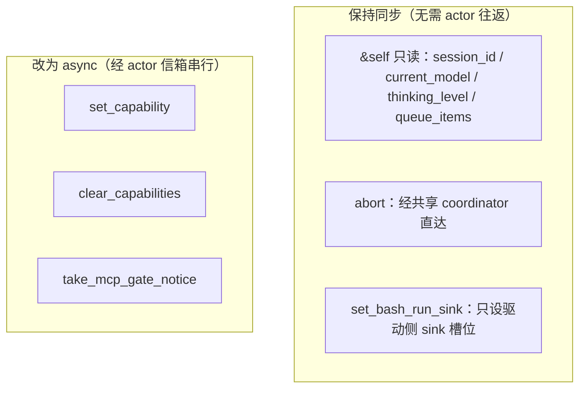

# Design：驱动同步面 async 化

> 决策记录（2026-11-21）：维护者选定「改 trait 面后重做 c3432 方案 2」。本 change 是 c3432 的前置，不做 actor 接线本身。

## 目标形态

`XyDriver` 上所有**有副作用且需要返回值**的方法统一为 `async fn`。只读方法与 `abort` 保持同步。

## 设计点

1. 判定标准：方法**有副作用**且**需要返回值**→ async。只读 → 保持 `&self` 同步。`abort` 是例外：有副作用但语义要求零等待必达（c3432 设计点 2），保持同步经共享 coordinator。
2. `set_bash_run_sink` 语义特殊：它设置的是驱动侧 sink 槽位，不触碰 runtime。actor 化后应留在驱动侧（`Mutex<Option<BashOutputSink>>` 已是共享可变），**不改为 async**。实测后确认它不需要 actor 串行。
3. `set_capability` / `clear_capabilities` 改 capability 覆盖集，需要 actor 串行（避免与 turn 内工具表变更竞争）。
4. `take_mcp_gate_notice` 取走一次性通知，需要 actor 串行（避免双取）。
5. 调用点改造：生产路径用 `.await`；测试替身同步改 async。
6. `XyRemoteDriver` 端侧本就经协议 unary 往返，async 化无新增成本。
7. 固有方法遮蔽：`XyInProcessDriver` 上不得再有与 trait 同名的同步固有方法（固有方法优先于 trait 方法解析，会让调用点静默绕过 async 面）。`set_capability` / `clear_capabilities` 的固有版本已删除，函数体并入 trait impl。

## 验收

- runtime 侧 `XyDriver` 上不再存在「`&mut self` + 非 async + 有副作用」的方法（`set_bash_run_sink` 除外，见设计点 2）。
- app-tui 副本 `XyDriver` 仍有 3 个此类方法：`drain_idle_events`、`take_resync_rebuild`、`bind_debug_scene`。它们是端侧客户端缓存方法，不持有 actor 的 runtime，不阻塞 c3432；其 async 化留给后续 change。
- 全部 driver 实现（in-process / occupancy / remote / 测试替身）编译通过。
- 全量 BDD + occupancy 测试组绿。
- c3432 分支可在此 change 归档后继续 actor 接线且不再撞所有权墙。
