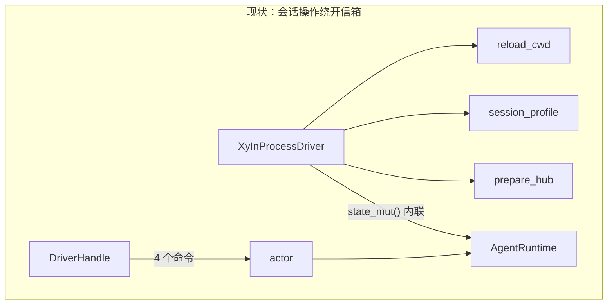
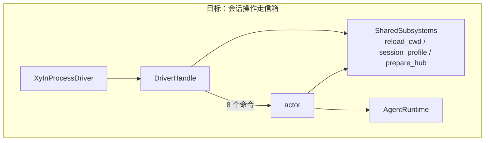

# Design：会话操作命令化与驱动 trait 一致性门禁

> 决策记录（2026-11-22）：维护者选「两个一起做」，先 trait parity 门禁后会话命令化，作为同一 change 的两个 task。

## 目标形态

## 设计点

1. **字段搬移**：`reload_cwd`、`session_profile`、`prepare_hub` 搬进 `SharedSubsystems`。三者均为 `Clone` 数据或 `Arc`，可共享；`session_profile` 与 `reload_cwd` 用 `Arc<Mutex<..>>` 包一层以支持写入，`prepare_hub` 已是 `Arc<dyn SessionPrepareHub>`。
2. **命令形状**：`SwitchSession { session_id, reply }`、`NewSession { reply }`、`ForkSession { entry_id, position, reply }`、`SetSessionName { name, reply }`、`SetSessionNameFor { session_id, name, reply }`。
3. **script hook 重入审计**：`switch_session` 内的 `session_before_switch`（cancel）与 `session_shutdown_resume`（observe）要在 actor 任务内执行。审计要点：hook 实现是否回调 driver、是否持有 runtime 引用、是否 await 外部资源。若发现重入，hook 改在命令分派前后由 driver 侧发起，命令体只做 runtime 状态变更。
4. **profile 通知时序**：`profile_mismatch_notice` 目前由 driver 侧 `take_profile_mismatch_notice()` 取走。命令化后 actor 写 notice，driver 侧仍从共享槽读取，时序不变。
5. **prepare hub 释放时机**：`hub.release_session(&previous)` 必须在 bind_session 成功后执行，顺序与现状一致。
6. **parity 门禁**：`scripts/check_driver_trait_parity.py --check` 解析两份 trait，比对共享方法的 `(name, is_async, receiver, params, ret)`；两侧独有方法走白名单（runtime 独有 `run_turn`；app-tui 独有 12 个端侧方法）。不一致 exit 1。
7. **门禁接线**：按根 `AGENTS.md`「非变更门禁脚本必须经 wiring 进 qa」，脚本须出现在 justfile 且被 `qa-check-scripts` 的 glob 覆盖。

## 验收

- 会话四操作经 `DriverCommand` 分派，`session.rs` 的 `state_mut()` 从 9 处降到 0-1 处。
- 全量 workspace 测试（4798+）与 1240 BDD 场景全绿。
- `scripts/check_driver_trait_parity.py --check` 落地且经 `just qa` 实跑为绿。
- 人为制造一处共享方法 async 性失配时，脚本 exit 1（负向验证）。
- `just qa` 与 `just qa-e2e` 实跑绿。
