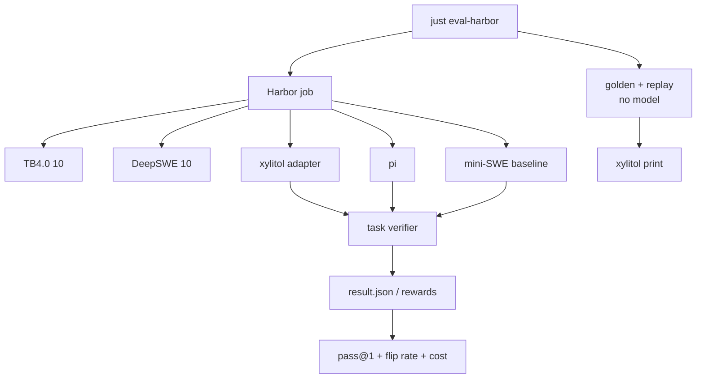

# Design：Harbor-first Agent Eval

## 目标与边界

`tools/eval/` 是开发者工具链，不是产品功能。主路径是 **Harbor**：同一模型、同一数据集、
同一 verifier，分别跑 `xylitol` 与 `pi`，用 pass@1 与 flip rate 做 cross-scaffold 对比。
能力闸用 Terminal-Bench 4.0 与 DeepSWE。

不做什么：不自研 judge；不用 TUI/PTY 驱动；不在 Rust runtime 引入 Docker；不把
Langfuse 当主分数；不把不同 scaffold/verifier 的分数混成“更强”；不在确认前 push/PR。

## 决策

- **固定模型**：`group/glm-5.3-flash`（catalog id，1M context，128000 max output，
  low/high/max reasoning；pricing 未返回）。同一轮对比中 xylitol 与 Pi 使用同一 model id、
  endpoint、effort、temperature、top_p、context、max turns/steps。
- **基准矩阵 B**：Terminal-Bench 4.0 10 + DeepSWE 10 都进主表；
  两者在 Linux amd64 原生与 macOS arm64 的 Docker amd64 模拟下运行。
- **Harbor-first**：所有基准统一走 Harbor task/verifier；DeepSWE 先做 Harbor spike，
  不能稳定跑则仅用 Pier 跑官方 baseline，不宣称 Pi 对比。
- **N≥3**：每个 task 跑 3 次；报告 pass@1、flip rate、cost、wall time、turns。
- **Phase 1 只做 xylitol**：先把 xylitol Harbor adapter 与一个 Terminal-Bench task 跑通；
  Pi/mini-SWE 对照放到 Phase 3。
- **Model/config lock**：`tools/eval/model-lock.yaml` 固定 model id、API format、
  context/output、thinking levels、`smoke` / `compare` 的 max_turns/wall_seconds；
  `doctor --lock` 校验。
- **快速回归**：golden fixture + mock/replay provider + session snapshot；无模型调用。

## 架构



```text
tools/eval/
  harbor/xylitol_agent.py       # Harbor BaseInstalledAgent
  src/xylitol_eval/             # 既有 config / dataset / print runner / report
  fixtures/golden/              # 小 golden task + expected patch/test
  fixtures/replay/              # 录制 session JSONL + mock server 脚本
  scripts/build_linux_musl.sh   # static musl
```

## Harbor 适配器

`XylitolAgent(BaseInstalledAgent)`：

- `install`：把 Linux binary 上传到 `/usr/local/bin/xylitol`，chmod 755。
- `configure`：生成临时 `config.yaml`；`group/glm-5.3-flash`，`openai-responses`，
  thinking `[low, high]`，context 1M，max output 128000，`session.max_turns`。
- `run`：`xylitol print --no-trust --config ... --model ... "<instruction>"`；
  `HOME` / `XYLITOL_CONFIG_DIR` 隔离；key 写入容器内 0600 `secret.env`，
  `config.yaml` 只引用 `{{ secret.MAGPIE_GATEWAY_KEY }}`，避免 Harbor
  `exec -e KEY=value` 把 key 放进 argv；`timeout` 包裹。
- `populate_context_post_run`：后续解析 session JSONL 的 usage；Phase 1 可先留空。
- 不采 patch/preds：Harbor verifier 在任务环境内直接跑测试，reward 由
  `/logs/verifier/reward.txt|json` 决定。
- binary：TB4.0 / DeepSWE 用 static musl（已验证 `statically linked`）。

调用形态：

```bash
PYTHONPATH=tools/eval/harbor harbor run \
  -p /tmp/tb4/terminal-bench/layout-config-recreation \
  -a xylitol_agent:XylitolAgent \
  -m openai/group/glm-5.3-flash \
  --ak binary=target/eval-bin/xylitol-linux-x86_64-musl \
  --ak max_turns=8 --ak wall_seconds=600 \
  --base-url "$MAGPIE_GATEWAY_URL/v1" \
  --api-key-name MAGPIE_GATEWAY_KEY \
  --api-format openai_responses \
  --env-file .env
```

Docker Hub 不可达时本地用 `DOCKER_BUILDKIT=0 COMPOSE_DOCKER_CLI_BUILD=0`；
Harbor compose 仍可能尝试 registry metadata，需记录为已知环境问题。

## 基准与对比矩阵

| 基准 | 规模 | 作用 | 备注 |
|---|---|---|---|
| Terminal-Bench 4.0 | 10 | 能力闸 | 66 task；8h 超时；排除 GPU/多容器 |
| DeepSWE v1.1 | 10 | 长程能力闸 | 113 task；Harbor schema 1.3 + separate verifier 已验证单 task；no-network 需 egress sidecar |

Pi 调用：`-a pi -m openai/group/glm-5.3-flash --effort high`，
`--base-url "$MAGPIE_GATEWAY_URL/v1"`，`--api-key-name MAGPIE_GATEWAY_KEY`，
`--api-format openai_responses`，`--ak model_api=openai-responses`。
mini-SWE baseline 固定版本（如 `--ak version=2.1.0`），同数据同 verifier。

DeepSWE 使用 Pier 时，官方榜用 mini-SWE on Modal；Pier 当前 agents 不含 Pi，
因此不得把 Pier 的 xylitol/mini-SWE 结果与 Harbor 的 Pi 结果混成同一张 cross-scaffold 表。
Phase 2 已验证 Harbor 能跑 DeepSWE v1.1 单 task；no-network task 需要 egress
sidecar（`gogost/gost`），Docker Hub metadata 不可达时先本地构建并打 tag。

## 指标

- `pass@1`：task 级 reward 均值；N=3 时先按 task 聚合再取均值；报告 SEM 或 paired bootstrap。
- `flip_rate`：同一 task 在 N 次运行中出现一次 pass、一次 fail 的比例。
- `cross_scaffold_flip`：xylitol 与 Pi 在同一 task 上结果不一致的比例；与 `flip_rate` 分开报。
- `cost_usd` / `wall_seconds` / `turns`：按 trial 记录；cost 以实际 usage 为准。
- 每个 scaffold、每个 benchmark 单独一行；不合并成单一“更强”分数。

## 快速回归

- 3–5 个 golden fixture：小仓库 + 明确测试命令 + expected patch/test。
- mock/replay provider：本地 OpenAI-compatible server 按录制 session JSONL 回放 assistant
  消息；工具真实执行；无模型调用。
- session snapshot：归一化 timestamp/session id 后对比关键事件与最终 patch。
- 进 PR 非阻塞门禁；失败实例可提升为 golden。

## 阶段

| 阶段 | 交付 | 验收 |
|---|---|---|
| Phase 0 | 既有 `tools/eval` 骨架 | 单测/dry-run/本地 binary |
| Phase 1 | Harbor adapter + xylitol 单 task | agent 跑通；verifier 产出 reward |
| Phase 2 | TB4.0 单 task + DeepSWE spike + musl | 两个基准各 1 task 跑通 |
| Phase 3 | Pi + mini-SWE + 10/10 N=3 | pass@1 + flip rate 表 |
| Phase 4 | golden + replay + snapshot | PR 门禁可跑 |
| Phase 5 | CI / Langfuse 旁路 / 云 | 回归与全量可复现 |

## 报告

`run.json` 记录：xylitol git commit、binary SHA-256、Harbor 版本、dataset revision、
model id、effort、context、max turns、task ids、每 trial reward、pass@1、flip rate、
cost、wall time。报告必须写明 scaffold 与 verifier，不写“xylitol 比模型强”。

## 不做什么

- 不混不同 scaffold/verifier 的分数。
- 不用多 LLM judge 做硬判。
- 不在 Phase 1 跑全量 / 云并行。
- 不在确认前 push/PR。

## 风险

- magpie catalog 只有 7 个模型；最新为 GLM-5.3 家族，无 Opus/GPT/K3；需要时先扩网关。
- `group/glm-5.3-flash` pricing 未返回；成本以 usage 为准。
- Docker Hub 不稳定；Harbor compose 可能卡在 registry metadata。
- TB4.0 含 GPU/多容器任务；本地先排除。
- DeepSWE Harbor 兼容性已验证单 task；10 task 子集仍需验证。
- SWE-bench Verified 已移除：上游镜像只有 linux/amd64，Harbor Compose build 在
  arm64 主机上按宿主平台拉取会失败；TB4.0 / DeepSWE 镜像同为 amd64，在
  macOS arm64 走 Docker amd64 模拟。
