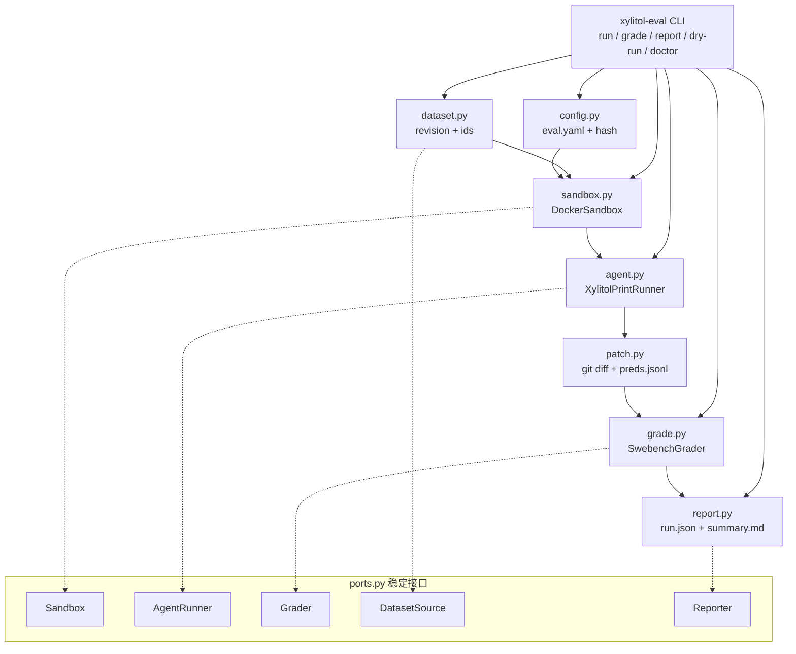
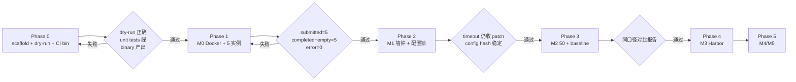

# Design：最小 Agent Eval 底座

## 目标与边界

`tools/eval/` 是开发者工具链，不是产品功能。它只做四件事：选实例、起容器、跑 headless
`xylitol print`、交给官方 grader。分数只认官方 grader；Langfuse 只旁路。

不做什么：不自研 judge；不用 TUI/PTY 驱动；不在 Rust runtime 引入 Docker；不做多用户平台；
不把 eval 放进 `just qa` 默认门禁。

## 架构



## 目录与模块

```text
tools/eval/
  pyproject.toml
  uv.lock
  README.md                 # 工具契约 + 使用说明
  src/xylitol_eval/
    cli.py                  # argparse：run / grade / report / dry-run / doctor
    config.py               # EvalConfig + 校验 + sha256
    ports.py                # Sandbox / AgentRunner / Grader / DatasetSource / Reporter
    dataset.py              # dataset 选择、revision、ids、limit
    sandbox.py              # DockerSandbox：pull/run/exec/cp/rm
    agent.py                # XylitolPrintRunner：注入 binary/config，timeout，收日志
    patch.py                # git add -A && git diff --cached；空 patch
    preds.py                # preds.jsonl 序列化
    grade.py                # swebench 5.0.2 run_evaluation + 报告解析
    report.py               # run.json / summary.md / schema_version
    paths.py                # run 目录、缓存、锁
    errors.py               # 分类错误与退出码
  tests/
    test_config.py
    test_dataset.py
    test_patch.py
    test_preds.py
    test_grade.py
    test_report.py
    test_cli_dryrun.py
    integration/test_docker_smoke.py   # 标记 integration，默认跳过
  examples/
    eval-swebench-mini.yaml
    eval-swebench-50.yaml
    eval-terminal-bench.yaml
```

## 稳定接口（ports.py）

```python
class DatasetSource(Protocol):
    def load(self, cfg) -> list[Instance]: ...
class Sandbox(Protocol):
    def ensure_image(self, image: str) -> None: ...
    def start(self, image: str, limits) -> Container: ...
    def exec(self, container, argv: list[str], timeout: float) -> ExecResult: ...
    def copy_in(self, container, src: Path, dst: str) -> None: ...
    def remove(self, container) -> None: ...
class AgentRunner(Protocol):
    def run(self, instance, sandbox, cfg) -> AgentRunResult: ...
class Grader(Protocol):
    def grade(self, preds_path: Path, run_id: str, instances) -> GradeResult: ...
class Reporter(Protocol):
    def write(self, run_dir: Path, report: RunReport) -> None: ...
```

M0 只实现 `DockerSandbox`、`XylitolPrintRunner`、`SwebenchGrader`、`SwebenchDataset`、
`JsonReporter`。M3/M4/M5 的适配器按同一接口实现，不在现在创建空模块。

## CLI

```text
xylitol-eval dry-run --config eval-swebench-mini.yaml
xylitol-eval run --config ... --phase m0
xylitol-eval grade --run-dir target/eval-runs/<run_id>
xylitol-eval report --run-dir ...
xylitol-eval doctor --config ...
```

`dry-run` 只打印：实例 ids、镜像名、命令行、config hash、dataset revision。不起容器、不调模型。
`--phase` 选择默认配置与适配器；未实现阶段返回明确错误，不静默降级。

## 配置

```yaml
version: 1
phase: m0
dataset:
  name: SWE-bench/SWE-bench_Verified
  revision: 78f471bf655a3137b2e8a75af1501690ec009ec3
  split: test
  instance_ids: [astropy__astropy-12907, django__django-13128, pydata__xarray-3151, sphinx-doc__sphinx-8120, sympy__sympy-15599]
  limit: 5
model:
  alias: "zhipu/glm-5.3"
  thinking_level: high
agent:
  binary: target/eval-bin/xylitol-linux-x86_64
  max_turns: 80
  wall_seconds: 1800
  trust: false
sandbox:
  backend: docker
  image: dataset
  network: model_only
  cpus: 2
  memory: 4g
grader:
  backend: swebench
  version: "5.0.2"
  run_id: <unique>
  max_workers: 2
report:
  formats: [json, markdown]
```

密钥只用占位符；真实 key 在本地 env / CI secrets。仓库不得出现真实 key。

xylitol 侧临时模型条目由 driver 从网关 catalog 生成，alias 直接用 catalog id，不手写别名：

```yaml
models:
  default_model: "zhipu/glm-5.3"
  models:
    "zhipu/glm-5.3":
      provider: openai
      model: "zhipu/glm-5.3"
      base_url: "{{ env.MAGPIE_GATEWAY_URL }}/v1"
      api: openai-responses
      api_key: "{{ env.MAGPIE_GATEWAY_KEY }}"
      thinking: true
      thinking_levels: [off, low, high]
      thinking_level_map:
        off: null
        low: low
        high: high
      context_window: 1000000
      max_output_tokens: 131072
```

默认 thinking 档位 = 声明列表最后一项；因此 `[off, low, high]` 默认 high。

## 模型接入（magpie）

- 只用 magpie 网关模型；不使用 `DEEPSEEK_API_KEY`。
- catalog id 直接作 alias（如 `zhipu/glm-5.3`）；不手写别名。
- 当前 catalog：`zhipu/glm-5.3`、`zhipu/glm-5.3-flash`、`fusionxparks/DeepSeek-V4.1-Flash-1017`、
  本地 halogen 模型（id 见本地 catalog）、`cursor/*`。
- 首选 `zhipu/glm-5.3` high；dry-run 用 `zhipu/glm-5.3-flash`；cursor 作备选。
- API 选择：catalog `native_endpoints` 含 `/v1/responses` → `openai-responses`；否则 `openai-completions`。
- 当前本机无 xylitol magpie 插件 / `magpie-models.yaml`；driver 读 catalog 生成临时配置，不写仓库或本地配置。
- 容器内访问网关需 `MAGPIE_GATEWAY_URL` / `MAGPIE_GATEWAY_KEY`；已验证容器可访问并返回 catalog。
- 价格：GLM-5.3 约 $1.20/$4.18 per 1M；GLM-5.3-Flash 约 $0.12/$0.42；DeepSeek magpie 约 $0.15/$0.60。成本按实际 usage 记录。

## 实例 id 与镜像名

- `instance_id` 是数据集字段，如 `astropy__astropy-12907`。
- `image` 是数据集字段，如 `swebench/sweb.eval.x86_64.astropy_1776_astropy-12907:latest`。
- `--instance_ids` 用前者；容器镜像用后者；不得混用。

## 数据集 revision 与本地 parquet

- 固定 revision `78f471bf655a3137b2e8a75af1501690ec009ec3`。
- driver 下载 `test-*.parquet` 到本地缓存，传本地路径给 `--dataset_name`；harness 支持 `.parquet`。
- 记录 revision、文件名、sha256。

## Linux binary 构建

- 确认前不 push，CI 暂不可用；M0 先在本地 Docker 构建。
- 目标：`x86_64-unknown-linux-gnu`，Ubuntu 22.04 / glibc 2.35；已验证镜像为 22.04。
- 构建容器内装 rust nightly、clang、mold；`cargo build --release --locked --target ...`。
- 产物记录 sha256、target triple；CI 手动触发后复用同一命令。

## 运行生命周期

1. 解析并校验配置，计算 config sha256。
2. 加载 dataset（固定 revision + 显式 ids）。
3. 逐实例：确保镜像；起容器；注入 binary/config；执行 `xylitol print`；超时则终止；收日志。
4. 收 patch：容器内 `git add -A && git diff --cached`；空 patch 也写 prediction。
5. 写 `preds.jsonl`；调 `run_evaluation`；解析报告。
6. 写 `run.json` / `summary.md`；退出码区分配置错误、基础设施错误、判分失败。

## 产物与报告

```text
target/eval-runs/<run_id>/
  run.json
  config.yaml            # 脱敏
  preds.jsonl
  results.json           # 官方 grader 摘要
  logs/                  # 每实例 stdout/stderr
  reports/               # 每实例 report.json / test_output.txt
  summary.md
```

`run.json` 必填：schema_version、run_id、phase、xylitol commit、binary sha256、target triple、
dataset name/revision/split/instance_ids、model alias/provider/model、config sha256、limits、
每实例结果、summary。

swebench 5.0.2 报告 schema v2 字段：`submitted_instances`、`completed_instances`、
`empty_patch_instances`、`resolved_ids`、`unresolved_ids`、`error_ids`、`failure_reasons`。
验收按此解释：`completed + empty_patch = submitted`，`error=0`，`infra_failure=0`。

## 阶段门禁



## CI

仅 `workflow_dispatch`，不做 nightly：

```yaml
on:
  workflow_dispatch:
```

- `runs-on: ubuntu-22.04`。
- 安装 rust nightly、clang、mold、cmake。
- `cargo build --release --locked --target x86_64-unknown-linux-gnu`。
- `strip` + `sha256sum`；上传 artifact；可选滚动 prerelease。
- 记录 target triple 与 glibc 要求。

确认前不 push，CI 暂不可用；本地 Docker 构建先行。

选择 glibc 而不是 musl：已验证镜像为 Ubuntu 22.04 / glibc 2.35；musl 静态构建受
`aws-lc-sys` / `libgit2-sys` / `zstd-sys` 影响，未验证。若后续镜像出现 Ubuntu 20.04，
再评估 musl 或 20.04 构建。

`eval-unit` CI 只在 PR/push 跑 pytest（`-m "not integration"`），不跑 Docker，不进 `just qa`。

## 网络与代理

| 场景 | 策略 |
|---|---|
| HF 数据集 | `HF_ENDPOINT` 指向可用镜像；固定 revision |
| Docker Hub | 本地经 OrbStack 代理；CI 直连 |
| 模型网关 | 本地 env 注入；容器经可解析主机名访问 |
| crates.io | CI 直连；本地 `HTTPS_PROXY` |

不把内部主机名、key、账号写进仓库；用环境变量占位。

## 模型策略

- 工程链路：fake provider → 1 实例。
- dry-run 小集：`zhipu/glm-5.3-flash` 跑 1–2 个典型实例。
- 终验小集：`zhipu/glm-5.3` high 跑 5–10 个实例；最终模型与规模由用户确认。
- 备选：`cursor/*`（用户偏好 GLM > cursor）；`fusionxparks/DeepSeek-V4.1-Flash-1017` 仅作廉价对照。
- baseline：同一模型跑 mini-SWE-agent。
- 前沿分数只作外部参照，不写入 xylitol 报告。
- 不使用 `DEEPSEEK_API_KEY`；只用 magpie 网关。
- 仓库只写 model id 与占位符；不写真实 key、内部网关地址、账号。

## 测试

- 纯函数单测：config、dataset、patch、preds、grade 解析、report schema、dry-run。
- 集成测试：标记 `integration`，默认跳过；Docker smoke 手动跑。
- fake provider：验证容器编排与日志收集，不依赖真模型。
- 不在单测里连网络、起容器。

## 非目标

- 不做多用户评测平台 / leaderboard。
- 不用 TUI 交互或自动按键跑 benchmark。
- 不用 Langfuse judge 当主分数。
- 不在 M0 做全量并行 / 云调度。
- 不在确认前开 PR / push。

## 后续适配器契约

- M3 Harbor：实现 `AgentRunner` + `Grader`；reward 来自 task verifier。
- M4 回归：实现 `Reporter` 旁路；失败实例写 Dataset。
- M5 云：实现 `Sandbox`；复用同一 run/report schema。
接口先定，实现在对应阶段落地；不预埋空壳。

## 风险

- 模型网关 key 只在本地 env；仓库不得出现真实 key。
- glibc 兼容性需实跑确认；musl 备选未验证。
- M2 镜像磁盘占用高；需逐实例清理或扩容。
- Docker VM 资源有限；默认 1–2 worker。
- 官方榜口径与 xylitol 不同；报告必须写明 scaffold 差异。
