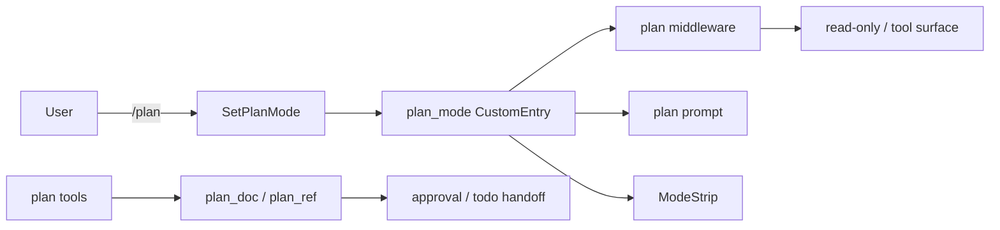
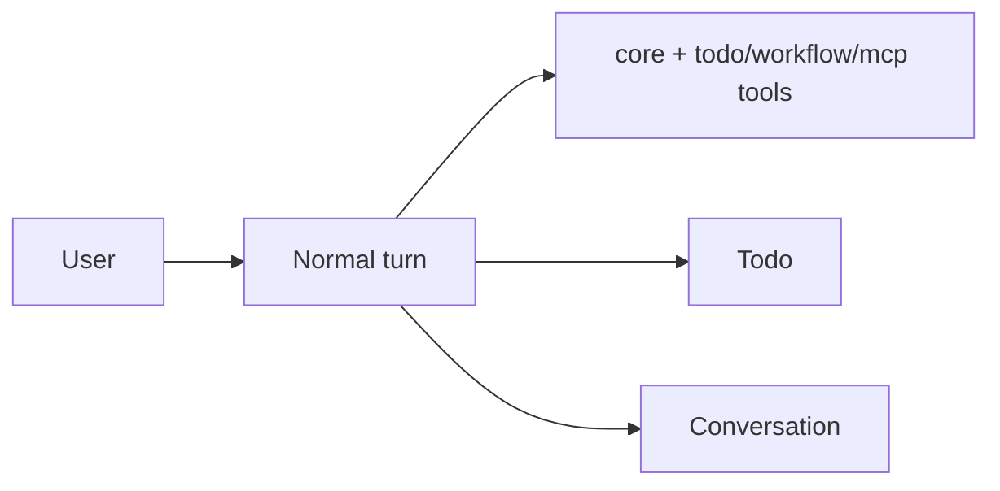

# Design — 删除 plan mode（Option B）

## 目标

- 完整删除 plan 插件与 plan mode：状态、命令、事件、工具、文档、审批/todo 交接、中间件、UI。
- 不提供替代 plan 机制；后续另设计。
- 保持其他能力不变；旧会话可启动；协议版本 bump。
- 收益：工具面/提示前缀稳定，KV cache 友好；单对话体验简化。

## 现状

Plan mode 跨 8 层：

1. SDK：`PlanMode` / `PlanModeKind` / `PlanDoc` / `PlanDocStatus` / `PlanDocStep` / `PlanRef` / `PlanScope`、`latest_plan_mode` / `latest_plan_doc` / `plan_docs`、`CUSTOM_TYPE_PLAN_MODE` / `CUSTOM_TYPE_PLAN_DOC` / `CUSTOM_TYPE_PLAN_REF`、`PlanGateway`、`BeforeLlmRequestCtx.plan_mode`、`XyEvent::PlanModeChanged` / `PlanDocUpdated`。
2. 官方插件：`xylitol-official-plugin-plan` 的 `PlanConfig` / `PlanPlugin` / `plan_mode_middleware` / `plan_tool_surface_middleware` / `plan_tools` / `SessionPlanGateway`；plan 文档、审批、todo 交接。
3. runtime：`react/mod.rs` 读 `latest_plan_mode` 并填 `BeforeLlmRequestCtx`；`driver/in_process` 持 `PlanGateway`。
4. kernel：`ToolFeatures.plan`；`builtins.rs` 注册 `PlanPlugin`；`compose_tools` 注入 plan 工具；`set_plan_gateway`；`SetPlanMode` 命令执行；`/plan` 产品命令；`DispatchOutcome::PlanMode`。
5. protocol/wire：`Command::SetPlanMode`、`Event::PlanModeChanged` / `PlanDocUpdated`、`METHOD_SET_PLAN_MODE`；`PROTOCOL_VERSION = 5`；wire 映射。
6. serve：`occupancy/host.rs` 在 switch/new session 后推送 `planModeChanged` 快照。
7. TUI/Print：`/plan` 解析与 pending；remote unary；`DispatchOutcome::PlanMode`；ModeStrip 状态/渲染/固定区 footprint；bridge handler；input policy；print 忽略事件。
8. compaction/config/specs/BDD：compaction 保留 plan_mode/plan_doc/plan_ref；`plan` 配置节；`agent-plan` spec；BDD bindings/steps；AGENTS 文档。

2026-11-06 复核：c3197 仍为 designed；上述代码仍保留 plan mode。c3206 归档未删除 `plan_mode` / `plan_doc`；本次复核补入的引用集中在 `boot.rs`、`contract.rs`、`sections.rs`、`config.schema.json` 与 `steps_runtime_config.rs`，已补入删除清单。

## 决策

- 选 B：完整删除 plan 插件（mode + 文档 + 工具 + 审批/todo 交接）。
- A/C 不采用：保留 plan 文档/审批会留下半套语义，和“淘汰独立模式”冲突。
- ModeStrip 删除（无 consumer）；固定区 footprint/layout 同步。
- 旧 session 的 `plan_mode` / `plan_doc` / `plan_ref` CustomEntry 忽略；不迁移。
- 现有 `.xylitol/plans`、`~/.xylitol/plans`、临时 plan 文件保留；无工具入口，用户可手工读取。
- 配置：删除 `plan` 节；旧顶层 `plan` 与 `loop_policies.plan_mode` 返回「plan mode 已移除」错误，不静默忽略；不再提示迁移到 `plan.enabled`。
- 协议：`PROTOCOL_VERSION` 5 → 6；旧客户端 `set_plan_mode` 返回未知方法，旧事件不再下发。
- `agent-llm-projection` 的 workflow `<plan>` 文本块与 plan mode 无关，保留。

## 删除清单

| 层 | 文件/符号 | 动作 |
|---|---|---|
| SDK | `crates/xylitol-plugin-sdk/src/session/plan_mode.rs`、`plan_doc.rs`、`ports/plan.rs` | 删除 |
| SDK | `session/mod.rs`、`ports/mod.rs`、`lib.rs` 的 plan 导出 | 删除导出 |
| SDK | `lifecycle.rs` 的 `PlanModeChanged` / `PlanDocUpdated` | 删除变体 |
| SDK | `loop_middleware.rs` 的 `BeforeLlmRequestCtx.plan_mode` | 删除字段 |
| 插件 | `plugins/xylitol-official-plugin-plan/` | 删除整个 crate |
| 插件 | `xylitol-official-plugin-compaction/src/lib.rs` 的 plan 保留逻辑与测试 | 删除 |
| 插件 | `xylitol-official-plugin-config/src/types.rs` 的 `PlanConfig` 再导出；`loader.rs` 的 `plan` 节 schema/default 与 `plan.enabled` 迁移提示；保留 `plan` / `loop_policies.plan_mode` 的移除错误与测试；`sections.rs` 的 `plan` 节 schema/default | 删除/改写 |
| 配置 | `configs/config.schema.json` 的 `plan` 节 | 重新生成 |
| 插件 | `loop-policies` / `workflow` / `todo` 的 `BeforeLlmRequestCtx { plan_mode: None }` | 删除字段 |
| 插件 | `xylitol-official-plugin-tools/src/tools/mod.rs` 的 `plan_write` 断言 | 删除 |
| runtime | `agent/runtime/react/mod.rs` 的 `latest_plan_mode` 读取与 ctx 填充 | 删除 |
| runtime | `agent/runtime/middleware.rs` 的 `plan_mode` 字段 | 删除 |
| runtime | `driver/in_process/mod.rs` 的 `PlanGateway` 字段/methods | 删除 |
| kernel | `builtins.rs` 的 `PlanPlugin` 注册 | 删除 |
| kernel | `driver/in_process/mod.rs` 的 `SessionPlanGateway` / `set_plan_gateway` / `compose_tools` plan 参数与工具 / `ToolFeatures.plan` | 删除 |
| kernel | `driver/in_process/tests/mod.rs` 的 plan gateway/tests | 删除 |
| kernel | `driver/command_exec.rs` 的 `SetPlanMode` / `exec_set_plan_mode` / `next_plan_mode` / `plan_mode_label` | 删除 |
| kernel | `product_commands.rs` 的 `/plan` | 删除 |
| kernel | `dispatch.rs` 的 `DispatchOutcome::PlanMode` | 删除 |
| kernel | `bootstrap_tests.rs` 的 plan mode toggle 测试 | 删除 |
| kernel | `boot.rs` 的 `plugin_rows` plan 行；`contract.rs` 的 `plan-mode` / `plan-tool-surface` 断言 | 删除/更新 |
| kernel | `Cargo.toml` 的 plan 依赖 | 删除 |
| protocol | `command.rs` 的 `SetPlanMode`；`event.rs` 的 `PlanModeChanged` / `PlanDocUpdated`；`registry.rs` 的 `set_plan_mode` 条目/测试 | 删除 |
| protocol | `message.rs` 的 `PROTOCOL_VERSION` | 5 → 6；更新测试 |
| wire | `xylitol-wire/src/event.rs` 的 plan 事件映射/helper/tests | 删除 |
| serve | `occupancy/host.rs` 的 `push_plan_mode_snapshot` / `plan_mode_event_from_branch` / `plan_mode_event_from_value` / `plan_mode_kind` / `publish_plan_mode_event` / tests | 删除 |
| TUI | `commands.rs` 的 `PendingSlash::SetPlanMode` 与 `/plan` 解析/测试；`product_commands.rs` 的 `/plan` | 删除 |
| TUI | `effects/slash/mod.rs` / `misc.rs` 的 plan 路由/handler | 删除 |
| TUI | `dispatch.rs` 的 `DispatchOutcome::PlanMode`；`driver/remote.rs` 的 `exec_set_plan_mode` / `plan_mode_outcome` | 删除 |
| TUI | `host/session_ops.rs` 的 `ModeStripState` 初始化；`host/input_policy.rs` 的 `SetPlanMode` 分支 | 删除 |
| TUI | `bridge/model.rs` 的 `ModeStripState` / `mode_strip`；`bridge/mod.rs` 导出；`bridge/handlers/tools.rs` 的 plan 事件/ModeStrip | 删除 |
| TUI | `widgets/mode_strip.rs`；`widgets/mod.rs`；`layout/fixed_zone_footprint.rs` / `layout/root/*` 的 ModeStrip footprint/render | 删除 |
| TUI | `harness.rs` 的 `Command::SetPlanMode`；`tests.rs` / `bridge/tests.rs` 的 plan/ModeStrip 测试 | 删除 |
| TUI | `crates/xylitol-app-tui/src/AGENTS.md` 的 ModeStrip 固定词 | 更新 |
| Print | `xylitol-app-print/src/print.rs` 的 plan 事件忽略 | 删除 |
| 工作区 | 根 `Cargo.toml` 的 plan member/dependency/root dep；`Cargo.lock`；`scripts/check_crate_graph.py` | 删除 |
| 文档 | 根 `AGENTS.md`、`src/AGENTS.md`、`llmanspec/AGENTS.md` 的 plan 插件/版本 | 更新 |
| Specs | `agent-plan` 删除；`protocol-app`、`app-tui-commands`、`app-tui-fixed-zone`、`app-tui-bridge`、`app-tui`、`agent-runtime`、`agent-session-store`、`server-core`、`domain-compaction`、`domain-security`、`runtime-config`、`agent-tools`、`workspace-assembly` | 更新（见下） |
| BDD | `tests/bdd/bindings_agent_plan.rs` 删除；`bindings_domain_compaction.rs`、`steps_loop_middleware.rs`、`steps_compaction.rs`、`steps_tools.rs`、`steps_runtime_config.rs` 的 plan 场景/断言 | 删除 |
| SDK | `session/workflow.rs` 的 `LEGACY_CUSTOM_TYPE_PLAN`；`session/helpers.rs` / `ports/session.rs` 的 legacy `plan` 测试 | 保留（workflow 迁移，不是 plan mode） |

## 兼容与迁移

- 旧会话：`CustomEntry` 仍是通用容器；`plan_mode` / `plan_doc` / `plan_ref` 不再被读取，忽略不报错。resume 不再初始化 ModeStrip。
- Workflow 旧 `plan` custom_type 迁移不是 plan mode：`LEGACY_CUSTOM_TYPE_PLAN` 与 workflow legacy 测试保留，不得随 plan mode 删除。
- Plan 文件：保留磁盘文件；无工具入口；文档说明可手工读取/迁移。
- 配置：`plan` 节从 schema 删除；loader 对顶层 `plan` 与 `loop_policies.plan_mode` 返回「plan mode 已移除」错误（不提示 `plan.enabled`）。`runtime-config` 同步。
- 协议：`PROTOCOL_VERSION` 5 → 6；旧客户端 `set_plan_mode` 返回未知方法；`planModeChanged` / `planDocUpdated` 不再下发；`host.describe` 返回 6。
- Compaction：不再保留 plan_mode/plan_doc/plan_ref；旧条目在 compaction 后可能被丢弃，不报错。
- 插件：plan crate 从 workspace/kernel/config 移除；`Cargo.lock` 更新；crate graph 脚本同步。

## Spec 变更

- 删除 `llmanspec/specs/agent-plan/`。
- `protocol-app`：Command 列表移除 `SetPlanMode`；删除 `set_plan_mode` unary / `planModeChanged` / `planDocUpdated`；Event 列表移除两个事件。
- `app-tui-commands`：删除 `/plan` 规则与场景。
- `app-tui-fixed-zone`：删除 ModeStrip 规则/场景，Fixed-Zone Footprint 去掉 ModeStrip。
- `app-tui-bridge`：删除 `plan-mode-bridge` 规则与场景。
- `app-tui`：删除会话切换/恢复初始化 ModeStrip 的条款。
- `agent-runtime`：删除 plan 模式中间件/契约注入条款与场景。
- `agent-session-store`：删除 plan_doc / plan_mode / plan_ref 条目规则与场景。
- `server-core`：删除 switch/new session 的 `planModeChanged` 快照条款与场景。
- `domain-compaction`：保留列表去掉 plan_mode / plan_doc / plan_ref 与相关场景。
- `domain-security`：删除 project-plan-trust 规则/场景。
- `runtime-config`：删除 `plan` 配置节。
- `agent-tools`：删除 plan 插件/工具提及、`plan-mode-before-tool-gate`、session 专属工具列表中的 plan。
- `workspace-assembly`：todo / workflow 独立插件；移除 plan。
- `agent-llm-projection`：保留（workflow `<plan>` 文本块与 plan mode 无关）。

## 测试

- 单测：`compose_tools` 无 plan 参数；`ToolFeatures` 无 plan；`builtins` 不注册 PlanPlugin；`boot.rs` plugin rows 不含 plan；`contract.rs` 默认 loop middleware 不含 `plan-mode` / `plan-tool-surface`；`sections.rs` 无 plan 节；`steps_runtime_config` 配置节列表无 plan；旧 session 的 plan CustomEntry 忽略；配置 `plan` / `loop_policies.plan_mode` 报「plan mode 已移除」错误；`PROTOCOL_VERSION` 为 6；wire 无 plan 事件；serve 无 plan 快照；TUI 无 ModeStrip；print 无 plan 事件。
- BDD：删除 `bindings_agent_plan`；删除 plan 中间件/compaction 场景；删除 `plan_write` 断言；保留 workflow/todo/compaction 其余场景。
- 门禁：`just fmt` / `just lint` / `just test` / `just qa`；BDD runner。
- 残留检查：`rg -n "PlanMode|plan_mode|ModeStrip|plan_write|plan_submit|plan_doc" crates plugins src tests llmanspec/specs`，排除 archive/delayed/research 与本 change；应为空。不得把 workflow 的 legacy `plan` custom_type 当 plan mode 删除。
- 手测：旧会话 resume 不崩；`/plan` 未知命令；配置含 `plan` 报迁移错误；协议 `host.describe` 为 6。

## 风险

- 协议/配置 breaking：版本 bump 与迁移错误需在 release note/文档说明。
- 用户依赖 `/plan`、plan 文档、ModeStrip：删除是行为回退；替代方案后续设计。
- ModeStrip 删除影响固定区 footprint/layout 与测试；需同步 `app-tui-fixed-zone`。
- 旧 plan 文件 orphaned；需文档说明。
- Compaction 不再保留 plan 条目；旧会话压缩后计划状态消失。
- Specs/BDD/AGENTS 大面积改动；需 `llman-sdd validate` 与 `just qa`。
- `Cargo.lock` / crate graph / 其他 change 引用 plan 类型（c3106 active designed，仅文档）需同步。
- `agent-llm-projection` 的 workflow `<plan>` 块不是 plan mode，不得误删。

## 实施顺序

1. protocol/wire：删命令/事件，`PROTOCOL_VERSION` 5 → 6。
2. SDK：删 plan 类型/端口/ctx 字段/事件。
3. runtime/kernel/插件装配：删 PlanGateway/PlanPlugin/plan tools/ToolFeatures.plan/命令执行。
4. TUI/serve/print/compaction/config：删 ModeStrip、快照、事件、保留逻辑、配置节。
5. Specs/BDD/AGENTS：删 agent-plan，更新条款与绑定。
6. 测试/门禁：单测、BDD、`just qa`、残留检查。

## 前后对比

