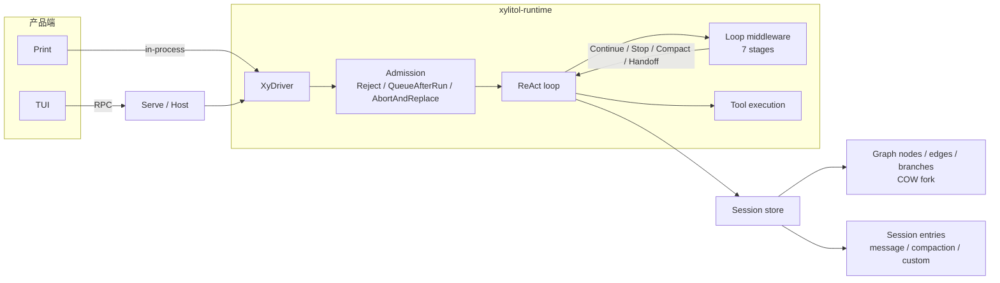
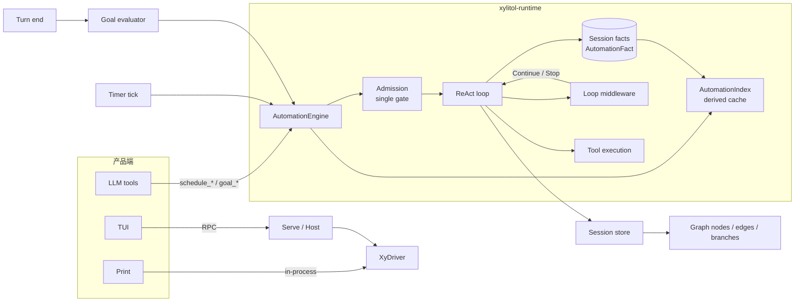
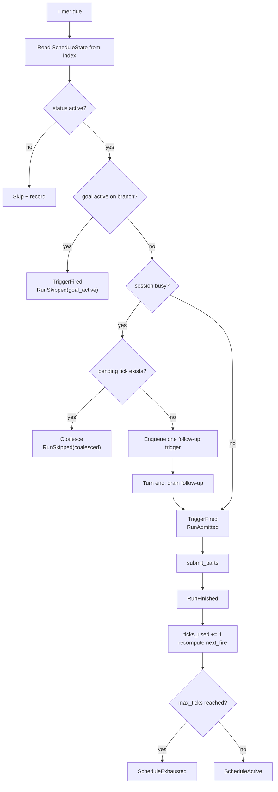
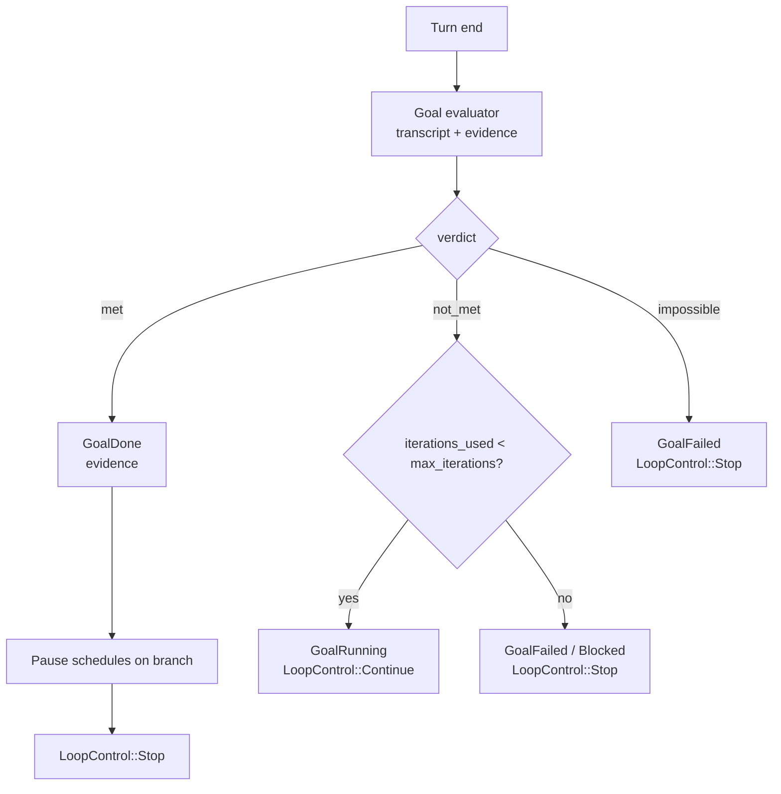
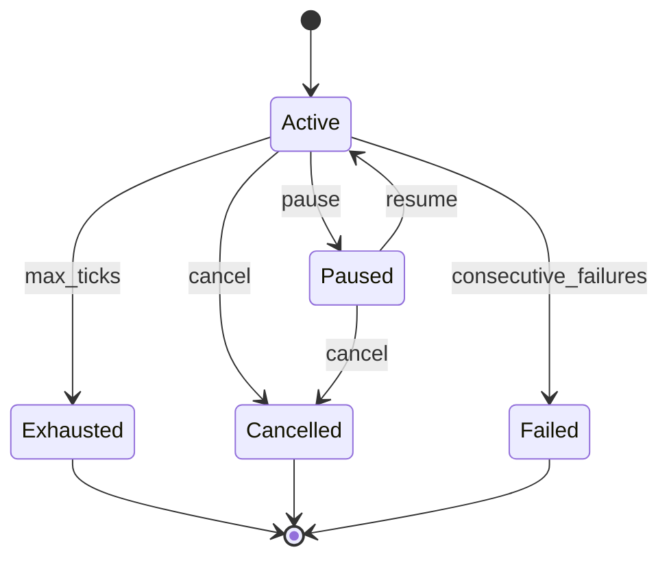
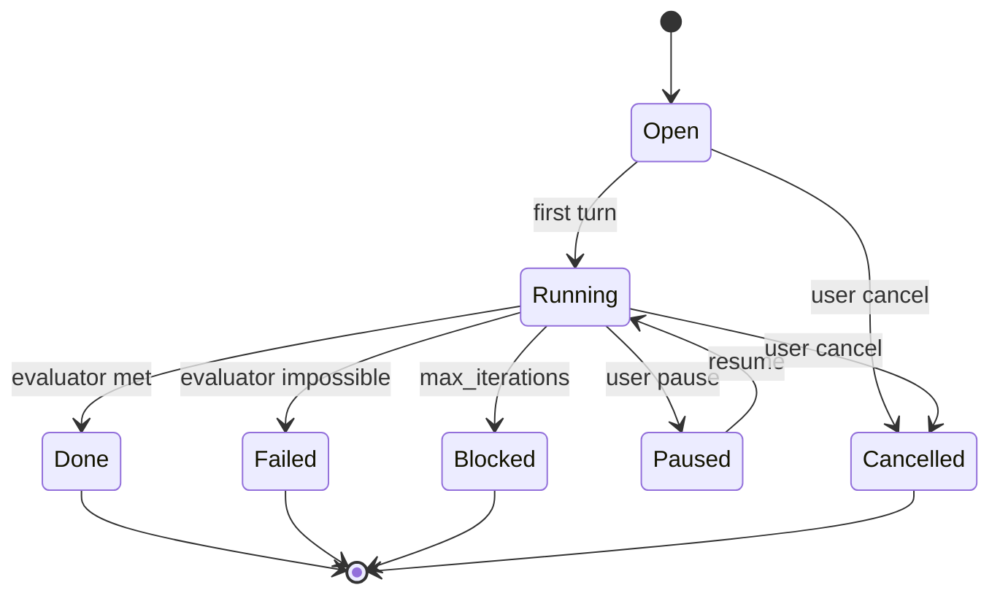
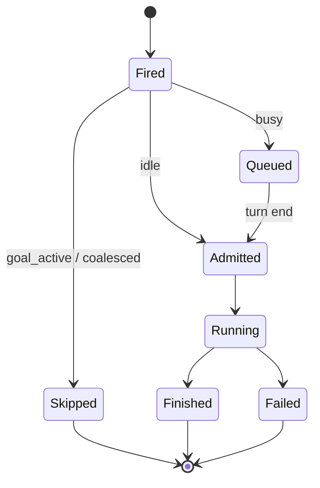

# Automation Core 架构与 harness 选型（2026-11）

> 性质：c3207 / c3208 共享设计调研，不是 live spec。
> 决策日期：2026-11-09。
> 结论：采用「会话事实 + host 派生索引 + 单一准入」的 hybrid；c3207 管 schedule/trigger，c3208 管 goal 续跑。

## 术语

- **Automation Core**：schedule、trigger、run、goal 共用的事实模型与执行入口。
- **Schedule**：按时间重复触发 run 的定义。
- **Trigger**：一次到期的触发记录；来源可以是 timer、turn end、manual。
- **Goal**：任务完成条件；每轮结束由 evaluator 判定。
- **Steer**：注入当前 run，在下一个 tool 边界生效。
- **Follow-up**：等当前 run 结束后再执行。
- **Host index**：从会话事实派生的内存索引，不是第二真源。

## 1. 现状架构（before）

缺口：

- run 只由用户提交触发；没有 timer，也没有 schedule/trigger 事实。
- `LoopControl` 只有 Continue / Stop / Compact / Handoff；没有“跳过本轮模型回调”的表达。
- 没有 goal 事实；没有每轮结束的完成判定。
- 没有 host 级自动化索引；重启后无 schedule 可恢复。

## 2. 目标架构（after）

要点：

- `AutomationEngine` 在 runtime，不在 serve；Print 与 TUI 都能用。
- 会话分支 custom facts 是唯一真源；`AutomationIndex` 只是派生缓存。
- schedule tick 与 goal 续跑都走同一个 admission；不另造执行路径。
- TUI 状态展示后置；第一版只暴露模型工具。

## 3. 事实模型

| 事实 | 关键字段 | 归属 |
|---|---|---|
| `ScheduleDefined` | schedule_id、branch、cadence、max_ticks、stop_condition | c3207 |
| `SchedulePaused` | schedule_id、reason、actor | c3207 |
| `TriggerFired` | trigger_id、source（timer / turn_end / manual）、schedule_id 或 goal_id、fired_at | c3207 |
| `RunAdmitted` | trigger_id、run_id、session_id、branch | runtime |
| `RunSkipped` | trigger_id、reason（busy / queue_full / goal_active / restart） | runtime |
| `GoalDefined` | goal_id、branch、objective、acceptance、max_iterations | c3208 |
| `GoalEvaluated` | goal_id、verdict（met / not_met / impossible）、evidence、iterations_used | c3208 |

约束：

- append-only；状态由最新事实投影，不覆盖历史。
- 按 `branch_id` 过滤；fork 不继承 schedule/goal。
- 同一 `schedule_id` / `goal_id` 的最新定义生效。
- `TriggerFired` 与 `RunAdmitted` / `RunSkipped` 通过 `trigger_id` 关联。

## 4. Schedule tick 流程

规则：

- 同一 schedule 最多一个 pending tick；重复到期合并，不堆队列。
- 当前 run 是用户 run：排 follow-up，不 steer。
- 当前 run 是同一 loop 的上一 tick：跳过并记录。
- 重启后不补跑；按当前时间重算 `next_fire`。

## 5. Goal 续跑流程

规则：

- goal 续跑在同一个 run 内通过 `DecideContinue` 完成，不新开 run。
- `max_iterations` 计 turn；`max_ticks` 计 schedule run；两个预算分开。
- goal 活跃时，同 branch 的 loop tick 跳过并记 `goal_active`。
- goal done 时自动暂停关联 schedule。

## 6. 状态图

### Schedule

触发/运行状态不塞进 Schedule 状态；由 Trigger/Run 事实单独表达。

### Goal

### Trigger / Run

## 7. 已有 harness 选型

| harness | 调度模型 | busy 语义 | goal 模型 | 优点 | 缺点 |
|---|---|---|---|---|---|
| [Claude Code](https://code.claude.com/docs/en/scheduled-tasks) | session cron + interval；每秒检查；低优先级队列 | 等当前 turn 结束；不补跑 | 独立 evaluator，每轮判定 | 简单、上下文连续 | session 级；7 天过期；不跨进程 |
| [Claude Code /goal](https://code.claude.com/docs/en/goal) | 无独立调度；goal 续跑 | 同 session | met / not_met / impossible | 独立判定，可带 turn/time 上限 | 额外模型调用；只能看 transcript |
| [Pi 0.32](https://pi.dev/changelog/releases/0.32.0) | 无 cron | steer 中断；followUp 等停止 | 无内置 goal | steer/followUp 语义清晰 | 无调度；steer 会改变当前任务 |
| [Codex](https://github.com/hqhq1025/maka-agent/blob/c29fcbb19379f848f6802de464f15db8d325990c/docs/codex-message-queue-reverse-engineering.md) | 无 cron | Queue 持久；Steer 提交到当前 turn | 无内置 goal | 队列可恢复、可编辑 | 队列状态复杂 |
| [Amp](https://ampcode.com/news/steer-dont-queue) | 无 cron | 默认 steer；queue 可选 | 无内置 goal | 反馈快 | steer 可能打断任务 |
| [OpenHands](https://docs.openhands.dev/openhands/usage/agent-canvas/managing-automations) | host automation service；cron/event | 并发上限 SKIPPED | 无内置 goal | 多 session、可审计 | 独立服务、部署复杂 |
| [agent-swarm](https://github.com/desplega-ai/agent-swarm/blob/main/docs-site/content/docs/(documentation)/guides/task-steering.mdx) | 外部编排 | queue / steer / fallback | 无内置 goal | 模式显式、可降级 | 额外抽象层 |

## 8. 架构模式对比

| 模式 | 代表 | 优点 | 缺点 | 结论 |
|---|---|---|---|---|
| session 内进程调度 | Claude Code | 简单、上下文连续 | session 结束即停；无跨进程恢复 | 参考其队列语义 |
| host 自动化服务 | OpenHands | 多 session、可审计、可并发控制 | 独立服务、部署与同步复杂 | 不作为第一版 |
| agent 驱动 loop 插件 | opencode-loop | 动态、模型可调 cadence | 模型控制节奏，难硬约束 | 不采用 |
| 会话事实 + host 派生索引 | 本方案 | 分支作用域、append-only、单准入 | 索引重建与过滤复杂度 | **采用** |

## 9. 已确认决策

- 事实存会话分支 custom facts；host index 派生，不双写。
- interval + 5-field cron；本地时区；不做条件 DSL；不做自动过期，只由 `max_ticks` 与手动停约束。
- busy 用 follow-up 队列；单 pending；coalesce；不 steer。
- goal 用独立 evaluator + agent evidence；第一版 evaluator 继承当前 session model；`max_iterations` 256。
- goal 活跃时跳过 loop tick；goal done 自动暂停 loop。
- 重启不补跑；fork 不继承 schedule/goal。
- 无人值守权限 fail-closed。
- 第一版只暴露 LLM 工具；TUI 后置；nsh 不做。

## 10. 风险

- host index 需要增量更新；全量扫描成本要测。
- fork 过滤依赖 branch_id；COW 父段中的 schedule 不能误投影到子分支。
- goal evaluator 第一版继承当前 model，增加模型调用与延迟；后续再评估小快模型与预算。
- cron 的时区/DST 交给成熟 parser；不手写。
- 无人值守的工具权限必须 fail-closed，不能沿用 allow-all 默认。
- 队列 coalesce 可能丢 tick；必须写 `RunSkipped` 原因，便于审计。
