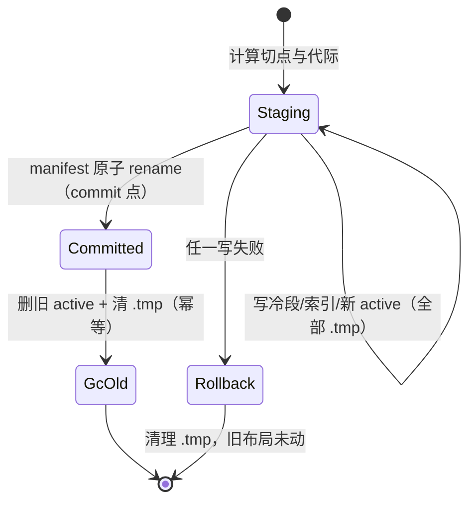

# Design — 会话存储事务完整性

## 1. 目标与边界

- 崩溃任意时刻磁盘布局可判定：要么旧布局完整，要么新布局完整，不存在中间态被当成有效。
- generation 单调持久，不再从文件名反推；manifest 不可读时报错。
- 布局判定与 leaf 解析各收敛为单一函数，全部调用方共用。
- 边界：不改 entry 序列化格式；不改 legacy（v6）拒绝语义；不引入外部数据库。

## 2. 决策摘要

| 决策 | 内容 | 状态 |
|---|---|---|
| seal 事务 | 全临时文件 + manifest 单次原子 rename 作 commit 点；旧 active 延迟 GC | 推荐，待 review |
| generation | manifest 增可选字段 `next_generation`；读侧缺字段时初始化为 max+1 并回写 | 推荐，待 review |
| 布局判定 | 单一 `layout_of(session_id) -> Layout` 枚举（Unknown/PendingOnly/V7Dir/LegacyFile/OrphanActive） | 定稿方向 |
| leaf 解析 | 单一 `resolve_leaf()`；统一回退链 hint → 内存 → manifest → anchor；内存三态改显式枚举 | 定稿方向 |
| flush 时机 | 终态 entry（tool 结果 / custom / branchSummary）随 assistant 同批落盘；批量窗口不留终态 | 待 review |
| 写锁 | 锁文件创建先于 manifest 判空；「无 manifest」分支不得返回已持锁 | 定稿方向 |

## 3. seal 目标状态机



- commit 点唯一：manifest rename。rename 前磁盘 = 旧布局；rename 后 = 新布局。
- 恢复扫描：启动或 load 时发现孤儿 .tmp 直接清理；发现双 active（历史遗留）以 manifest 为准并 GC 另一个。
- 目录 fsync：rename 前对临时文件 fsync、rename 后对目录 fsync（macOS/Linux 差异用 cfg(unix) 门控）。

## 4. generation 持久化

```text
SessionManifest {
  ...
  next_generation: Option<u64>   // 可选字段，serde default
}
读侧：next_generation.unwrap_or_else(|| 现存 max+1)，首次写 manifest 时落盘固化
写侧：allocate_generation() = 取出 next_generation 并 +1 回写，同一 manifest 写事务内完成
```

- 废弃 current_active_path 的静默回退 0：manifest 缺失 / active 段缺失一律 `XySessionStoreError`，错误信息含会话 id 与期望路径。

## 5. leaf 与布局单点

- `resolve_leaf(session_id, hint) -> Option<String>`：唯一实现四级回退；fork 分支与普通分支共用。
- 内存 leaf_ids 的值改 `LeafMem { NeverLoaded, Reset, At(String) }` 三态，显式区分 Reset 与 NeverLoaded。
- `layout_of()` 消灭 persist/load/seal/store 四处重复分支；六处调用点替换。

## 6. 兼容与迁移

- 旧 manifest 无 next_generation：读时初始化，下次写固化；无格式 breaking。
- 历史孤儿 active（可能已存在）：load 时按 manifest GC，日志记录被清理路径。
- legacy 单文件行为不变（报错），不趁本 change 做迁移（proposal Q3 未决）。

## 7. 测试边界（seam）

- 单测（manager 内）：崩溃注入矩阵——seal 每一步之后 kill，断言重启后 layout 可判定且 entry 集合 = 旧或新其一。
- 并发：两 writer 同时 flush 同一新会话，断言写锁互斥。
- BDD：agent-session-store 既有场景回归（fork / compaction / 分页）。

## 8. 风险与回滚

- 风险：rename 跨设备失效（会话目录内部 rename，不跨设备，风险低）；Windows rename-over-existing 语义差异（先删目标再 rename，配合恢复扫描幂等）。
- 回滚：全部改动在 session 插件内，revert 单 commit 即可；旧读路径对新增可选字段天然兼容。
