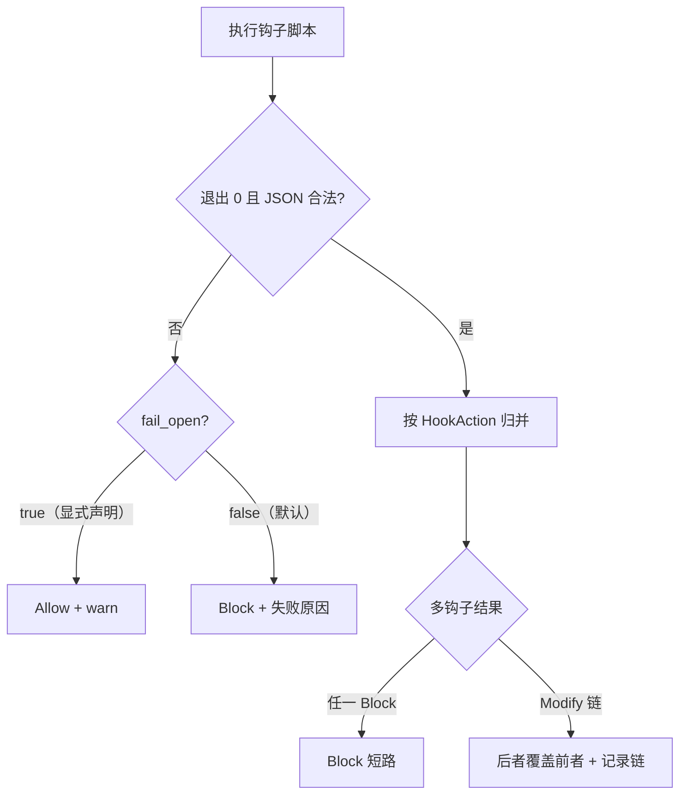

# Design — 安全门禁 fail-closed

## 1. 目标与边界

- hooks「执行失败」与「判定拦截」分离：失败不再默认等价于放行。
- trust 门禁任何解析异常按未信任处理（拒绝项目资源），不得默认选项。
- 边界：不改钩子协议（JSON stdin/stdout 不变）；不引入钩子签名。

## 2. 决策摘要

| 决策 | 内容 | 状态 |
|---|---|---|
| 档位推导 | 按分发点类别：仅观察类维持 fail-open（spec r1004/r1005 已定）；强制类（可 Block/Modify）执行失败 → Block + 失败分类 | 已决（2026-11-11） |
| 逃生口 | 逐钩子 fail_open: true 显式声明才在失败时放行 + warn；无全局开关 | 已决（2026-11-11） |
| phase 匹配 | 单一 phase_matches 实现（枚举与字符串共用）；typed/raw 双 dispatch 循环收敛公共骨架；未知值 warn | 已决（2026-11-11） |
| trust 解析 | 答案解析失败 / key 未命中 / 越界 → Cancelled（等同拒绝，直接退出不重弹）；选项绑定稳定 key | 已决（2026-11-11） |
| timeout | 代码回归 spec r1010：未设 = 不限时（移除 30s 默认）；新增可选全局 hooks.default_timeout_secs（未设 = 不限时） | 已决（2026-11-11） |
| requires_approval | 移除死字段（全仓零读取）；审批业务分析与加回触发条件录 research/requires_approval-followup.md | 已决（2026-11-11） |

## 3. hooks 失败决策流



- 失败原因进 Block.reason 与日志（target: xylitol::hooks，含 error.kind）。
- Modify 链顺带显式化：记录每钩子的动作序列，观测可查（修 C10 的隐式合并）。

## 4. trust 选择器绑定

```text
TrustOption 增稳定 key（trust / deny_session / trust_parent ...）
ChoicePrompt answer 回传 key 而非位置下标
run_trust_gate_if_needed:
  answer 解析失败 ──→ TrustGateResult::Cancelled
  key 未命中选项 ──→ TrustGateResult::Cancelled（不再 unwrap_or(0)）
  options.get(idx) None ──→ Cancelled（不再 return Ok）
```

- Cancelled 与 Denied 的用户文案沿用现有 TrustGateError Display。

## 5. 迁移

- 依赖「钩子崩了照样跑」的存量配置：release note 声明 + 配置项 `fail_open` 逃生口；默认迁移期（一个 minor 版本）内 fail-closed 拦截时附迁移提示文案。

## 6. 测试边界（seam）

- BDD（agent-hooks / test-hooks-wiring）：失败矩阵 ×（默认 / fail_open）×（单钩子 / 多钩子链）。
- trust：UI 返回垃圾答案 / 越界下标场景（harness 注入 ChoiceResult）。

## 7. 风险与回滚

- 风险：flaky 钩子从静默放行变为拦截，可能阻断工作流——靠 fail_open 逃生口与提示文案缓解。
- 回滚：档位判定集中一处函数，revert 后回到 fail-open 行为。

## 8. 定稿记录（2026-11-11 深挖对齐）

深挖核证的关键事实：spec r1004 / r1005 已明文「仅观察；fail-open」——观察类 hooks 的 fail-open 是合约不是缺陷；真正缺失败语义的是强制类分发点（r3 的 block/allow、r1006 session_before_*、r1007 user_bash）。本 change 由此收敛为「把 spec 已有的分类贯彻到失败路径」，不推翻任何已定合约。

档位推导表：

| 分发点 | 类别 | 失败（spawn_failed / nonzero_exit / bad_json / io_error） | 超时 |
|---|---|---|---|
| 生命周期 / 模型与 thinking 选择（r1004/r1005） | 仅观察 | Allow + warn（维持合约） | 结果被忽略，无影响 |
| tool_call pre / user_bash / session_before_*（r3/r1006/r1007） | 强制 | Block + 失败分类进 reason（默认）；显式 fail_open: true 时 Allow + warn | Block（现状已 fail-closed，保持） |

spec delta 清单（landing 时在分支上改 .feature）：

- r3 / r1006 / r1007：各增补一条失败语义子句「脚本执行失败时按 Block 处理，reason 含失败分类」+ 对应嵌套场景（失败拦截）。
- r1004 / r1005：不动（观察类 fail-open 合约保持）。
- r1010：不动；代码回归（移除 dispatcher.rs 的 30s 默认 unwrap_or，未设 = 不限时；测试 omitted_timeout_secs_gets_30s_default 改写为「未设 = 不限时」）。

requires_approval 处置：字段删除（schema + 两处测试夹具）。它是「声明未接线」的半截审批机制；现状真实防线是项目级 trust 门禁（项目层 hooks 随项目 config 加载，未信任项目不加载）。逐项审批已判定为需要的能力：后置为 delayed draft c3330-add-hook-approval-gate（分层信任原则 + 防篡改要求，见 llmanspec/delayed-changes/c3330-add-hook-approval-gate/proposal.md）；本期不做、只删死字段。

trust UX：解析失败 / 未命中 / 越界一律 Cancelled 直接退出（与用户按 Esc 同权），不做重弹；文案沿用 TrustGateError Display。
