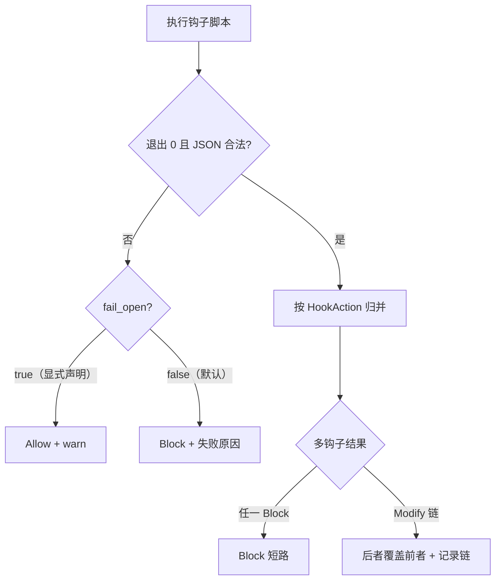

# Design — 安全门禁 fail-closed

## 1. 目标与边界

- hooks「执行失败」与「判定拦截」分离：失败不再默认等价于放行。
- trust 门禁任何解析异常按未信任处理（拒绝项目资源），不得默认选项。
- 边界：不改钩子协议（JSON stdin/stdout 不变）；不引入钩子签名。

## 2. 决策摘要

| 决策 | 内容 | 状态 |
|---|---|---|
| 默认档位 | enforcing（可 Block/Modify 的钩子）任一执行失败 → Block + 原因 | 推荐，待 review |
| advisory 声明 | 钩子配置显式 `fail_open: true` 才在失败时放行 + warn | 推荐，待 review |
| phase 匹配 | 单一 `phase_matches(entry_phase, hook_phase)`，枚举与字符串共用一份实现；未知值 warn | 定稿方向 |
| trust 解析 | UI 答案解析失败 / 下标越界 → Cancelled（等同拒绝）；选项绑定稳定 id 而非位置下标 | 推荐，待 review |

## 3. hooks 失败决策流



- 失败原因进 Block.reason 与日志（target: xylitol::hooks，含 error.kind）。
- Modify 链顺带显式化：记录每钩子的动作序列，观测可查（修 C10 的隐式合并）。

## 4. trust 选择器绑定

```text
TrustOption 增稳定 key（trust / deny_session / trust_parent ...）
ChoicePrompt answer 回传 key 而非位置下标
run_trust_gate_if_needed:
  answer 解析失败 ──→ TrustGateResult::Cancelled
  key 未命中选项 ──→ TrustGateResult::Cancelled（不再 unwrap_or(0)）
  options.get(idx) None ──→ Cancelled（不再 return Ok）
```

- Cancelled 与 Denied 的用户文案沿用现有 TrustGateError Display。

## 5. 迁移

- 依赖「钩子崩了照样跑」的存量配置：release note 声明 + 配置项 `fail_open` 逃生口；默认迁移期（一个 minor 版本）内 fail-closed 拦截时附迁移提示文案。

## 6. 测试边界（seam）

- BDD（agent-hooks / test-hooks-wiring）：失败矩阵 ×（默认 / fail_open）×（单钩子 / 多钩子链）。
- trust：UI 返回垃圾答案 / 越界下标场景（harness 注入 ChoiceResult）。

## 7. 风险与回滚

- 风险：flaky 钩子从静默放行变为拦截，可能阻断工作流——靠 fail_open 逃生口与提示文案缓解。
- 回滚：档位判定集中一处函数，revert 后回到 fail-open 行为。
