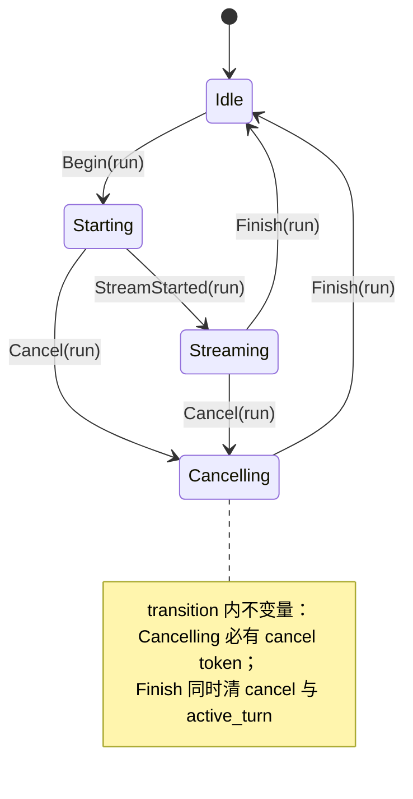

# Design — ReAct 内环运行状态一致性

## 1. 目标与边界

- RunCoordinator 转移收敛单一入口，非法组合（Cancelling 且 cancel=None）不可构造。
- AutoRetryEnd 只在本轮真实重试后发出。
- turn 终止归因保留（不再压成一个 bool）。
- 边界：不改变 XyEvent 对外形状（归因进事件流是未决项）；不动 loop 中间件协议。

## 2. 决策摘要

| 决策 | 内容 | 状态 |
|---|---|---|
| 转移入口 | `RunCoordinator::transition(RunEvent) -> Result<...`；try_begin/mark_streaming/cancel/finish 全部改走 | 定稿方向 |
| retry 复位 | RetryState 每轮（user turn）重建；attempt() 只增于真实重试 | 定稿方向 |
| 归因 | 进程内 `AbortReason` 枚举（UserCancel/MiddlewareStop/ModelError/ModalityUnsupported/HookStop）；TurnEnd hook 透出 | 推荐，待 review |
| 计数守卫 | nested 与 run_inflight 改 RAII guard（Drop 递减） | 定稿方向 |
| settles 复位 | run 边界复位（每 run 重新装计数闭包） | 推荐，待 review |
| bang cancel | 并发执行返回 busy，不覆盖在飞取消令牌 | 定稿方向 |

## 3. RuntimePhase 合法转移



- `transition` 返回错误而非静默 no-op：stale run_id 的 Finish 变为显式 `StaleRun`（保留 revoke_pending 语义）。
- cancel_token() 空闲时返回 default token 的行为保留（订阅方需要可等待对象），但 debug_assert 不在 Idle 调用。

## 4. 归因枚举（进程内先行）

```text
enum AbortReason { UserCancel, MiddlewareStop, ModelError, ModalityUnsupported, HookStop }
```

- react 循环 16 处 turn_aborted 写点改为携带 reason 的 `abort(reason)`；turn_end 聚合为单一 reason（首个非 OK 归因胜出）。
- AgentHooks::ShouldStopAfterTurnCtx 与 AfterTurn ctx 增加 reason 字段（进程内，不进 XyEvent）。
- 进事件流（wire 映射 + protocol 字段）列为 follow-up，按 review 决策拆分。

## 5. 计数与槽守卫

- `NestedGuard`：dispatch.rs 的 fetch_add/fetch_sub 包成 guard，早退路径 Drop 自动递减。
- run_inflight（serve 侧）同思路在 c3250 处理；本 change 只管 runtime 内 nested。

## 6. 测试边界（seam）

- 单测：transition 全矩阵（合法推进 + 非法转移报错）；stale finish 不清 newer run（沿用既有用例）。
- 两轮重试场景：第 1 轮触发重试、第 2 轮正常，断言无 AutoRetryEnd。
- BDD：agent-runtime 取消场景补归因断言（hook 侧可见）。

## 7. 风险与回滚

- 风险：react/mod.rs 体量大（2300 行），分片推进（先 RetryState、后 transition、最后归因）。
- 回滚：三片各自独立可 revert；RetryState 复位是行为修复，单独成立。
