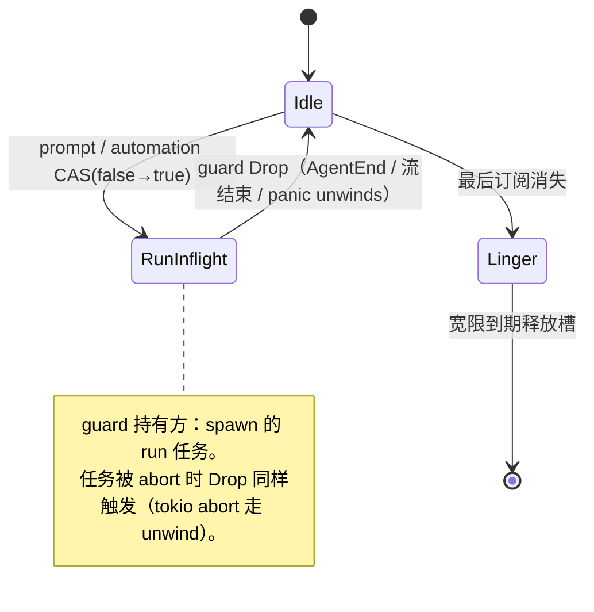

# Design — Host 会话槽生命周期

## 1. 目标与边界

- run_inflight 泄漏不可达：流丢弃 / 任务 panic 自动释放槽。
- writer 死标志移除；幂等台账容量边界不破坏幂等；外进程插件僵尸态显式迁移。
- 边界：不改 linger/eviction 产品语义（最后订阅消失 + 宽限到期释放）；不改 journal seq 不变量。

## 2. 决策摘要

| 决策 | 内容 | 状态 |
|---|---|---|
| inflight 守卫 | `RunInflightGuard` RAII（CAS 占位构造，Drop 复位）；事件流消费循环持 guard | 推荐，待 review |
| 看门狗 | 不加（RAII 已覆盖；超时阈值属新魔法数） | 推荐，待 review |
| writer 标志 | 直接删除，独占语义由 driver Option 承载 | 定稿方向 |
| 幂等淘汰 | 淘汰时对进行中 Reservation 显式终态化（Conflict）；完成路径不变 | 推荐，待 review |
| ExternalClient | EOF/破管 → `state = None` + `dead_reason`；请求显式报 unavailable | 定稿方向 |
| 自动重启 | 不做（显式报错，重启策略另立 change） | 推荐，待 review |

## 3. 槽相位



- CAS 占位与 guard 构造合一：`SlotGuard::acquire(slot)?` 失败即 busy，成功即占用。
- eviction 检查点（host.rs:1478/1504/1546）保留，读 guard 存在性而非裸 bool。

## 4. 幂等台账淘汰

```text
evict(id): entry = map.remove(id)
  if let Some(res) = entry.in_flight_reservation() {
      res.finish_conflict("evicted by capacity")   // 重放方拿到 Conflict 而非重复执行
  }
```

- Reservation 增加 conflict 终态（复用现有 watch 通道，不新增类型面）。

## 5. ExternalClient 存活态

```text
state: Mutex<Option<ClientState>> + dead_reason: Mutex<Option<String>>
EOF / broken pipe 读循环退出 → state.take() + dead_reason = Some(...)
call() 遇 None → 错误 "plugin unavailable: {dead_reason}"
```

- kill_on_drop 已有；不自动 respawn（对齐「配置驱动」原则）。

## 6. 测试边界（seam）

- 单测：guard Drop 释放（含 panic 场景 \`catch_unwind\`）；幂等淘汰时重放得 Conflict。
- BDD：infra-plugin——kill 外进程插件后工具调用报 unavailable；server-core busy 恢复（泄漏后可再次 prompt）。

## 7. 风险与回滚

- 风险：guard 生命周期若跨 await 挂到过长任务，busy 窗口变长——guard 只包事件流消费循环，不包整个 session。
- 回滚：guard、writer 删除、幂等淘汰三片独立。
