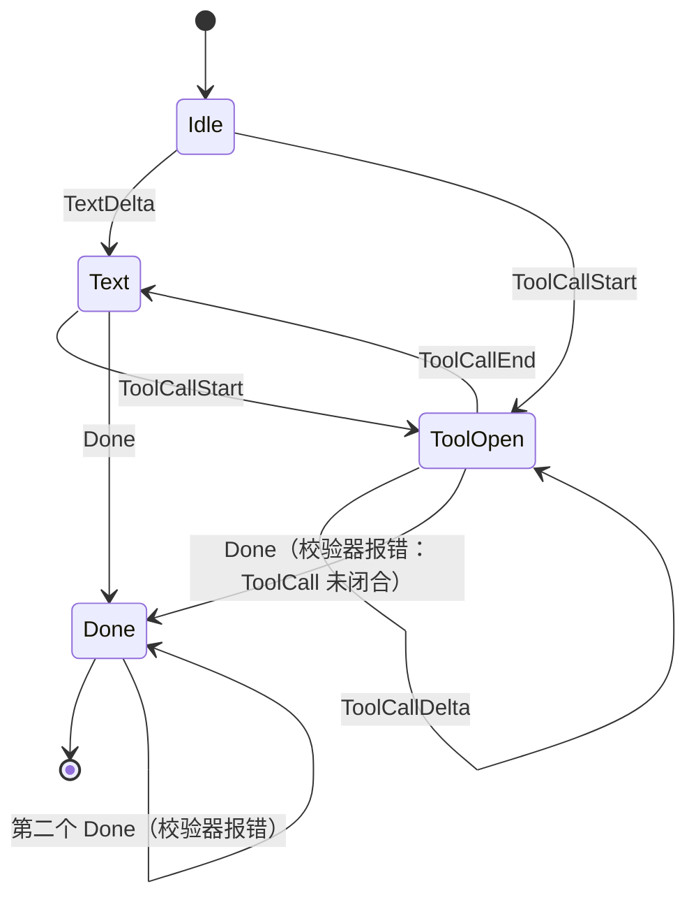

# Design — Provider 流终态语义

## 1. 目标与边界

- XyChunk 流终态约束唯一化：Done 恰一次且最后；每个 ToolCallStart 恰一个 ToolCallEnd；EOF 无终态报错；终态后不再产出。
- 三个方言适配器共享同一份约束的真值来源。
- 边界：不改 XyChunk 词表形状；不改 SSE 解析细节（各方言保留）。

## 2. 决策摘要

| 决策 | 内容 | 状态 |
|---|---|---|
| validator 落点 | sdk 纯函数 `chunk_stream_check`（状态机）+ 三适配器共享测试宏；debug_assert 消费侧 | 推荐，待 review |
| 终态内聚 | 三适配器统一 `StreamOutcome { chunks, terminal: Option<Terminal> }`，done_emitted 语义内置 | 定稿方向 |
| 中断 flush | 异常中断时为已开 ToolCall 发「空参 ToolCallEnd + 流错误」 | 推荐，待 review |
| 乱序容忍 | delta 无 start / 重复 start → 显式流错误（anthropic 不再自建/覆盖） | 定稿方向 |

## 3. 校验器状态机



- `chunk_stream_check(prev, next) -> Result<(), Violation>`：纯函数，无 IO；三适配器的 SSE→XyChunk 映射测试逐 chunk 喂入。
- runtime 消费侧（react 循环）挂 debug_assert；release 不拦（性能与容错取舍，review 可改）。

## 4. 适配器统一结构

```text
struct StreamState<Acc> {
  accumulators: Acc,          // 方言自有（responses function_calls / anthropic blocks / completions tool_args）
  terminal: Option<Terminal>, // Done | Error(err)
}
map_*_sse_event(...) -> Vec<XyChunk>   // 终态后返回空（已 Done / 已 Error）
中断路径: drop 前 drain_accumulators() -> 补发 ToolCallEnd(空参) + XyChunk 错误
```

- completions 的 Done 移出 choices 循环（流级一次性）；EOF 未终态 → 错误（对齐另两实现）。
- responses 的 finish_responses_terminal 检查 terminal 已设则不再发。
- anthropic 重复 start / 孤儿 delta → 错误 chunk。

## 5. 测试边界（seam）

- 单测：三方言 SSE fixture 回放矩阵（双 Done / 无 Done / 悬挂 ToolCall / 乱序 delta / 终态后事件）。
- BDD：provider-openai* 既有流场景回归；fake provider 补终态约束（rider：Cyclic 回绕含第 0 步）。

## 6. 风险与回滚

- 风险：中断 flush 的「空参 End」下游（ReAct 工具结果处理）需接受空参错误结果；retry 分类回归。
- 回滚：validator 纯函数独立；适配器统一结构可逐方言推进。
