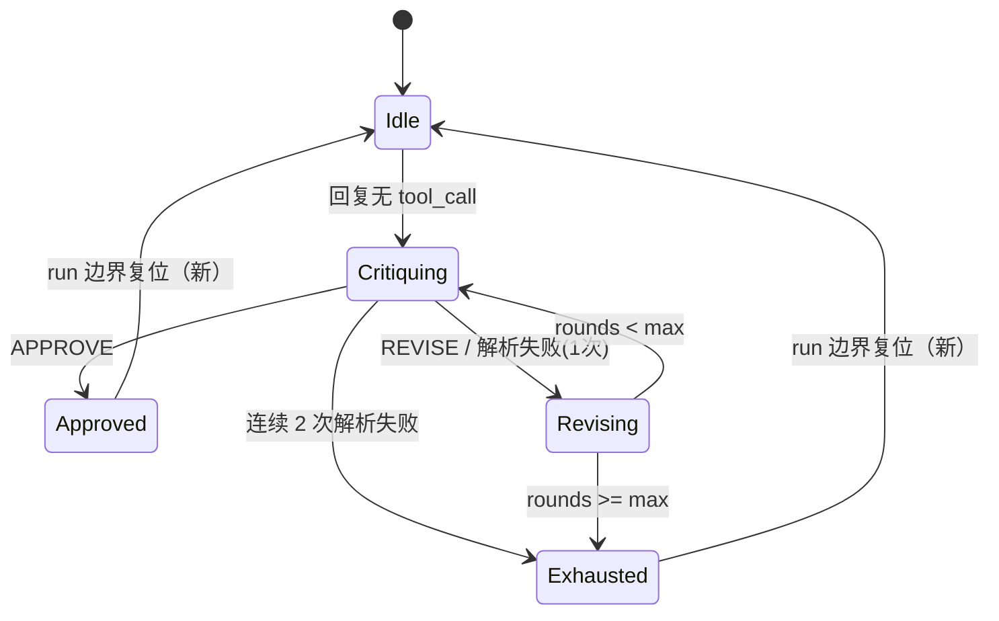

# Design — 中间件生命周期复位与自动化转移

## 1. 目标与边界

- critic 终态跨轮泄漏修复：第二轮起模型恢复执行机会。
- todo checkpoint 闸门失败可恢复；goal/schedule 写入经合法转移表。
- 边界：不改 loop 中间件协议；不改自动化事实流格式（投影层约束）。

## 2. 决策摘要

| 决策 | 内容 | 状态 |
|---|---|---|
| critic 复位 | run 边界（BeforeTurn 且无待续跑）复位 Idle/rounds/instruction_injected | 推荐，待 review |
| todo 闸门 | 先判条件再置位；restore 失败回滚 restored 并可重试 | 定稿方向 |
| goal 转移表 | 投影层 `GoalState::can_transition(next)`；工具写入前校验，非法拒绝（存量容忍投影） | 推荐，待 review |
| Exhausted | 持久化事实化：ticks 耗尽时由 tick 引擎写 ScheduleStateChanged(Exhausted)，派生与持久合一 | 定稿方向 |
| automation 入口 | tick 产 Run 与 drain_pending 合并走同一 `admit()` | 定稿方向 |
| todo reminder | 三原子量合并进 Mutex 快照；进度解析改用 SDK TodoStatus | 定稿方向 |

## 3. critic 修复后状态机



- 复位实现：中间件注册 `after_turn` 阶段复位（LoopStage::AfterTurn 已在 CRITIC_STAGES 外，补注册该 stage）。

## 4. goal/schedule 合法转移表

| from \ to | Open | Running | Done | Failed | Blocked | Paused | Cancelled |
|---|---|---|---|---|---|---|---|
| Open | — | ✓ | ✗ | ✗ | ✗ | ✓ | ✓ |
| Running | ✗ | — | ✓ | ✓ | ✓ | ✓ | ✓ |
| Done/Failed | ✗ | ✗ | — | ✗ | ✗ | ✗ | ✗（终态锁定） |
| Blocked | ✗ | ✓(解除) | ✓(判定) | ✓ | — | ✓ | ✓ |
| Paused | ✗ | ✓ | ✗ | ✗ | ✗ | — | ✓ |
| Cancelled | ✗ | ✗ | ✗ | ✗ | ✗ | ✗ | —（终态锁定） |

- 校验位置：`set_goal_state` / goal_pause / goal_resume / goal_clear 工具入口 + runtime decide_active_goal 内部转移。
- 存量投影：历史事实流按同表投影，非法序列投影保留最后合法态 + warn（不改写历史事实）。

## 5. todo 闸门修复

```text
before_llm_request:
  if !restored && ctx.session_id.is_some() {
      restored = true;                    // 先判后置
      restore(session_id).await?;          // 失败：restored 回滚 false，下轮重试
  }
  if !injected { injected = true; inject_summary(...) }
```

## 6. 测试边界（seam）

- 单测：转移表全矩阵；critic 两轮对话（第二轮不被 stop）；todo 无 session 首调用后恢复能力。
- BDD：agent-goal / agent-automation 既有场景回归 + 非法转移拒绝。

## 7. 风险与回滚

- 风险：终态锁定与存量事实冲突（历史已有 Done→Paused 序列）——投影容忍策略兜底。
- 回滚：critic 复位 / 闸门 / 转移表三片独立。
