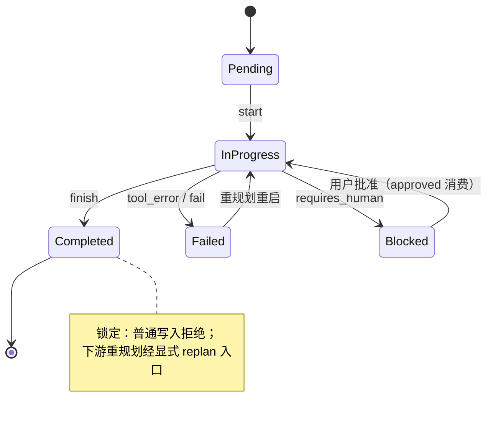

# Design — Workflow 步骤状态转移

## 1. 目标与边界

- 步骤状态写入经单一转移表；Completed 锁定（对齐 src/AGENTS.md「已完成步骤锁定，只有失败步骤及其下游可改写」）。
- 容器九字段收敛为显式阶段枚举 + 附属数据。
- 边界：不改 workflow CustomEntry 持久形状（blocked 显式化若需持久字段，另拆 change）。

## 2. 决策摘要

| 决策 | 内容 | 状态 |
|---|---|---|
| 步骤转移表 | SDK `step_transition(from, event) -> Result<StepStatus>`；Pending→InProgress→{Completed,Failed,Blocked}；Completed 仅容许下游重规划场景经显式入口 | 推荐，待 review |
| 写入收敛 | middleware 与 workflow_fail 全部经转移表；非法转移显式错误（LLM 可见） | 定稿方向 |
| 容器阶段 | `WorkflowPhase { Contract, Executing, AwaitingApproval, Replanning, SubWorkflow, Summarizing, Done }`；九字段降为阶段附属数据 | 定稿方向 |
| 重置合一 | reload 与 after_tool 的失败标记共用 `mark_failed(step)`；approved 随步骤重跑清位 | 定稿方向 |
| 存量非法 | 投影容忍（按表投影保留最后合法态）；新写入拦截 | 推荐，待 review |

## 3. 步骤转移表



- `step_to_fail`（middleware）与 `workflow_fail`（tools）改经 `step_transition`，删除各自的直写分支。
- Blocked 仍由 requires_human + approved 隐式表达的部分：approved 消费后移位（一次批准只解锁一个步骤）。

## 4. 容器阶段机

```text
WorkflowPhase::Contract        plan=None，等待 <plan> 注入
WorkflowPhase::Executing       有 plan，驱动步骤
WorkflowPhase::AwaitingApproval 存在 Blocked 步骤
WorkflowPhase::Replanning      失败重规划中（replan_count < max）
WorkflowPhase::SubWorkflow     stack 非空
WorkflowPhase::Summarizing     全步完成，注入总结
WorkflowPhase::Done            总结完成
```

- summary_injected/summary_done 两 bool 由 Summarizing→Done 单向承载。
- pending_workflow_error 归入 Replanning 阶段数据。

## 5. 测试边界（seam）

- 单测：步骤转移全矩阵；容器阶段转移；重规划耗尽弹栈。
- BDD：agent-workflow 既有 4 场景回归 + 非法写入拒绝（Completed 步骤改写报错给 LLM）。

## 6. 风险与回滚

- 风险：阶段枚举重构触碰 middleware 主体（265-472 行区间），先冻结行为快照测试再迁移。
- 回滚：步骤表（SDK）与容器阶段（插件）两片独立。
