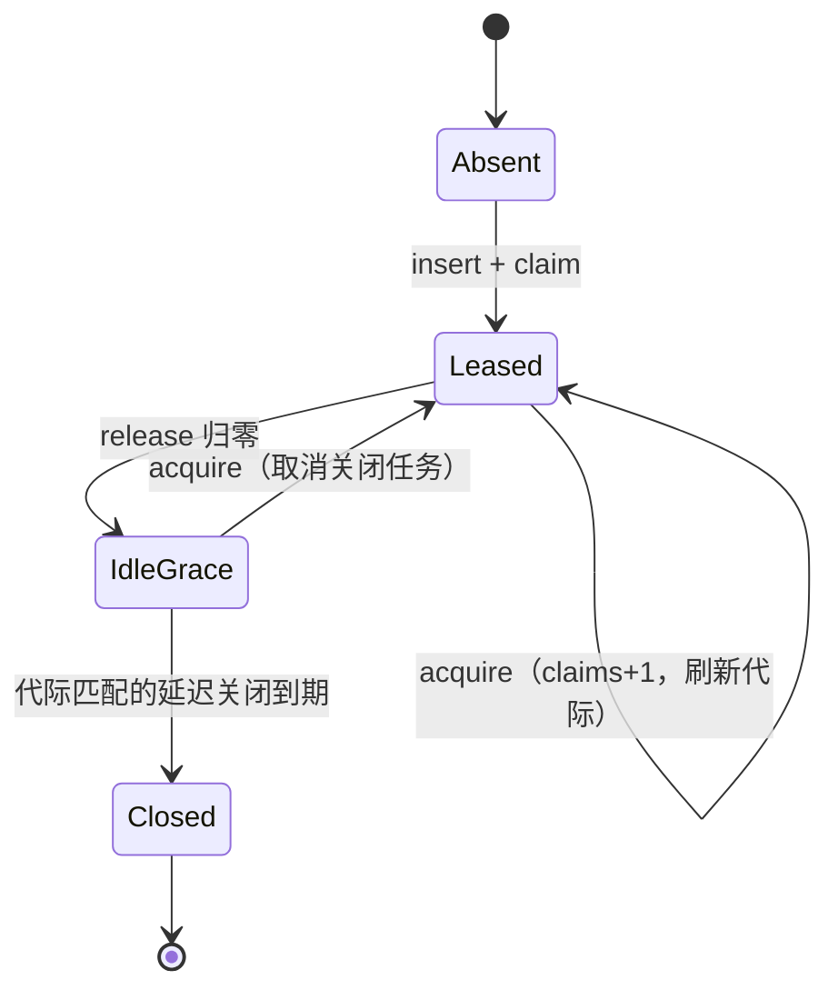

# Design — MCP 租约池与 OAuth 终态

## 1. 目标与边界

- 租约相位显式建模，空闲关闭任务可取消；OAuth 终态必达；prepare 门禁随会话复位。
- 边界：租约模型沿用 c3228 的 ResourcePool（不推翻）；不改 MCP 配置格式。

## 2. 决策摘要

| 决策 | 内容 | 状态 |
|---|---|---|
| 租约相位 | PoolEntry 增 phase: Leased / IdleGrace / Closed；acquire/release/expire 显式转移 | 定稿方向 |
| 关闭任务 | schedule_idle_close 返回 JoinHandle 存 entry，新事件 abort 旧任务 | 定稿方向 |
| 重连计数 | 空闲过期不再计入 reconnects（移到独立 idle_closes 观测） | 定稿方向 |
| 快照缓存 | update_snapshot 单点更新全部派生；try_lock 失败视图标 degraded | 定稿方向 |
| OAuth 真值 | status 表为唯一真值；flow 只承载 channel；回调失败/超时/无 gateway 均落终态 | 推荐，待 review |
| 过期 | expires_at_ms 生效：查询时过期转 Failed(expired) | 定稿方向 |
| 进度代际 | McpConnectProgress 增 generation，并发 connect 旧代际丢弃 | 定稿方向 |
| prepare 复位 | switch_session 重置 prepare_acked 与 gate notice | 定稿方向 |

## 3. 租约相位

- expire_idle 保留代际比对；Close 动作收敛进 phase 转移；phase 为权威，claims 降为观测。

## 4. OAuth 终态收敛

状态真值 oauth_status 单表：回调成功 Completed；回调失败或监听器死 Failed；cancel 删 flow 写 Cancelled；查询时 expires_at 已过转 Failed(expired)；无 gateway 在 bind 阶段即 Failed(no_gateway)，不留 Pending。

## 5. 测试边界（seam）

- 单测：租约并发 acquire/release/过期；关闭任务被新 acquire 取消；OAuth 失败矩阵终态断言。
- BDD：infra-mcp 切会话后首轮门禁再次生效。

## 6. 风险与回滚

- 回滚：租约 / 快照 / OAuth 三片独立。
