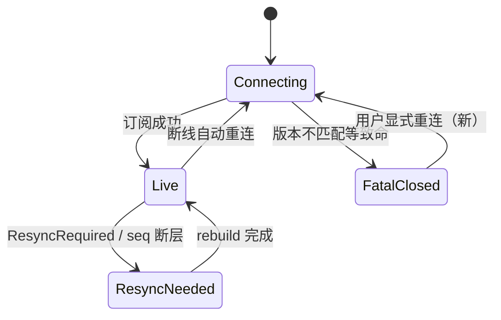

# Design — TUI 远程驱动链路状态

## 1. 目标与边界

- 断链 / 重同步 / 致命三态显式化；fatal 可观测且可恢复。
- 边界：不改 wire 协议与重连节奏。

## 2. 决策摘要

| 决策 | 内容 | 状态 |
|---|---|---|
| 链路相位 | LinkPhase { Connecting, Live, ResyncNeeded, FatalClosed } 单一字段承载 | 定稿方向 |
| link_health | 由相位派生（Live/Connecting=Up，其余 Down + 原因） | 定稿方向 |
| fatal 恢复 | 不自动重连；通知条给显式重连动作（用户触发回 Connecting） | 推荐，待 review |
| http_ws | 四载体合一 PeerState { Alive, Dead(reason), Resetting } | 定稿方向 |
| turn_cancel | run 结束（AgentEnd / 流关闭）复位新 token | 定稿方向 |
| AttachObserve | Ended→Live 仅经显式 resubscribe 事件 | 定稿方向 |
| 历史窗口 | HistoryWindow 显式 notice 字段，不再靠 entries[0] 类型 | 定稿方向 |
| Esc 双击 | last_esc_at 与 suppress 收敛 input_policy 单点 | 定稿方向 |

## 3. 链路相位机

## 4. 测试边界（seam）

- harness：断链自动重连、fatal 后显式恢复、ResyncNeeded 未消费时 link_health 呈现。
- BDD：app-tui-host attach 场景回归。

## 5. 风险与回滚

- 过渡期旧字段（downlink_gen/resync_needed）降为派生；回滚三片独立。
