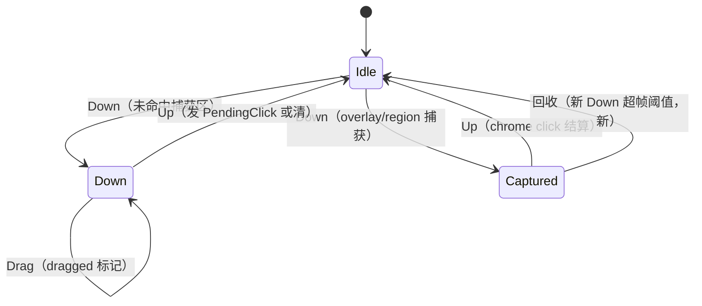

# Design — TUI 引擎指针 / 选区 / 焦点状态

## 1. 目标与边界

- 指针捕获闩丢失 Up 可回收；选区两实现合一；overlay 焦点单一真值；ChoicePrompt Review 态显式。
- 边界：不改 hit-testing 管线与 AO 模式语义。

## 2. 决策摘要

| 决策 | 内容 | 状态 |
|---|---|---|
| 指针相位 | PointerPhase { Idle, Down, Captured, PendingClick }；capture_latch 并入 Captured；新 Down 超帧阈值回收 | 推荐，待 review |
| 选区合一 | 引擎 SelectionController 吸收 editor 特化（dock clamp 与自动滚动为配置项） | 推荐，待 review |
| 焦点合一 | FocusState 单一所有者（root/overlay/restore 三字段一对象）；dispatch 二次修补删除 | 定稿方向 |
| ChoicePrompt | Tab { Question(usize), Review } 枚举，消灭 tab==len 越界编码 | 定稿方向 |
| overlay 可见性 | hidden 不可聚焦断言；旧矩形命中加渲染帧号校验 | 定稿方向 |
| gutter 拖拽 | grab 复位点补 pointer leave / 新 Down 路径 | 定稿方向 |

## 3. 指针相位机

## 4. 选区合一结构

SelectionController 增 auto_scroll: Option 与 clamp: Option 配置；editor 版删除，行为差异以配置表达。合并前对两实现各冻结一组快照测试，合并后双跑对照。

## 5. 测试边界（seam）

- 单测：指针矩阵（含丢 Up 注入）；焦点转移矩阵；Review 态下标安全。
- BDD：package-tui pointer / app-tui-mouse-actions 回归。

## 6. 风险与回滚

- 选区是行为面最大片，可拆独立 change；四片（指针/选区/焦点/choice）独立回滚。
