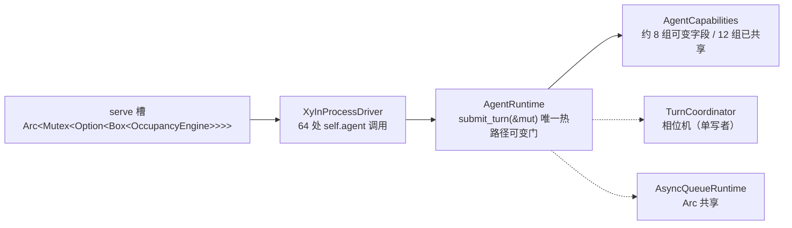
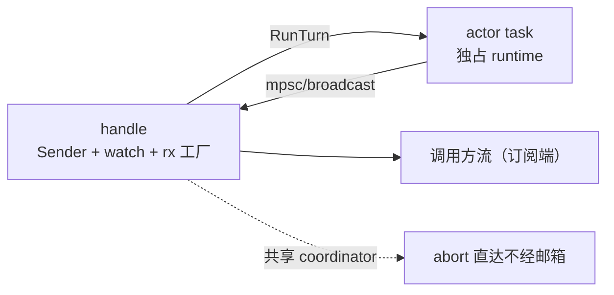
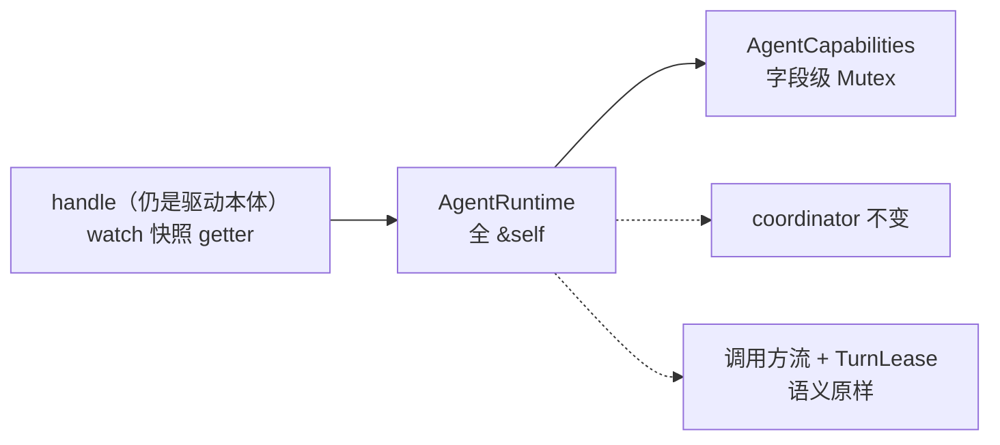

# Design：驱动物理化（路线对比与分阶段实施）

## 现状（语义完备，物理未收敛）

单写者由三件事保证：coordinator 相位机（Idle 才 admit）、serve 的 RunInflightGuard、事件流惰性轮询（TurnLease::Drop 收 turn，state.rs:345-356）。这三件不依赖 actor 存在。

## 路线 A：actor 驱动（eager 流）

actor task 独占 AgentRuntime；驱动退化为 handle（命令 Sender + watch 快照 + 流接收端工厂）；run 发 RunTurn，actor 调 submit_turn 后自己轮询流并转发到通道。

- 利：单写者成为构造性质；有界信箱 64 真实存在；T6 occupancy 上收彻底（槽=handle，全 drop 即自杀）。
- 弊：事件投递变 eager——调用方不再轮询时模型调用仍在跑，现状"drop 流即停"的隐式背压消失，必须显式定义订阅端 drop 的语义（取消 turn？继续跑完？）；约 64 处驱动调用消息化样板；TurnLease 锚点从调用方流移到 actor 内。
- 前置：先完成路线 B，否则 66 处 E0596 墙仍在。

## 路线 B：能力集锁化 + 门面投影（调用方轮询保持）

不移动 runtime。把约 8 组可变字段改内部锁（全部 set_* 改 &self），AgentRuntime 随之全面 &self 化；驱动加 watch::channel&lt;DriverSnapshot&gt;（同步 getter 读快照）与控制命令邮箱（异步语句），run/run_turn 仍在调用方语境建流。

- 利：增量可验收（每组字段独立小步）；流语义零变更（lease/drop/abort 原样）；react 内环零触碰（freeze_root_config 已隔离，react/mod.rs:512-533）；66 处墙按字段溶解而非整体翻越。
- 弊：非"真" actor——单写者仍靠约定 + coordinator；快照新鲜度依赖变更点显式 publish；T6 只能收敛生命周期双份（handle 引用计数即自杀），占用/驱逐策略仍留 serve。
- 量级估计：8 组字段 ×（锁化 + 调用点改写 + 快照 publish），每组一步可独立回归。

## 对比与推荐

| 维度 | A（actor 驱动） | B（锁化 + 门面） |
|---|---|---|
| 流/abort 语义 | 变更（须重新定义 drop） | 不变 |
| 单写者性质 | 构造保证 | 约定 + coordinator |
| 样板量 | 约 64 处消息化 | 约 8 组字段锁化 |
| 可增量性 | 差（一次到位） | 好（每组一步） |
| T6 收敛度 | 彻底 | 生命周期收敛，策略留 serve |
| 当前消费者 | 无 | 无 |

推荐 B 先行、A 挂起：两条路线都没有现实消费者，B 以零语义风险换取大部分物理化收益；A 的唯一增量（构造性单写者）在没有并行 turn 需求前不构成必要条件。B 落地后若出现并行拓扑消费者，再以 B 为地基评估 A，届时只剩流语义一个决策。

## 验收

- B1：submit_turn 改 &self 后全量 BDD 绿；cargo check 无 E0596 残留路径。
- B2：驱动同步 getter 全部读 watch 快照；快照 staleness 有单测（变更后 getter 立即可见）。
- B3：occupancy 槽生命周期测试改经 handle 引用计数表达；linger/eviction 语义测试不降级。
- lockstep：thoughtdag path 依赖编译 + 测试绿。
