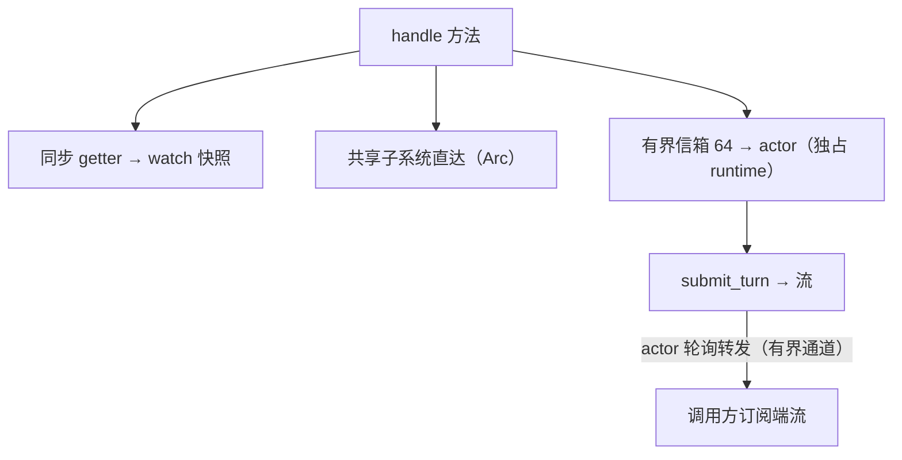

# Design：驱动物理化（路线 A：actor 驱动，已选定）

> 决策记录（2026-11-21）：维护者选定路线 A。路线 B 的锁化不再是独立目标，其可取部分（快照骨架）并入 A0。

## 目标形态

actor task 独占 AgentRuntime；驱动退化为 handle：同步 getter 读 watch 快照，共享子系统（队列 / coordinator / model_manager / sampler / store，均为 Arc）直达，独占操作（RunTurn / 会话绑定 / 标题生成 / reload / hooks 置换）经有界信箱 64；run 返回订阅端流。

## 八项已决设计点

1. drop 语义：订阅端 drop → 走正规取消（清 steer、保 follow_up，r1028 路径）。四家 run 流消费方（serve host.rs:1507/1936、cli/print.rs:10、app-tui effects mod.rs:388）正常路径均不中途 drop，此变更只收紧异常路径。实施期实测确认：现状惰性流 drop 可能丢弃已 drain 的 steer（局部 pending 变量），取消路由顺带修复。
2. abort：经共享 coordinator 同步直达（react/mod.rs:112、state.rs:229），不进邮箱，零等待必达。
3. RunTurn 接纳：coordinator 非 Idle 即拒（r2894 + src/AGENTS.md:201 硬约束）；邮箱只提供到达序与背压，不提供根提交排队。serve RunInflightGuard 契约不变。
4. 消息面三分类：getter→快照；共享→直达；独占→命令。A0 首件活是把 64 处 self.agent. 调用分桶（预估独占桶 10-15 处）。
5. 背压：事件通道有界（256），消费慢则 actor 暂停轮询；单通道保序。
6. 重入禁令：actor 只 send oneshot 从不 await 回复；禁嵌套命令。reload 钩子（hook.reload(self, cancel)）是已知重入点，A2 专项审计。
7. spawn：懒启动（首命令时 Handle::try_current），失败回落内联直通模式保无 runtime 单测；handle 全 drop → 邮箱关闭 → 取消收尾后退出（T6"全 drop 即自杀"）。
8. occupancy 上收：serve 的 Arc&lt;Mutex&lt;Option&lt;Box&lt;OccupancyEngine&gt;&gt;&gt;&gt; 消失，handle 可 Clone；linger/eviction 重述为丢 handle + 等 actor 退出。

## 验收

- A1 后：drop 中途专项测试（清 steer、保 follow_up、AgentEnd 收尾）新增且绿；既有 1240 BDD 场景全绿。
- A3 后：occupancy 测试组 48 例经 handle 表达且不降级；thoughtdag lockstep 编译 + 测试绿。
- 全程：just qa + e2e 每阶段实跑。
