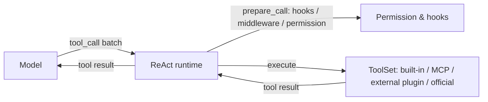
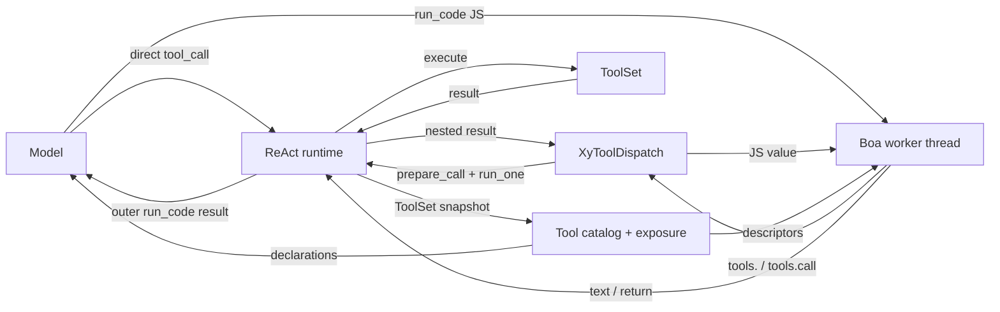
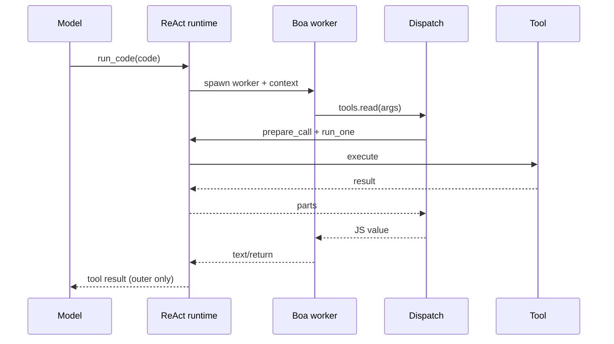

# Design — Codemode（Boa）工具与工具暴露层

## 目标

- 新增 run_code 工具（codemode）：模型写 JS，脚本内调用所有被允许的工具。
- 建立工具暴露/catalog/声明层：内置、MCP、外进程插件、官方插件工具都能被模型理解。
- 能力限制在 catalog 与 dispatch 两侧生效；嵌套调用复用 ReAct 的 hooks/中间件/权限/事件。
- 不做强制模式；MVP 只做 tool + mode on；不做 provider 原生 PTC、WASM、多语言、嵌套事件树。

## 现状

- XyToolCtx 只有 call_id/cancel/output_tx/state_events/workspace；无 dispatch（crates/xylitol-plugin-sdk/src/ports/tool.rs:13-19）。
- ToolSet/selection/replaces/freeze；HostRegistries.tools；MCP mcp__{server}__{tool}；外进程插件 {plugin}__{tool}。
- prepare_call/run_one 负责 hooks、loop 中间件、权限、事件（crates/xylitol-runtime/src/agent/runtime/tool_exec.rs:87/173）。
- permission_router 只映射 read/write/edit/bash；check_process 未接线（crates/xylitol-runtime/src/agent/runtime/permission_router.rs:12-19）。
- 事件扁平：ToolExecutionStart/Update/End 只有 id（crates/xylitol-plugin-sdk/src/lifecycle.rs:79-94）。
- plan mode 用 CustomEntry + 中间件；工具面可在 BeforeLlmRequest 改（plugins/xylitol-official-plugin-plan/src/middleware.rs:81）。
- XyTool 无 exposure/namespace/output_schema。

## 决策

### 1. 语言与运行时

- 选 Boa 0.22（MIT OR Unlicense，Test262 95.6%）；纯 Rust，无 Node/C。
- JS 足够通用；多语言/WASM 不在本 change。
- Boa Context 是 !Send：每次执行在专用 worker 线程（current-thread tokio + LocalSet）内创建 Context。
- 脚本作为 async function body 执行；host 调用用 NativeFunction::from_async_fn / JsPromise；用 run_jobs_async 驱动。
- 宿主工具调用走 tokio channel 到主 runtime；dispatch 在主 runtime 执行。
- RuntimeLimits：loop_iteration_limit / recursion_limit / stack_size_limit；默认值见配置。
- 取消：ctx.cancel + 协作检查；超时后请求停止并等待 grace；Boa 无 hard interrupt，worker 可能跑到 loop limit；不得把 Boa 当安全边界。
- 内存：Boa 无 heap limit；用输出/循环/超时上限；残留风险写入文档。

### 2. 工具暴露

```rust
pub enum XyToolExposure {
    Direct,
    ModelOnly,
    Codemode,
    Deferred,
    Hidden,
}
```

- Direct：模型可见，codemode 可调。
- ModelOnly：模型可见，codemode 不可调。
- Codemode：模型不可见，codemode 可调，声明内联。
- Deferred：模型不可见，codemode 可调，不内联；靠 ALL_TOOLS/searchTools/describeTool 发现。
- Hidden：模型不可见，codemode 不可调。

默认：

- 核心 7 工具、todo/plan/workflow：Direct。
- ask、subagent_readonly：ModelOnly。
- run_code：Hidden。
- MCP、外进程插件：Direct（保持现状）；配置可改 Codemode/Deferred。
- 配置 codemode.exposure 可按名称/glob 覆盖。

过滤：

- 模型工具表 = Direct + ModelOnly。
- codemode catalog = Direct + Codemode + Deferred。
- plan mode read-only：catalog 只留只读 allowlist；与 plan 中间件同源。
- 会话工具集 / 能力开关 / trust 先过滤；catalog 不绕过。

### 3. Catalog 与声明

- XyToolDescriptor：name、identifier、namespace、description、parameters、output_schema、exposure、guidelines。
- XyToolCatalog：snapshot/describe/search；runtime 实现；按 freeze 快照。
- identifier：非法字符→_；首字符数字加 _；冲突按 canonical 排序加 _2/_3；始终支持 tools["canonical"] 与 tools.call。
- namespace：core / official / mcp:{server} / plugin:{plugin}；声明按 namespace 分组。
- 声明：TypeScript 风格 declare const tools；复杂 schema 用 unknown + describeTool；inline_budget 3000 tokens；Deferred 不内联。
- 运行时 globals：tools.<identifier>、tools.call、ALL_TOOLS、searchTools、describeTool、describeNamespace、text、console、exit、return；image/store/load 不在 MVP。
- 提示注入：codemode 插件注册 BeforeLlmRequest 中间件，按 ctx.plan_mode 与 catalog 生成声明，push 一条 user 消息；tool description 只放 API 指南。mode on 下不改工具表；mode only 后续。

### 4. Dispatch

- XyToolDispatch：call(parent_call_id, name, args) + catalog()。
- runtime DispatchHandle 持有 ToolSet/hooks/hook_bus/permission/cancel/obs/loop_chain/turn_index/workspace/events。
- call：拒绝 run_code/Hidden/ModelOnly；解析 canonical/wire；prepare_call + run_one；嵌套 id <parent>:code:<n>；不落盘；错误返回 XyToolError。
- 并发：max_parallel_subcalls=10；max_nested_calls=100。
- 事件：嵌套 Start/End 抑制；Update 转成外层 progress 文本（前缀 → name:）；外层 Start/Update/End 正常。DispatchHandle 持有外层 output_tx 与 events sender；AgentHooks/LoopChain 以 Arc 克隆。
- 权限：run_code 映射 check_process(workspace)（新增 SandboxCapability::Exec）；嵌套调用各自能力；凭据剥离。

### 5. 输出与会话

- text()/return 收集；JSON 序列化；结果上限 max_result_bytes=100 KiB / max_output_tokens=10000；截断时写 full output temp file 并给路径。
- 脚本失败保留 partial output；XyToolError → is_error。
- 嵌套结果不进 session history；只外层 run_code tool result 落盘。
- 事件：外层事件进 journal；嵌套 progress 只走 tape（ToolExecutionUpdate 不写 journal）。

### 6. 配置

```yaml
codemode:
  enabled: false
  runtime: boa
  mode: on
  timeout_ms: 120000
  max_output_tokens: 10000
  max_result_bytes: 102400
  max_parallel_subcalls: 10
  max_nested_calls: 100
  inline_budget: 3000
  loop_iteration_limit: 10000000
  recursion_limit: 512
  stack_size_limit: 10000
  exposure:
    "mcp__*": deferred
```

- 未配置零装配；runtime 只 boa；mode 只 on（MVP）；only 后续。
- 配置 schema-first；插件声明；项目配置沿用 trust 语义。

### 7. 不做的

- provider 原生 PTC；WASM；多语言；嵌套事件树；store/load；image()；output_schema 的结构化消费（MVP 只存元数据）；mode only；强制模式/命令/ModeStrip。

## 规则

- 必须：catalog 与 dispatch 两侧同时执行 exposure/会话/plan mode 过滤。
- 必须：嵌套调用复用 prepare_call/run_one；不得旁路权限/hooks/中间件。
- 必须：只有外层 run_code 结果进入模型上下文与 session；嵌套结果不落盘。
- 必须：run_code 不在 7 工具闭集；经插件注册表注册；并发类 Sequential。
- 必须：未配置零装配；配置关闭时不注册工具/中间件。
- 必须：identifier 唯一；冲突加后缀；保留 canonical 访问。
- 必须：声明有 inline budget；Deferred 不内联。
- 必须：plan mode read-only 时 catalog 只留只读工具。
- 不得：递归调用 run_code；不得把 ask/subagent 暴露给 codemode。
- 不得：把 Boa 当安全边界；文档明示 permission 建议性。
- 不得：首切片改 protocol-app/wire/TUI 或发嵌套 ToolExecutionStart。

## 架构图

### 现状



### 新架构



### 调用序列



## API 形状

```rust
pub struct XyToolDescriptor {
    pub name: String,
    pub identifier: String,
    pub namespace: Option<String>,
    pub description: String,
    pub parameters: serde_json::Value,
    pub output_schema: Option<serde_json::Value>,
    pub exposure: XyToolExposure,
    pub guidelines: Vec<String>,
}

pub struct XyToolCallResult {
    pub parts: Vec<AgentPart>,
    pub details: Option<serde_json::Value>,
    pub is_error: bool,
}

pub trait XyToolCatalog: Send + Sync {
    fn snapshot(&self) -> Vec<XyToolDescriptor>;
    fn describe(&self, name: &str) -> Option<XyToolDescriptor>;
    fn search(&self, query: &str, limit: usize) -> Vec<XyToolDescriptor>;
}

#[async_trait]
pub trait XyToolDispatch: Send + Sync {
    async fn call(
        &self,
        parent_call_id: &str,
        name: &str,
        args: serde_json::Value,
    ) -> Result<XyToolCallResult, XyToolError>;
    fn catalog(&self) -> std::sync::Arc<dyn XyToolCatalog>;
}
```

XyTool 增加默认方法：

```rust
fn exposure(&self) -> XyToolExposure { XyToolExposure::Direct }
fn namespace(&self) -> Option<&str> { None }
fn output_schema(&self) -> Option<serde_json::Value> { None }
```

XyToolCtx 增加可选 dispatch：

```rust
pub fn with_dispatch(mut self, dispatch: Arc<dyn XyToolDispatch>) -> Self;
pub fn dispatch(&self) -> Option<&Arc<dyn XyToolDispatch>>;
```

## 接入点

- xylitol-plugin-sdk：ports/tool.rs 增加 exposure/descriptor/catalog/dispatch 类型；XyToolCtx 增加 dispatch。
- xylitol-runtime：新增 agent/tools/catalog.rs（catalog + identifier）；tool_exec.rs 构建 DispatchHandle；permission_router 增加 Exec/check_process。
- xylitol-kernel：装配 codemode 插件；compose_tools 注册 run_code；注入 catalog/dispatch；配置节。
- 新插件 plugins/xylitol-official-plugin-codemode：Boa worker、globals、声明生成、BeforeLlmRequest 中间件、run_code 工具。
- workspace：根 Cargo.toml member；workspace-assembly 官方插件列表；runtime-config 配置 schema。
- 不新增 crate 边界；插件只依赖 plugin-sdk + boa_engine + tokio/serde。

## Spec 变更

- 新增 agent-codemode.feature：exposure/catalog/declaration/dispatch/limits/zero assembly/plan mode/recursion/cancel。
- agent-tools：XyTool exposure/namespace/output_schema；run_code 注册；不进 7 工具闭集；并发类 Sequential。
- agent-runtime：嵌套调用复用 before_tool/权限/after_tool；取消；事件；不得把嵌套结果写入模型上下文。
- domain-security：run_code 权限映射；凭据剥离；隔离声明。
- runtime-config：codemode 配置节。
- workspace-assembly：官方插件装配列表。
- 不改 protocol-app/wire/app-tui。

## 测试

- 单测：exposure 默认；catalog 过滤；identifier 冲突；声明 budget；dispatch 递归拒绝；权限；结果上限。
- 集成：fake model 发 run_code；Boa 执行 read/grep；外层结果；无嵌套 session 消息。
- BDD：agent-codemode 场景；plan mode read-only；MCP deferred；取消；零装配。
- 限额：while(true) 命中 loop limit；timeout；输出截断；max nested。
- Boa 兼容：标准 JS；无 Node globals；错误可读。
- 门禁：just fmt / lint / test / qa。

## 风险

- Boa in-process：无 crash isolation、无 hard interrupt、无 heap limit。缓解：RuntimeLimits、timeout、输出上限；文档明示非安全边界；后续 worker 子进程。
- Boa 95.6% Test262；个别 JS 特性失败；错误面要可读。
- 声明 budget/复杂 MCP schema；退回 tools.call/describeTool。
- identifier 冲突；bracket 访问。
- 动态工具；catalog 在 freeze 快照；提示中间件每 turn 生成。
- Agent 使用质量；用真实模型测。
- 二进制/构建时间；Boa 增加编译时间。
- 嵌套事件抑制；可观测性只有 progress；后续事件树。
- permission 建议性；bash 已是任意命令。

## 后续

- mode only；image()；store/load；output_schema 结构化消费；worker 子进程 hard kill；嵌套事件树；多语言/WASM。
