# 代码架构 SSOT

本文件是代码架构的单一真值源。覆盖目标 crate 图、依赖方向、seam、`Xy*`、消息/工具边界、扩展开闭、复杂度与体量策略。全局工作方式见根 `AGENTS.md`；产品心智见 `docs/architecture/`。子目录 `AGENTS.md` 只写本端例外，不重复本文件。

**真值顺序**：代码与测试 → 本文件 → archive design。本文件写**稳定规则**，不写文件清单、change id 进度、超标表。现行 workspace 成员以根 `Cargo.toml` 为准。词表以 `xylitol-plugin-sdk` 为准。信封以 `xylitol-protocol` 为准（不认识 `XyEvent`）。其余目标 crate 未填叶前，对应代码仍在主 crate `src/`。新代码必须按目标依赖方向落点。

## 目标 crate 图（normative）

crate 边界按替换、开关、生命周期划，**不得**按 `app / agent / infra` 各拆一 crate。**不得**再抽 `xylitol-domain` / `xylitol-types` / `xylitol-assemble` / `xylitol-kernel` / `xylitol-host`。**不得**用 `xylitol-protocol` 承接 plugin-sdk。**不得**把发给模型的形状搬进主仓 `xylitol`。分层纪律留在每个 crate 内部。

```text
我 → xylitol-app-tui → xylitol-protocol → xylitol-serve（监听 + mapping）
   → xylitol-runtime（准入 + 内环 + 组稿）
   → 端口：session / model / tools / compaction

Print：我 → xylitol-app-print → xylitol-runtime（不编 fory）
根包 xylitol：只在进程启动接线
```



```mermaid
flowchart TB
  subgraph contracts["① 契约叶 · 框内三包互不依赖"]
    direction LR
    xylitol_plugin_sdk["xylitol-plugin-sdk<br/>词表 + 端口"]
    xylitol_protocol["xylitol-protocol<br/>信封"]
    xylitol_tui["xylitol-tui<br/>引擎"]
  end

  subgraph plugins["② 官方插件 · 只依赖 xylitol-plugin-sdk"]
    direction TB
    subgraph plugins_loop["会话 / 压缩"]
      direction LR
      xylitol_official_plugin_session["xylitol-official-plugin-session"]
      xylitol_official_plugin_compaction["xylitol-official-plugin-compaction"]
    end
    subgraph plugins_model["模型方言"]
      direction LR
      xylitol_official_plugin_provider_openai["xylitol-official-plugin-provider-openai"]
      xylitol_official_plugin_provider_anthropic["xylitol-official-plugin-provider-anthropic"]
    end
    subgraph plugins_ext["工具 / 配置启用"]
      direction LR
      xylitol_official_plugin_tools["xylitol-official-plugin-tools"]
      xylitol_official_plugin_mcp["xylitol-official-plugin-mcp"]
      xylitol_official_plugin_hooks["xylitol-official-plugin-hooks"]
    end
  end

  subgraph kernel["③ 执行权威 · 不接线"]
    xylitol_runtime["xylitol-runtime<br/>XyDriver + 准入 + ReAct 内环"]
  end

  subgraph surfaces["④ 载体与端"]
    direction LR
    xylitol_serve["xylitol-serve<br/>监听 + mapping"]
    xylitol_app_print["xylitol-app-print"]
    xylitol_app_tui["xylitol-app-tui<br/>信封 + tui + sdk词表投影"]
  end

  subgraph root["⑤ 组合根"]
    xylitol["xylitol<br/>argv + 默认接线"]
    xylitol_rutis["xylitol-rutis<br/>唯一 use rutis"]
  end

  xylitol_official_plugin_session --> xylitol_plugin_sdk
  xylitol_official_plugin_compaction --> xylitol_plugin_sdk
  xylitol_official_plugin_provider_openai --> xylitol_plugin_sdk
  xylitol_official_plugin_provider_anthropic --> xylitol_plugin_sdk
  xylitol_official_plugin_tools --> xylitol_plugin_sdk
  xylitol_official_plugin_mcp --> xylitol_plugin_sdk
  xylitol_official_plugin_hooks --> xylitol_plugin_sdk
  xylitol_runtime --> xylitol_plugin_sdk
  xylitol_serve --> xylitol_runtime
  xylitol_serve --> xylitol_protocol
  xylitol_serve --> xylitol_plugin_sdk
  xylitol_app_print --> xylitol_runtime
  xylitol_app_tui --> xylitol_protocol
  xylitol_app_tui --> xylitol_tui
  xylitol_app_tui --> xylitol_plugin_sdk
  xylitol --> plugins
  xylitol --> xylitol_runtime
  xylitol --> xylitol_serve
  xylitol --> xylitol_app_print
  xylitol --> xylitol_app_tui
  xylitol --> xylitol_rutis
```

`xylitol-rutis` 是装配适配层。组合根经它 `apply` 官方 Host 插件。执行权威 / 官方插件 / 产品端 **不得** 依赖它。

| crate | 必须 | 不得 |
|---|---|---|
| `xylitol-plugin-sdk` | 词表 + 端口 + 错误。插件作者只依赖这一包 | 认识信封；放 HTTP / 假模型 / 观测写出；再拆 `xylitol-types` |
| `xylitol-protocol` | 四象限信封 + fory-v3 + `PROTOCOL_VERSION` | 认识端口；认识 `XyEvent`；承接 plugin-sdk |
| `xylitol-runtime` | `XyDriver` + trust + 会话槽 + ReAct 内环 + 唤醒准入。进程内直调合法 | 接线；依赖官方插件；依赖信封；为此编 fory |
| `xylitol-serve` | 监听；`XyEvent` ↔ `v3::Event` mapping（词表经 plugin-sdk） | 把 mapping 放进 protocol / plugin-sdk / runtime |
| `xylitol-official-plugin-*` | 只依赖 plugin-sdk。依赖用端口声明，由组合根注入 | 插件之间 `use`；依赖 protocol；客户端进这个前缀 |
| `xylitol-app-tui` | 信封 + `xylitol-tui`；Host 词表（`XyEvent` / `SessionEntry`）经 attach 投影 | 依赖 runtime、官方插件 |
| `xylitol-app-print` | 同进程直调 runtime | 依赖 serve / protocol；编 fory |
| `xylitol-rutis` | 唯一 `use rutis`。给组合根封装 `Ctx` / `Plugin` | 被 runtime、官方插件、产品端依赖；插件 `use rutis` |
| 根包 `xylitol` | argv + 默认接线。唯一列出官方插件的 `Cargo.toml` | 把组合根塞进 runtime；直接 `use rutis` |

官方插件七个：session、compaction、provider-openai、provider-anthropic、tools、mcp、hooks。没有 react。内置（默认挂）：session / compaction / provider-* / tools。配置启用：mcp / hooks。没配置则不 start。

测循环用假端口。测端用 `ScriptedDriver`。唤醒源走同一道准入，不换内环。`RunId` 仅运行时内部，**不得**进 `XyEvent` / 信封。

每个 crate 内部仍守依赖方向（runtime ↛ 插件、↛ 信封；插件之间不得 `use`）。根包 `src/` 是组合根：CLI / wiring / embed。协议无关 `XyDriver` 在 `xylitol-runtime`；官方插件由组合根注入。占用（session slot / linger / 单写者）在 `xylitol-serve`，装配与 MCP 物化由组合根注入。监听与 `XyEvent` ↔ v3 mapping 在 `xylitol-serve`。

### `AgentCapabilities` 职责边界

引擎侧聚合体，**只**收敛这些职责（新能力先问是否属此列）：

| 留 | 不留（归端 / Driver） |
|---|---|
| model 选择与 thinking | 产品 slash 词表（`wiring::product_commands`） |
| tools + freeze / hooks / permission | bang `!` / `!!`（`xylitol-runtime` `BangExecHandler`；组合根注入 executor） |
| session id + store + fork/stats | HTML/JSONL export-import（`xylitol-runtime` `SessionExporter`；组合根注入 I/O） |
| context_policy + prompt 装配 | — |
| compaction 门禁 | — |
| steer / follow-up queues | — |

Skill/extension slash 尚未交付：需要时在 **端 / `XyDriver`** 侧注册并并入 `get_commands`，**不得**再塞回 `AgentCapabilities`。产品 builtin 列表只在 `XyDriver::get_commands` 组装。不得 `agent` → `app`。

- **组合根**只在根包 `xylitol`。靠 review + 行为测守住；**不得**源码 grep 元测试卡 import。
- **应用端**：Print / TUI 走 `XyDriver::run` → `XyEvent` 流 → 端渲染。不够就扩 seam（`l8ng-write-surface`），不得绕过。
- **产品角色（client / host）**：TUI 等端是 client（键、画、TTY、编辑器、剪贴板）。模型 / 会话 / MCP / 工作区 / trust 是 host 操作器角色。print / 库嵌入仍可同进程走同一方法表。**不得**把 host 等同于 HTTP 监听器；**产品 TUI** 默认 attach 本机监听器（未在听失败）。
- **产品信封**：四象限（`POST /rpc` unary + `WS /rpc` 下行，同一方法表），载体为 fory-v3 二进制帧。Command/Event 是载荷；JSON-RPC 2.0 文本不是产品通道。跨进程不跳过信封直调 Driver。
- **steer / follow-up / abort**：只经 `XyDriver` 队列 API；端不得改 ReAct 内部队列。产品语义：`docs/architecture/插话续跑与中止.md`。
- **会话 actor（硬约束）**：一个 runtime **显式绑定一个 session** 后才可根提交；任意时刻至多一个 ReAct worker 可写该 session。根提交默认拒绝忙碌并发；busy 时 `steer` / `follow_up` 是轮内改向，不是第二次根提交。子 agent = **另建隔离 runtime**。Host 进程可 lazy 物化 N 个 session 槽 Driver。

| 必须 | 不得 |
|---|---|
| 一 runtime 绑一 session；单写者 | 同一 runtime 按 session id 多路复用 |
| busy 时只用 steer / follow-up 改向 | 忙碌中塞第二次根提交 |
| 子 agent 另建隔离 runtime | 子 agent 挤进现有 runtime 共享状态 |
| `RunId` 仅运行时内部 | `RunId` 进 `XyEvent` / 信封 |

开箱主线 vs 配置后置见根 `AGENTS.md`。库嵌入：`xylitol::embed`。

## 三层契约与 `Xy*`

```text
① 线协议     四象限信封 + fory-v3（Command/Event 为载荷）→ xylitol-protocol
② 应用协议   XyDriver + XyEvent 流 + XyDriverError → xylitol-runtime（跨进程走信封）
③ 可替换口   XyModel / XyTool / XySessionStore / … → xylitol-plugin-sdk
```

- **`Xy*`** = 库入口级契约（精选 `pub use` / embed），不是全局品牌。端口、共享应用协议、跨端事件、库级错误用 `Xy*`；内部协作者、单处 DTO、bootstrap 细节、包 `xylitol-tui` **不用**。
- **外部库**：会出现在库入口或多方言统一处 → 包一层；纯内部 → 直接用上游类型。不得为包而包。
- **取消**：公开工具上下文直接用 `tokio_util::sync::CancellationToken`（接受为契约依赖）。
- **schemars**：放配置边界 / 使用方 crate；词表根类型默认只 serde。
- **`XyEventSink`**：侧路生命周期（如 compaction），**不是**多 client turn 总线；turn 走 `XyDriver::run` 的事件流。

端口清单与签名以 `xylitol-plugin-sdk` 代码为准。升格新 port 前先证明不能用配置开关或既有 `XyTool`/`XyModel`/`XyDriver`。异步 port 以 `dyn` 注入 → **维持 `async_trait`**（朴素 RPITIT 与 dyn 冲突）。

## 错误与观测

- 热路径：`XyError` / `XyToolError` + 稳定 `kind()`；会话域用 `XySessionError`（含 store 持久化 + 无绑定会话 / busy / 树旅行），`XySessionStoreError` 只表示 `XySessionStore` 持久化失败（`fork` 例外：树定位失败走 `XySessionError`）。Driver flatten：store `NotFound` → `kind=NotFound`；`NoActiveSession` → `kind=Message`、`detail_kind=Session`。
- 应用级接缝：`XyDriverError`（含 `Agent(…)`）+ `kind` / `detail_kind` / `log_failure`。session/export/trust 失败 flatten 后 `kind` 仍是 Driver 分类（`NotFound`/`Io`/…），`detail_kind` 与 `log_failure` 的 `source.kind` 保留来源域（`Session`/`Export`/`Trust`）。opaque 字符串经 `from_opaque`（具体短语，避免裸 token 误伤）。
- 栈：**仅** fastrace + `log`；不得 `tracing` 双栈。失败日志宜带 `error.kind`。
- 读 trace：skill `xylitol-dev`（`references/observability.md`）/ `just obs-*`；不得整文件灌 JSONL。

## 工具与钩子

```text
跨进程 / MCP / 脚本 hook  = JSON Value
官方工具插件               = *Args + serde；优先 TypedTool → dyn XyTool
```

- 不改 MCP / hook 的 JSON 口换“全类型”。
- schema 与 Args 手写并置；钩子总线与 `AgentHooks` **刻意保留 Value**。
- 内置工具经 `TypedTool` 装配；MCP / hook 仍走 `Value` + `XyTool`。

## 扩展开闭

产品心智：`docs/architecture/扩展与开闭.md`。接线优先序：

1. **配置 / 会话开关 + 组合根接线**（未启用 zero-cost）
2. **既有 port**。不得旁路第二套语义。
3. **新 port**（仅真实第二套替换，或嵌入/测试必须替换时）

不得做插件市场、Extension Host、为未交付能力预留空壳 `Xy*`、“已是统一口再包一层”。改名不留兼容别名 / 双解析路径（一次性改调用点）。死码分诊走 skill `l8ng-audit-dead-code`。不得为 LSP / DAP / gpui / 语音端预埋空壳 crate。`xylitol-rutis` 是装配适配层，不是预埋空壳。

Trust / Permission / MCP 产品语义分别见 `docs/architecture/` 对应文。边界：Trust 门禁**项目本地资源**；工具开箱 allow-all；MCP **有配置才装配**并支持重载。

## Provider 与消息

业务只认 `XyModel`。方言 HTTP 落在 `xylitol-official-plugin-provider-openai` / `-anthropic`。`xylitol-plugin-sdk` 只收词表薄留（消息 / chunk / usage / thinking 选项 / `Compat` 名 / `tool_wire` 形状）。**不得**把 HTTP、假模型、观测写出放进 plugin-sdk。**不得**把 DTO 搬回主仓 `xylitol`。

| 概念 | 归属 |
|---|---|
| LLM 叶（Message/Part/Usage…） | 词表薄留（plugin-sdk） |
| `AgentMessage` / `EnvMessage` / `XyEvent` | plugin-sdk |
| `project_for_llm` | runtime |
| HTTP / SSE / 厂商 SDK | 对应方言插件 |
| Fake `XyModel` | 测试支持，不进内核 |

新兼容端 = 新方言插件或配置；**不改** ReAct / `AgentMessage`。`rmcp` 只在 mcp 插件；`async-openai` 只在 openai 插件。当前交付范围见 `docs/architecture/多厂商模型.md`。

Hook 三条接缝只认可移植 JSON（headers map + body Value）；不把 reqwest/某一 SDK 类型泄漏进 hook。原始 SSE 诊断用进程内 provider trace，不进 hook。

## 复杂度与体量

生产模块避免无结构 God 文件。**不得以文件物理行数作为质量约束**。行数与可维护性无直接映射；行数硬测会逼出按 impl 块散落的假拆分。质量信号只走函数级复杂度指标（cccc-rs 的 Sonar cognitive / McCabe cyclomatic）。

**TUI 端复杂度门禁（HARD）**：产品 TUI 入口协调者（host 入口、layout 根、effects 入口、bridge 入口）的函数级复杂度，经 `just qa` 的 `qa-check-complexity`（cccc-rs）强制。Sonar cognitive ≤32 且 McCabe cyclomatic ≤27。测试专用模块不参与本门禁。

**全树复杂度雷达（review 信号）**：`just complexity` 对全生产树（排除测试文件）报告 cccc-rs top-cognitive 排名，作为 review 参照；软信号，非硬门禁。复杂度高的函数优先拆分/重构，不用行数 KPI。

**默认不为行数大拆**：ReAct（剧本可与行为测同居；state machine 未开放）、session manager、已拆开的 driver 子树。功能逼出或编辑痛点明确时再拆；复杂度超门禁必须拆分或显式豁免。**不得**在本文件维护超标清单。不为编译速度拆 crate。

## 测试

跨层：BDD + 回归 + 端 / Driver 行为测。细则与命令见根 `AGENTS.md`。设计史：`llmanspec/changes/archive/`。

### 进程级全局状态与并行纪律

obs / env / 键位 / cwd / 固定路径与端口等跨测会互相踩的状态，按**域名**隔离；具体 helper 以代码为准，不得在本文件维护存量清单。

- 新测试不得无必要引入新的进程级可变全局；能注入 / 局部化则注入。
- 必须串行时用 `#[serial(<domain>_global)]`，不得默认空组把无关域捆在一起。
- 主门禁 `just qa` 走 nextest（一测一进程）：不得假设 in-process `#[serial]` 跨测生效。无固定端口 / 共享非 temp 路径等外部共享资源时**不**配置 `[test-groups]`；出现再开。
- `cargo test` 回退与 `just test-tui` 仍依赖 in-process 命名组。
- 配置 / trust / session 测走注入与 tempfile；不得改 `HOME`、不得指到开发者真实 `~/.xylitol/sessions`。产品路径不得无必要写包级 `GLOBAL_KEYBINDINGS`。
