# 代码架构 SSOT

本文件是代码架构的单一真值源。覆盖目标 crate 图、依赖方向、seam、`Xy*`、消息/工具边界、扩展开闭、复杂度与体量策略。全局工作方式见根 `AGENTS.md`；可验证产品行为见 `llmanspec/specs/`。子目录 `AGENTS.md` 只写本端例外，不重复本文件。

**真值顺序**：代码与测试 → 本文件 → archive design。本文件写**稳定规则**，不写文件清单、change id 进度、超标表。现行 workspace 成员以根 `Cargo.toml` 为准。词表以 `xylitol-plugin-sdk` 为准。线协议（JSON-RPC 2.0 文本形状）以 `xylitol-protocol` 为准（不认识 `XyEvent`）；`XyEvent` ↔ wire 映射以 `xylitol-wire` 为准。其余目标 crate 未填叶前，对应代码仍在主 crate `src/`。新代码必须按目标依赖方向落点。

## 目标 crate 图（normative）

crate 边界按替换、开关、生命周期划，**不得**按 `app / agent / infra` 各拆一 crate。**不得**再抽 `xylitol-domain` / `xylitol-types` / `xylitol-assemble` / `xylitol-host`。**不得**用 `xylitol-protocol` 承接 plugin-sdk。**不得**把发给模型的形状搬进主仓 `xylitol`。分层纪律留在每个 crate 内部。

```text
我 → xylitol-app-tui → xylitol-protocol（线）+ xylitol-wire（映射）→ xylitol-serve（监听 + 分派）
   → xylitol-kernel（boot + 核心/官方插件）
   → xylitol-runtime（准入 + 内环）
   → 端口：session / model / tools / compaction

Print：我 → xylitol-app-print → xylitol-kernel → xylitol-runtime（不编线协议）
根包 xylitol：argv + profile → Kernel::boot
```



```mermaid
flowchart TB
  subgraph contracts["① 契约叶 · 框内三包互不依赖"]
    direction LR
    xylitol_plugin_sdk["xylitol-plugin-sdk<br/>词表 + 端口 + rt"]
    xylitol_protocol["xylitol-protocol<br/>JSON-RPC 信封"]
    xylitol_tui["xylitol-tui<br/>引擎"]
  end

  subgraph plugins["② 官方可替换插件 · 只依赖 xylitol-plugin-sdk"]
    direction TB
    subgraph plugins_loop["会话 / 压缩"]
      direction LR
      xylitol_official_plugin_session["xylitol-official-plugin-session"]
      xylitol_official_plugin_compaction["xylitol-official-plugin-compaction"]
    end
    subgraph plugins_model["模型方言"]
      direction LR
      xylitol_official_plugin_provider_openai["xylitol-official-plugin-provider-openai"]
      xylitol_official_plugin_provider_anthropic["xylitol-official-plugin-provider-anthropic"]
    end
    subgraph plugins_ext["工具 / 配置启用"]
      direction LR
      xylitol_official_plugin_tools["xylitol-official-plugin-tools<br/>core tools"]
      xylitol_official_plugin_tools_fff["xylitol-official-plugin-tools-fff<br/>fff search"]
      xylitol_official_plugin_todo["xylitol-official-plugin-todo"]
      xylitol_official_plugin_workflow["xylitol-official-plugin-workflow"]
      xylitol_official_plugin_plan["xylitol-official-plugin-plan"]
      xylitol_official_plugin_mcp["xylitol-official-plugin-mcp"]
      xylitol_official_plugin_hooks["xylitol-official-plugin-hooks"]
      xylitol_official_plugin_loop_policies["xylitol-official-plugin-loop-policies"]
    end
    subgraph plugins_host["配置 / 观测"]
      direction LR
      xylitol_official_plugin_config["xylitol-official-plugin-config"]
      xylitol_official_plugin_obs["xylitol-official-plugin-obs"]
    end
  end

  subgraph exec["③ 执行权威与内核"]
    xylitol_runtime["xylitol-runtime<br/>XyDriver + 准入 + ReAct 内环"]
    xylitol_kernel["xylitol-kernel<br/>boot / 核心插件 / Builtins / admit"]
  end

  subgraph surfaces["④ 载体与端"]
    direction LR
    xylitol_wire["xylitol-wire<br/>XyEvent ↔ wire 映射"]
    xylitol_serve["xylitol-serve<br/>监听 + 分派"]
    xylitol_app_print["xylitol-app-print"]
    xylitol_app_tui["xylitol-app-tui<br/>协议客户端 + tui + sdk词表投影"]
  end

  subgraph root["⑤ 根包"]
    xylitol["xylitol<br/>argv + profile"]
  end

  xylitol_official_plugin_session --> xylitol_plugin_sdk
  xylitol_official_plugin_compaction --> xylitol_plugin_sdk
  xylitol_official_plugin_provider_openai --> xylitol_plugin_sdk
  xylitol_official_plugin_provider_anthropic --> xylitol_plugin_sdk
  xylitol_official_plugin_tools --> xylitol_plugin_sdk
  xylitol_official_plugin_tools_fff --> xylitol_plugin_sdk
  xylitol_official_plugin_todo --> xylitol_plugin_sdk
  xylitol_official_plugin_workflow --> xylitol_plugin_sdk
  xylitol_official_plugin_plan --> xylitol_plugin_sdk
  xylitol_official_plugin_mcp --> xylitol_plugin_sdk
  xylitol_official_plugin_hooks --> xylitol_plugin_sdk
  xylitol_official_plugin_loop_policies --> xylitol_plugin_sdk
  xylitol_official_plugin_config --> xylitol_plugin_sdk
  xylitol_official_plugin_obs --> xylitol_plugin_sdk
  xylitol_runtime --> xylitol_plugin_sdk
  xylitol_kernel --> xylitol_plugin_sdk
  xylitol_kernel --> xylitol_runtime
  xylitol_kernel --> xylitol_protocol
  xylitol_kernel --> xylitol_serve
  xylitol_kernel --> xylitol_app_print
  xylitol_kernel --> plugins
  xylitol_serve --> xylitol_runtime
  xylitol_serve --> xylitol_protocol
  xylitol_serve --> xylitol_wire
  xylitol_serve --> xylitol_plugin_sdk
  xylitol_wire --> xylitol_protocol
  xylitol_wire --> xylitol_plugin_sdk
  xylitol_app_print --> xylitol_runtime
  xylitol_app_tui --> xylitol_protocol
  xylitol_app_tui --> xylitol_wire
  xylitol_app_tui --> xylitol_tui
  xylitol_app_tui --> xylitol_plugin_sdk
  xylitol --> xylitol_kernel
  xylitol --> xylitol_app_print
  xylitol --> xylitol_app_tui
```

`rutis` 只出现在 `xylitol-plugin-sdk` 与 `xylitol-kernel` 的 `Cargo.toml`（精确锁 `=0.17.0`）。`rutis-loader` 只在 kernel。官方插件与 runtime 只依赖 sdk（经 `xylitol_plugin_sdk::rt`），**不得** `use rutis`。产品端不得依赖 rutis。一张监听器表、发射方选 mode（rutis plugin API 3）。`Call::next` 仅 waterfall；双模式事件（开火 emit / 等待 waterfall）必须 `CallExt::chain`，不得无条件 `next`。kernel 作 host 时用 `rutis::host`（`CtxHost` / `FiberState` / `BoxFuture`）。

| crate | 必须 | 不得 |
|---|---|---|
| `xylitol-plugin-sdk` | 词表 + 端口 + 错误 + `rt` 再导出。插件作者只依赖这一包 | 认识信封；放 HTTP / 假模型 / 观测写出；再拆 `xylitol-types` |
| `xylitol-protocol` | 四象限信封（JSON-RPC 2.0 文本）+ `PROTOCOL_VERSION`（仅 `host.describe` 协商） | 认识端口；认识 `XyEvent`；承接 plugin-sdk；依赖 wire / runtime |
| `xylitol-runtime` | `XyDriver` + trust + 会话槽 + ReAct 内环 + 唤醒准入 + 资源发现 + 权限后端。进程内直调合法 | 依赖官方插件；依赖信封或 wire 映射；`use rutis` |
| `xylitol-kernel` | `Kernel::boot`；核心插件挂载；loader rows；admit；`Command` 经 `xylitol-protocol` | 依赖 `xylitol-app-tui`；把每 token delta 送上 rutis 总线 |
| `xylitol-serve` | 监听；JSON-RPC 分派（`POST /rpc` / `WS /rpc` / healthz）；`XyEvent` 经 `xylitol-wire` 映射 | 自写 `XyEvent` ↔ wire 映射；把映射放进 protocol / plugin-sdk / runtime |
| `xylitol-wire` | `XyEvent` ↔ wire `Event` 唯一映射（逐变体显式、无 catch-all）；依赖 protocol + plugin-sdk | 依赖 runtime / serve / app-tui；serde 往返代替显式映射；静默吞掉映射失败 |
| `xylitol-official-plugin-*` | 只依赖 plugin-sdk（config/obs 可依赖 sdk + 配置类型）。依赖用端口 / 服务声明 | 插件之间 `use` 实现；依赖 protocol；客户端进这个前缀 |
| `xylitol-app-tui` | 线协议客户端（JSON-RPC 文本）+ `xylitol-wire` + `xylitol-tui`；Host 词表（`XyEvent` / `SessionEntry`）经 attach 投影；客户端剪贴板 | 依赖 runtime、官方插件 |
| `xylitol-app-print` | 同进程直调 runtime | 依赖 serve / protocol / wire；编线协议 |
| 根包 `xylitol` | argv + profile。列出官方插件的 `Cargo.toml` 经 kernel 转发 | 把装配逻辑塞回 `src/wiring`；`use rutis` |

官方可替换插件：session、compaction、provider-openai、provider-anthropic、tools、tools-fff、todo、workflow、plan、mcp、hooks、config、obs、loop-policies。核心插件（kernel 直接挂、不可经 rows 替换）：config、obs、trust、registries、session-host、agent-react、tool-table、driver。内置（默认挂）：session / compaction / provider-* / tools / todo / plan。配置启用：workflow / mcp / hooks / loop-policies。没配置则不 start。todo 插件 只提供 todo 工具与中间件；plan 插件 只提供 plan 工具与模式中间件；workflow 插件 只提供 workflow 中间件；loop-policies 插件 是插件作者的 loop 中间件参考实现（见 `crates/xylitol-plugin-sdk/README.md`）。核心 tools 插件 只提供 read / write / edit / bash / grep / find / ls 与 ask；tools-fff 只提供 ffgrep / fffind。第三方插件是方向、未交付；只留 Chain 解析器与 admit 准入位。

静态工具源 须经 `HostRegistries.tools` 注册；`compose_tools` 以注册表快照为基座（空则回落 `core_tools()`）。模型可见集 须由配置 `tools` 列表（`+name` / `-name`）与 `XyTool::replaces()` 解析：替换工具胜出、同类只留一个、未知名告警。内核 不得为单个工具插件写特判；session 专属工具（todo / plan / workflow / ask）仍由装配层注入。

测循环用假端口。测端用 `ScriptedDriver`。唤醒源走同一道准入，不换内环。`RunId` 仅运行时内部，**不得**进 `XyEvent` / 信封。

每个 crate 内部仍守依赖方向（runtime ↛ 官方插件、↛ 信封；插件之间不得 `use`，只经服务 / 事件）。根包 `src/` 是 argv + profile。协议无关 `XyDriver` 在 `xylitol-runtime`；官方插件由 kernel 挂载。占用（session slot / linger / 单写者）在 `xylitol-serve`：槽在最后订阅消失且宽限到期后**释放**（先清 driver 断开 `slot ↔ SlotAskGateway` 环，再从会话表移除），事件序号水位**保留**并在同会话重建时续接（空 journal 不发 resync，重置 seq 会让 `last_seq` 重连永久错位）。journal **只存事实事件**（生命周期 / 消息 / 工具边界与状态变更）；流式 tape（`TextDelta` / `ThinkingDelta` / `MessageUpdate` / `ToolExecutionUpdate`）**不写 journal、不消耗 seq**，仅实时下发并在 `latest_tape` 保留一份最新快照供中段重连经 `subscribe.partial` 补齐。`seq` 不变量（同一 seq 永久指向同一内容）不可破坏——**不得**用覆盖式槽位换 O(1) 内存。监听在 `xylitol-serve`；`XyEvent` ↔ wire 映射在 `xylitol-wire`。

### `AgentCapabilities` 职责边界

引擎侧聚合体，**只**收敛这些职责（新能力先问是否属此列）：

| 留 | 不留（归端 / Driver） |
|---|---|
| model 选择与 thinking | 产品 slash 词表（kernel `product_commands`） |
| tools + freeze / hooks / permission | bang `!` / `!!`（`xylitol-runtime` `BangExecHandler`；组合根注入 executor） |
| session id + store + fork/stats | HTML/JSONL export-import（`xylitol-runtime` `SessionExporter`；组合根注入 I/O） |
| context_policy + prompt 装配 | — |
| compaction 门禁 | — |
| steer / follow-up queues | — |

Skill/extension slash 尚未交付：需要时在 **端 / `XyDriver`** 侧注册并并入 `get_commands`，**不得**再塞回 `AgentCapabilities`。产品 builtin 列表只在 `XyDriver::get_commands` 组装。不得 `agent` → `app`。

- **组合根**在 `xylitol-kernel`（根包只做 argv → profile）。靠 review + 行为测守住；**不得**源码 grep 元测试卡 import。
- **应用端**：Print / TUI 走 `XyDriver::run` → `XyEvent` 流 → 端渲染。不够就扩 seam（`l8ng-write-surface`），不得绕过。
- **产品角色（client / host）**：TUI 等端是 client（键、画、TTY、编辑器、剪贴板）。模型 / 会话 / MCP / 工作区 / trust 是 host 操作器角色。print / 库嵌入仍可同进程走同一方法表。**不得**把 host 等同于 HTTP 监听器；**产品 TUI** 默认 attach 本机监听器（未在听失败）。
- **产品信封**：四象限（`POST /rpc` unary + `WS /rpc` 双向 text 帧，同一方法表），载体为 JSON-RPC 2.0 文本（方法按名字寻址）。Command/Event 是载荷。跨进程不跳过信封直调 Driver。
- **steer / follow-up / abort**：只经 `XyDriver` 队列 API；端不得改 ReAct 内部队列。产品语义：`llmanspec/specs/agent-runtime/`。
- **会话 actor（硬约束）**：一个 runtime **显式绑定一个 session** 后才可根提交；任意时刻至多一个 ReAct worker 可写该 session。根提交默认拒绝忙碌并发；busy 时 `steer` / `follow_up` 是轮内改向，不是第二次根提交。子 agent = **另建隔离 runtime**。Host 进程可 lazy 物化 N 个 session 槽 Driver。

| 必须 | 不得 |
|---|---|
| 一 runtime 绑一 session；单写者 | 同一 runtime 按 session id 多路复用 |
| busy 时只用 steer / follow-up 改向 | 忙碌中塞第二次根提交 |
| 子 agent 另建隔离 runtime | 子 agent 挤进现有 runtime 共享状态 |
| `RunId` 仅运行时内部 | `RunId` 进 `XyEvent` / 信封 |

开箱主线 vs 配置后置见根 `AGENTS.md`。库嵌入：`xylitol::embed`。

## 三层契约与 `Xy*`

```text
① 线协议     四象限信封（JSON-RPC 2.0 文本；Command/Event 为载荷）→ xylitol-protocol；XyEvent ↔ wire 映射 → xylitol-wire
② 应用协议   XyDriver + XyEvent 流 + XyDriverError → xylitol-runtime（跨进程走信封）
③ 可替换口   XyModel / XyTool / XySessionStore / … → xylitol-plugin-sdk
```

- **`Xy*`** = 库入口级契约（精选 `pub use` / embed），不是全局品牌。端口、共享应用协议、跨端事件、库级错误用 `Xy*`；内部协作者、单处 DTO、bootstrap 细节、包 `xylitol-tui` **不用**。
- **外部库**：会出现在库入口或多方言统一处 → 包一层；纯内部 → 直接用上游类型。不得为包而包。
- **取消**：公开工具上下文直接用 `tokio_util::sync::CancellationToken`（接受为契约依赖）。
- **schemars**：放配置边界 / 使用方 crate；词表根类型默认只 serde。
- **`XyEventSink`**：侧路生命周期（如 compaction），**不是**多 client turn 总线；turn 走 `XyDriver::run` 的事件流。

端口清单与签名以 `xylitol-plugin-sdk` 代码为准。升格新 port 前先证明不能用配置开关或既有 `XyTool`/`XyModel`/`XyDriver`。异步 port 以 `dyn` 注入 → **维持 `async_trait`**（朴素 RPITIT 与 dyn 冲突）。

## 错误与观测

- 热路径：`XyError` / `XyToolError` + 稳定 `kind()`；会话域用 `XySessionError`（含 store 持久化 + 无绑定会话 / busy / 树旅行），`XySessionStoreError` 只表示 `XySessionStore` 持久化失败（`fork` 例外：树定位失败走 `XySessionError`）。Driver flatten：store `NotFound` → `kind=NotFound`；`NoActiveSession` → `kind=Message`、`detail_kind=Session`。
- 应用级接缝：`XyDriverError`（含 `Agent(…)`）+ `kind` / `detail_kind` / `log_failure`。session/export/trust 失败 flatten 后 `kind` 仍是 Driver 分类（`NotFound`/`Io`/…），`detail_kind` 与 `log_failure` 的 `source.kind` 保留来源域（`Session`/`Export`/`Trust`）。opaque 字符串经 `from_opaque`（具体短语，避免裸 token 误伤）。
- 栈：**仅** fastrace + `log`；不得 `tracing` 双栈。失败日志宜带 `error.kind`。
- 读 trace：skill `xylitol-dev`（`references/observability.md`）/ `just obs-*`；不得整文件灌 JSONL。

## 工具与钩子

```text
跨进程 / MCP / 脚本 hook  = JSON Value
官方工具插件               = *Args + serde；优先 TypedTool → dyn XyTool
```

- 不改 MCP / hook 的 JSON 口换“全类型”。
- schema 与 Args 手写并置；钩子总线与 `AgentHooks` **刻意保留 Value**。
- 内置工具经 `TypedTool` 装配；MCP / hook 仍走 `Value` + `XyTool`。

### Loop 中间件（有界参与，不是可换 loop）

```text
词表 / 注册表  = xylitol-plugin-sdk（LoopStage / LoopControl / LoopMiddlewareRegistry）
执行权威       = xylitol-runtime（run_react_loop 七阶段调用点）
注册表提供者   = kernel 核心插件 agent-react（Ctx 服务，boot 交 driver）
```

- core **永远**持 turn 边界、取消、权限最终裁决、消息落盘；插件只能经 `{ ctx, control }` 返回值参与，**不得**整段替换 ReAct。
- **内置项 vs 可注册项**：skills 展开是 **loop 内置项**（`before_llm_request` 之前、不占 order、不产生 span、不计入「空链」）；第三方只能在其后叠加，不得替换或跳过。MCP 结果截断由 mcp 插件在**有 servers 时**注册 `after_tool` 中间件（`mcp-result-truncate`，上限 50 KiB，单段文本才截断，多分片与错误结果不动）。
- 链在 run 启动时快照；链空零开销、无 span，行为与基线一致。
- **会话作用域**：Host 每个会话槽在创建时从 root `derive()` 一份链（冻结父快照，槽内注册不影响 root 或其他槽）；链是纯数据，槽丢弃即释放，无需显式卸载。嵌入方经 `xylitol::embed::with_loop_registry` 挂注册表，不接触 rutis 类型。服务级作用域（按会话换 compaction / permission）不在本机制内，走 rutis `isolate` 是独立方向。
- **Strategy 槽**：不引入 `ReActStrategy` trait；loop 拓扑差异先由**中间件组合 + 配置**表达（todo-progress 示例见 `c2957`）。只有中间件表达不了的拓扑（如并行 model call、跨 resume 的 workflow DAG 执行器）且至少两个独立消费者、todo-progress 实测失败时，才评估 core 级 seam；即使评估，也优先数据/配置驱动，而不是 Rust trait。`decide_continue` 的 `handoff` 是未来交接拓扑的预留门，未支持时稳定报错。
- `before_tool` 在**工具批规划前**预演（hooks → AgentHooks → 中间件 → 权限），可改参数与工具名；core 用最终 `(name, args)` 重算权限目标并再裁，并按最终工具执行分类重排并发窗（MCP 前缀仍强制串行）；路由目标须已在本次装配的工具集内。预演先于本批任何执行：前序调用 `stop` 后，后续调用的中间件**已运行但工具不执行**，中间件不得假设「放行即执行」（`r2922`）。
- `after_tool` 收结构化载荷（原始分片 + 可解析详情 + 错误标志）；core 的 write/edit quiet 摘要只在结果仍是单段文本时生效，中间件给的详情不被丢弃。
- `decide_continue` 只在 Settle 调；`compact` 可带压缩指令与来源标签（进 `CompactionStart/End.reason`，缺省 `loop_middleware:<id>`）；`handoff` 未支持以稳定错误结束；无进展 `continue` / `compact` 各有硬上限。
- **进度与恢复**：`BeforeLlmRequestCtx.todo` 由 core 用状态栏同一份 leaf-branch 填充，插件据此做提醒与工具收窄；`todo_checkpoint` 是插件写的 `CustomEntry`（只追加不覆盖），todo 给人看、checkpoint 给恢复用。`BeforeLlmRequestCtx` / `AfterTurnCtx` 的 `session_id` 仅供插件把状态落回当前会话，不改变落盘格式。插件写会话工件 须经 `RuntimeSessionStore`（runtime 的 live store）；不得使用 session-store 插件的服务实例，两者可能不是同一实例。
- **自愈**：`self-heal` 只在 `after_tool` 命中确定性失败签名时介入，`decide_continue` 在独立上限内续跑；超时、网络、权限等非确定性失败不进入自愈。上限须远小于 core 的 32 次硬上限；Stop 仍由最先返回 Stop 的中间件决定。
- **生成评审**：`generator-critic` 只评审无 tool_calls 的最终答案；critic 调用由 core 调度，插件只注入 rubric / 修订指令并解析 `CRITIC_VERDICT`。轮数受 `max_rounds` 约束，无结构化 verdict 最多重试一次；不得允许 critic 触发 compact 或自动改代码。
- **workflow 执行**：workflow 是持久 `CustomEntry`（`custom_type = "workflow"`），模型经 assistant 中的 `<plan>{json}</plan>` 块写入；中间件校验 DAG 与重规划约束后落盘并驱动 `decide_continue`。已完成步骤锁定，只有失败步骤及其下游可改写；`requires_human` 步骤阻塞，用户下一条消息视为一次批准。runtime 只是 plumbing，workflow 的契约在工件与中间件。
- `XyHookBus` / `AgentHooks` 是旁路（审计 / 兼容），不承载 loop 决策。

## 扩展开闭

接线优先序（扩展开闭，本节下文）：

1. **配置 / 会话开关 + kernel 接线**（未启用 zero-cost）
2. **既有 port / 服务 / 瀑布事件**。不得旁路第二套语义。
3. **新 port**（仅真实第二套替换，或嵌入/测试必须替换时）

插件生态是方向、未交付。不得为未交付市场预埋清单 / 注册中心 / dylib / 空壳 `Xy*`、“已是统一口再包一层”。改名不留兼容别名 / 双解析路径（一次性改调用点）。死码分诊走 skill `l8ng-audit-dead-code`。不得为 LSP / DAP / gpui / 语音端预埋空壳 crate。

Trust / Permission / MCP 产品语义：`llmanspec/specs/domain-security/`、`app-tui-trust/`、`infra-mcp/`。边界：Trust 门禁**项目本地资源**；工具开箱 allow-all；MCP **有配置才装配**并支持重载。

## Provider 与消息

业务只认 `XyModel`。方言 HTTP 落在 `xylitol-official-plugin-provider-openai` / `-anthropic`。`xylitol-plugin-sdk` 只收词表薄留（消息 / chunk / usage / thinking 选项 / `Compat` 名 / `tool_wire` 形状）。**不得**把 HTTP、假模型、观测写出放进 plugin-sdk。**不得**把 DTO 搬回主仓 `xylitol`。

| 概念 | 归属 |
|---|---|
| LLM 叶（Message/Part/Usage…） | 词表薄留（plugin-sdk） |
| `AgentMessage` / `EnvMessage` / `XyEvent` | plugin-sdk |
| `project_for_llm` | runtime |
| HTTP / SSE / 厂商 SDK | 对应方言插件 |
| Fake `XyModel` | 测试支持，不进内核 |

新兼容端 = 新方言插件或配置；**不改** ReAct / `AgentMessage`。`rmcp` 只在 mcp 插件；`async-openai` 只在 openai 插件。当前交付范围见 `llmanspec/specs/infra-provider/`。

Hook 三条接缝只认可移植 JSON（headers map + body Value）；不把 reqwest/某一 SDK 类型泄漏进 hook。原始 SSE 诊断用进程内 provider trace，不进 hook。

## 复杂度与体量

生产模块避免无结构 God 文件。**不得以文件物理行数作为质量约束**。行数与可维护性无直接映射；行数硬测会逼出按 impl 块散落的假拆分。函数级质量信号用 **两套互补工具**（对比实验临时脚本：`xylitol-dev` skill `references/complexity-cccc-crap.md`）：

| 工具 | 度量 | 门禁 |
|---|---|---|
| **cccc-rs** | Sonar **cognitive** + McCabe cyclomatic | **HARD**：ath12 TUI 入口四文件（`qa-check-complexity`）cognitive≤32、cyclomatic≤27 |
| **cargo-crap** | CRAP（cyclomatic × 未覆盖行）+ 结构重复 | **CI 回归**（`.github/workflows/crap.yaml`）；重复扫描（`crap-duplicates.yaml`）；不进 `just qa` |

**不得**用 cargo-crap 替代 cccc 硬闸：CRAP 无 cognitive 维度。本地软雷达：`just complexity`（cccc 认知）、`just crap-duplicates`、`just coverage-lcov` + `just crap`（有 LCOV 时）。

**全树认知雷达**：`just complexity`。复杂度高的函数优先拆分/重构，不用行数 KPI。

**默认不为行数大拆**：ReAct（剧本可与行为测同居；state machine 未开放）、session manager、已拆开的 driver 子树。功能逼出或编辑痛点明确时再拆；复杂度超门禁必须拆分或显式豁免。**不得**在本文件维护超标清单。不为编译速度拆 crate。

## 测试

跨层：BDD + 回归 + 端 / Driver 行为测。细则与命令见根 `AGENTS.md`。设计史：`llmanspec/changes/archive/`。

### 进程级全局状态与并行纪律

obs / env / 键位 / cwd / 固定路径与端口等跨测会互相踩的状态，按**域名**隔离；具体 helper 以代码为准，不得在本文件维护存量清单。

- 新测试不得无必要引入新的进程级可变全局；能注入 / 局部化则注入。
- 必须串行时用 `#[serial(<domain>_global)]`，不得默认空组把无关域捆在一起。
- 主门禁 `just qa` 走 nextest（一测一进程）：不得假设 in-process `#[serial]` 跨测生效。无固定端口 / 共享非 temp 路径等外部共享资源时**不**配置 `[test-groups]`；出现再开。
- `cargo test` 回退与 `just test-tui` 仍依赖 in-process 命名组。
- 配置 / trust / session 测走注入与 tempfile；不得改 `HOME`、不得指到开发者真实 `~/.xylitol/sessions`。产品路径不得无必要写包级 `GLOBAL_KEYBINDINGS`。
